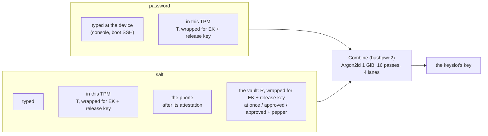
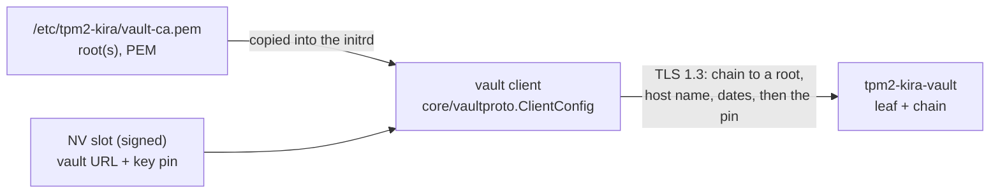

# PLAN

- **A. One derivation for every keyslot:** the disk's key is always the
  combiner's (the hashpwd2-compatible `Combine(password, salt)`, Argon2id);
  a keyslot only says where its password and its salt come from.
- **B. The vault's TLS certificate** verified against a root certificate.
- **C. The slot's record in an EFI variable, TOTP a method of its own:**
  the TPM keeps only what its policies read; everything else of a slot
  goes into `KIRAslotN`.

Done before this plan: the operator's pepper travels wrapped for the
machine's TPM (tpm2-kira `10b9066`, the vault `00d0482`); vmtest's pepper
step is written (`671aa51`), not yet run. Part A changes how the pepper
enters the key, so that step changes with it.

---

## A. One derivation, the secrets distributed

### Goal

Security comes only from how the secrets are distributed: the key is
always computed from a password and a salt, the same way, and a keyslot
names the source of each. The owner's eight scenarios:

| # | Password | Salt | Today |
|---|---|---|---|
| 1 | typed | typed | `password+salt` (Combine) |
| 2 | typed | in this TPM | - |
| 3 | typed | the vault, released at once | - |
| 4 | typed | the vault, after an operator's approval | - |
| 5 | typed | the vault, after an approval with the pepper | - |
| 6 | in this TPM | the vault, released at once | `tpm+vault` (HKDF, not Combine) |
| 7 | in this TPM | the vault, after an approval | `tpm+vault`, device in approve mode (HKDF) |
| 8 | in this TPM | the vault, after an approval with the pepper | `tpm+vault --pepper` (HKDF, the pepper not stretched) |
| - | typed | the phone, after its attestation | `password+phonesalt` (Combine) - kept |

### Assessment

- **Sound, and no variant of today is more secure.** 6-8 keep today's
  distribution (a TPM part and a vault part, both opening only in a boot
  the slot's signing key approved, before the cap); only the derivation
  changes. With two random 32-byte parts HKDF and Argon2id are equally
  strong; with a pepper Argon2id is stronger - today the pepper enters
  HKDF unstretched and the slot's pepper check (an HMAC of the key) is a
  fast guessing oracle for whoever already has both parts. 3-5 are
  stronger than 6-8: they add something a person knows, at the price of
  an unattended boot.
- **What must stay:** a part held for the TPM opens only in an approved
  boot before the cap (the TPM checks it again after the vault); the vault
  never sees a salt in the clear; a keyslot is never the disk's only one;
  the recovery passphrase is always the way in by hand (AGENTS.md).
- **"hashpwd2-compatible" is the format, not a way in.** A salt held by
  the TPM or the vault is known to nobody, by design, and a TPM-held
  password likewise: nothing is shown or exported at enrolment. Whoever
  kept a copy would reduce that keyslot to the copy. Recovery stays its
  own keyslot (the recovery passphrase, or a `typed+typed` keyslot).
- **2 (typed password, salt in the TPM):** the disk's header and the
  password alone are not enough - the salt needs this TPM in an approved
  boot. But once such a boot is had, the TPM gives the salt out at will,
  and the password can be guessed offline at Argon2id's cost (about a
  second a guess): its strength is the limit. The vault variants add
  revocation, a log and approval before any salt leaves.
- **The cost:** Argon2id with 1 GiB at every unattended boot (6-8), as the
  typed modes have it today: the boot image needs that memory free.
- **Both parts on the device** (password and salt in the TPM) distribute
  nothing: refused.

### Design

- **A keyslot's recipe** is a number (below, "Recipes by number"): the
  password's source, the salt's, the pepper, the TPM's password check.
  Stored in the keyslot's own LUKS2 token - the header is the one place,
  nothing is configured (AGENTS.md). The names `password+salt`,
  `password+phonesalt`, `tpm+vault` and `--mode` go.
- **The command line:** `tpm2-kira luks enrol /dev/sda2 --password typed
  --salt vault --pepper --url … --pin … --token …`; a combination not in
  the table is refused with the ones that are.
- **Shown** the same way everywhere (control, `luks status`, the code
  screen): `0x1401 password typed · salt from the vault (pepper)`.
- **control** offers the recipes as named choices, with what each needs
  at boot (a person typing, the phone near, the vault, an operator).
- **The TPM part T:** 32 random bytes in the slot's blob, wrapped for the
  EK and the slot's release key - today's L. The password of the
  unattended recipes, the salt of `0x1200`, as `FactorSalt(T, label)`.
- **The vault part R:** the salt of the vault recipes, 64 hexadecimal
  characters; with a pepper `hex(HKDF-SHA256(R, pepper))`, so every
  guessed pepper costs a whole Argon2id. The release carries R and the
  pepper wrapped for the TPM, as now.
- **Approval** is the vault device's release mode (at once, after an
  approval); a pepper forces the approval, as now.
- **The pepper check** stays an HMAC of the key - now behind Argon2id.

### Steps

1. [x] diskkey: `Recipe` (IDs, checks, names for display), the token
   (`recipe`, type `tpm2-kira-XXXX`); the old modes and `--mode` go
   (`--password`/`--salt`/`--pepper`), in the code, `control`, the help,
   acceptance.py and vmtest. This build enrolled 0x1100, 0x1302, 0x2400,
   0x2401 then (renumbered in step 2: 0x1300); 0x2400/1
   keep the HKDF derivation until step 3, 0x1200 and 0x1400/1 came with
   steps 2 and 3. README and docs: step 7.
2. [x] the TPM salt (0x1200): T in the slot's blob, wrapped for the EK and
   the release key (blob version 15); `luks enrol --salt tpm`; the boot
   plan's part `tpmsalt`, which opens it while the code screen holds; the
   key provider asks the password after the hold. The slot's preparation
   (attestation part, EK, release key) is shared with the vault's
   enrolment. Tested: unit, swtpm (opens in the approved state, not after
   a PCR moved), the plan rule; vmtest in step 8. `control`'s choice for
   it: step 4.
3. [x] vaultkey: R as the salt (`vaultkey.Salt`, the pepper as HKDF's
   salt), L as the unattended recipes' password (`vaultkey.Password`),
   the key the combiner's; the pepper check (unattended with a pepper
   only) over that key; 0x1400/0x1401 enrol with a typed password (no L
   in the slot), the vault's release opens the salt during the hold and
   the password is asked after it; the vault's release modes are
   `vaultproto.ReleaseMode` (0x01 auto, 0x02 approve; the words on the
   command line). Tested: unit, swtpm (0x2400, 0x2401, 0x1401), the
   vault's tests.
4. [x] enrolment: `luks enrol --password … --salt … [--pepper]`, refused
   combinations named (step 1); `control`'s choices named by recipe -
   recovery (0x1100), salt in this TPM (0x1200, new), the phone (0x1300),
   the vault (asks: password held by the TPM or typed, the pepper); the
   red line when every keyslot of a volume is tpm2-kira's says why (the
   OS prompt then opens nothing), and `tpm2-kira status` notes it too.
5. [x] (with steps 1-3, tested in diskkey and bootrun) boot: the prompts by recipe (console and boot SSH), the fallback
   order (recipe, recovery recipe, the OS prompt), a typed password while
   the vault is asked.
6. [x] the vault: the CLI answers the queue - `request approve ID` asks a
   pepper device's pepper (no echo on a terminal, a line from a pipe) and
   sends it with the approval; `requests answer` goes through what waits
   (approve, deny, skip). Tested in the vault's CLI tests.
7. [x] docs: DISK-KEY (the recipes, the token, one section per recipe, the
   fallback order), VAULT (the salt, the password, the combiner, the CLI
   queue, numeric release modes), SECURITY-BACKGROUND (the combiner for
   every recipe, blob version 15), README, ARCHITECTURE, PHONE, SLOT, SSH,
   TESTING, PROJECT-STRUCTURE, the vault's README; the PLAN-*.md design
   records carry a note mapping the old mode names to the recipes;
   HISTORY.md (the mode names, the dropped TPM check, blob version 15).
8. [x] (vmtest-20261029-223448: 126 checks on Arch and Debian, all
   passed; 0x1400 and 0x1300 are covered by the unit and swtpm tests, not
   on the VMs) tests: every recipe - unit (each ID's derivation against the
   known answer, the refused ones), swtpm (T as the unattended password;
   the vault with and without a pepper), the vault's tests (the CLI
   queue), vmtest on every machine, every recipe.

**Breaks:** every tpm2-kira keyslot is enrolled again (the token format,
and `tpm+vault`'s derivation); the vault's devices enrol again.

### Decided

1. The pepper goes into the salt: `salt = hex(HKDF-SHA256(S, pepper))`.
2. No phone salt with a TPM-held password; salt = what a device holds, pepper = what a person enters.
4. vmtest runs every test on every machine, every run.

### The assignment (decided)

- **Password:** typed by the person in front of the machine - nothing on
  the machine holds it - and then always the combiner's password. Held by
  this TPM only in a fully unattended recipe.
- **Salt:** held by a device - this TPM, the vault (its TPM), or the
  phone. A typed salt is the recovery recipe alone.
- **Pepper:** entered by a person, into the salt.

### Entering (decided)

- **The pepper** is entered at the vault's approval: the REST operator
  interface (as now), the vault's CLI on the vault machine (asked on its
  terminal, never an argument - today the CLI refuses a pepper), and a
  phone app as the operator's client (a new client of the same operator
  interface; its own plan).
- **What is typed at the machine** (the password, the recovery recipe's
  password and salt) can also be typed over the boot SSH server, when the
  person switched it on in `control` - as the code screen's prompts are
  today; every new prompt of part A goes the same way.

### Fallbacks (decided), in this order, always

1. The keyslot's own recipe (the vault, the phone, ...).
2. The recovery recipe at tpm2-kira's prompt: password and salt typed,
   the combiner (hashpwd2) - it opens a keyslot enrolled that way.
3. The operating system's prompt with a plain passphrase (systemd's
   agent, Debian's askpass) - the only way in when tpm2-kira itself fails.

A plain passphrase keyslot may be removed; `control` warns (red) when
every keyslot of a volume is tpm2-kira's.

### The TPM and a typed password (decided: C, no check)

The TPM does not check the typed password. A device-held salt opens in a
boot the slot's signing key approved, while the code screen holds (on
Arch the separator ends the policy when the hold ends; the password
prompt comes after it), and the password is typed after the hold. After
a stolen machine boots, the password can be guessed offline at the
combiner's cost (Argon2id, about a second a guess, and LUKS's own KDF on
top): its strength is the limit. Options A (the TPM's check, the
password asked during the hold) and B (Debian only) were weighed and
not taken (2026-10-29).

### Found while checking the fallbacks

- **The combiner's key ends in a newline** (hashpwd2's format). A
  passphrase prompt - systemd's, Debian's askpass - ends at the newline,
  so a recipe's key cannot be typed at the operating system's prompt:
  step 2 is tpm2-kira's prompt, step 3 needs a plain passphrase keyslot.

### Recipes by number (decided)

A recipe is a 16-bit identifier, `0xPSFF`: P the password's source, S
the salt's, FF flags. Code uses the constants (`diskkey.Recipe`, a
uint16), the token stores the number, names are for display only.

| Nibble / bit | Value |
|---|---|
| P: password | `1` typed, `2` held by this TPM (unattended) |
| S: salt | `1` typed (the recovery recipe), `2` this TPM, `3` the phone, `4` the vault |
| flag `0x01` | pepper (entered at the vault's approval) |

| ID | Recipe |
|---|---|
| `0x1100` | recovery: password and salt typed |
| `0x1200` | password typed, salt in this TPM |
| `0x1300` | password typed, salt from the phone |
| `0x1400` / `0x1401` | password typed, salt from the vault / with a pepper |
| `0x2400` / `0x2401` | unattended: this TPM and the vault / with a pepper |

Refused: P = 2 with S = 1, 2 or 3; the pepper without S = 4. The token:
`{"type": "tpm2-kira-1401", "recipe": 5121, "slot": 1, ...}` - the type
repeats the ID in hexadecimal, so `cryptsetup luksDump` names it too.
`--password`/`--salt`/`--pepper` on the command line and control's named
choices map to the ID; the vault's release modes become IDs alike in
`vaultproto` (`0x01` at once, `0x02` after an approval).

### The vault's queue (decided)

`tpm2-kira-vault requests` is the queue of releases waiting for an
operator; the CLI answers it: `request approve ID` (asks the pepper on the
terminal, echo off, when the device needs one), `request deny ID`, and
`requests answer`, which goes through the queue one by one (approve or
deny each, the pepper asked where needed). The REST operator interface
and a phone app (its own plan) answer the same queue.

---

## B. The vault's TLS certificate verified against a root certificate

### Goal

CodeQL (code scanning) flags `InsecureSkipVerify: true` in the vault
client (`internal/vaultkey/vault.go`, and the same pattern in the vault's
`internal/tlsutil.PinnedConfig`). Today the only check is the pin of the
vault's key (SHA-256 of its SubjectPublicKeyInfo) in `VerifyConnection`.
The connection shall be verified the standard way: a chain to a root
certificate placed in a defined location, the vault's host name, the
validity dates - and no `InsecureSkipVerify` anywhere.

### Design

- **The location:** `/etc/tpm2-kira/vault-ca.pem`, root-owned, a PEM bundle
  (one or more root certificates; every vault of every slot). Both initrd
  integrations (mkinitcpio install hook, initramfs-tools hook) copy it in
  when a slot uses a vault; `control` counts a changed file as "pending
  rebuild", like the other initrd inputs.
- **The check:** one function in the core, `vaultproto.ClientConfig(roots,
  host, pin)`: TLS 1.3, `RootCAs` from the file, `ServerName` from the URL,
  Go's standard verification - then the pin in `VerifyConnection`, kept:
  the root file lies unsigned in the initrd on /boot, the pin is in the
  signed NV slot, so swapping the file alone does not get a foreign vault
  accepted. tpm2-kira's client and the vault's `PinnedConfig` both use it.
- **Fail closed:** no file, or no root in it that verifies the vault - the
  vault is refused with a message naming the file. `vault enrol` checks
  the same before it enrols; `status`/`control` show a missing root.
- **The vault's certificate:** `tpm2-kira-vault` makes a root CA (20
  years) in its state directory, `/var/lib/tpm2-kira-vault/tls/` (`ca.pem`,
  `ca-key.pem`, next to the existing `key.pem`/`cert.pem`), and a leaf signed
  by it (1 year, SAN: the host), renewed from the root at start when it has
  less than 30 days left. It serves leaf and root and prints the root for
  the machines (`tpm2-kira-vault tls root`).
- **What the pin pins:** a certificate of the verified chain. New
  enrolments pin the root's key, so the leaf can be renewed without
  re-enrolling a machine; a pin of an old leaf still matches.
- **Dates are checked** (decided): the system clock in the initrd, set from
  the RTC. A machine whose clock is outside a certificate's validity
  refuses the vault and says so, with both dates.

### Steps

0. [x] **Pepper wrapped for the TPM.** (Code, unit, vault and swtpm tests
   done; vmtest written, not run.) `EnrolRequest` carries the release
   key's public area; the vault wraps a fresh K with `MakeCredential` for
   (EK, RK Name) and the pepper under K with AES-256-GCM.
1. [x] core: `vaultproto.ClientConfig(roots, host, pin)` (TLS 1.3, the
   standard verification, then the pin of any certificate of the verified
   chain) and `ParseRoots(bundle)` (CA certificates only; reading the file
   is tpm2-kira's, the core stays pure); tested against a real TLS server:
   the root's and the leaf's pin taken, another root, host or pin, an
   expired leaf and one not valid yet refused; bundles that are empty, not
   PEM, a key, a leaf, or with trailing text refused.
2. [x] tpm2-kira: `vaultkey.NewClient` reads the roots
   (`vaultkey.RootsPath`, `/etc/tpm2-kira/vault-ca.pem`) and uses the
   core's `ClientConfig` - no `InsecureSkipVerify` left in tpm2-kira;
   `vaultkey.AddRoot` takes the pin's root from a file into the bundle;
   `--ca FILE` on `luks enrol` and `vault enrol`, the root's file in
   control's vault step; `vaultkey.Problem` names a refusal (no root of
   the bundle, another name, outside the dates or a wrong clock, no pinned
   key) for status, control and the boot's console. Tested: unit (a vault
   of another root, no bundle, AddRoot), the swtpm vault tests with the
   test server's CA as the bundle.
3. [x] initrd: the plan writes the bundle into the image (both hooks take
   the plan's files), the vault part carries the bundle's digest (a
   changed root is a rebuild) and is out without a bundle, saying so.
   Tested: the rule, the digest, the image's file.
4. [x] vault: a root (P-256, 20 years) and a leaf it signs (1 year) in
   `tls/` (`ca.pem`, `ca-key.pem`, `cert.pem`, `key.pem`); served leaf and
   root through `GetCertificate`, the leaf made again from the root with
   fewer than 30 days left (at start and while serving); the pin is the
   root's; `tpm2-kira-vault tls root` prints it; the test clients verify
   with the core's `ClientConfig`; operators' curl `--cacert`;
   `CurlPin` gone. No `InsecureSkipVerify` in the vault. Tested: the
   served chain, the renewal (pin kept, client verifies), an old state
   directory, the vault's suites. (An own PKI's certificate in the state
   directory: not built - the vault's root serves the plan's need.)
5. [x] docs: VAULT.md (init's root and leaf, the root to the machine -
   `tls root`, `--ca`, the bundle in the image -, the boot's TLS check,
   the state directory, operators' `curl --cacert`, the commands, the
   threats), SECURITY-BACKGROUND (the pin is the root's), the READMEs,
   ARCHITECTURE; HISTORY.md (the pinned key alone, InsecureSkipVerify).
6. [x] SHA-1: the PCR bank's hash helpers (core/attest, vaultproto,
   internal/measure) say the SHA-1 bank is legacy, used only where no
   SHA-256 bank is extended (slot add --sha1), reproducing what the TPM
   hashes; its display name is "legacy SHA-1" (messages, status, the
   vault's selection); cmd_test says its SHA-1 is the test's subject.
   TOTP's HMAC-SHA1 stays.
7. [x] tests: `make test-all`, the vault's tests, `tools/vmtest.py` (its
   vault steps place the root on the VMs; an enrolment without a root is
   refused; operators verify with --cacert): 128 checks on Arch and on
   Debian, with aSSH 93d79df. The run found the hold ending under an
   opening of a released salt (TPM_RC_PCR_CHANGED on Arch): the vault's
   and the phone's parts now wait for it before READY.

**Breaks:** existing vault enrolments refuse the vault until the root file
is placed (and the vault's certificate reissued under its root). The old
self-signed vault certificate works as its own root in the meantime: Go
accepts a self-signed certificate that is itself in `RootCAs`.

### Decided

1. Dates checked against the system clock.
2. The vault generates its root and keeps it in its state directory.
3. One bundle, `/etc/tpm2-kira/vault-ca.pem`.
4. (2026-10-29, at the start of part B) The root reaches the machine by
   hand - `tpm2-kira-vault tls root` prints it - placed in the bundle, or
   with `luks enrol ... --ca FILE`, which adds it only when its key is the
   pin's: the pin, given out of band with the token, authenticates the
   root. The pin `token create` prints is the root's. The boot plan's
   vault part carries the bundle's digest (a changed bundle is a rebuild)
   and is out without a bundle, saying so. Operators verify with curl
   `--cacert ca.pem`. Breaks: the vault's state directory is made again
   (`init`), and machines enrol again.

### Also in this change: SHA-1 notes

- PCR SHA-1 bank (`core/attest/measurepoint.go`, `internal/measure`,
  `core/vaultproto/verify.go`, `admin/vault_enrol.go`): a comment that the
  SHA-1 bank is legacy, used only where the TPM or firmware extends no
  SHA-256 bank; enrolment and status name it "legacy SHA-1 bank".
- `internal/admin/cmd_test.go`: a comment that the SHA-1 there is a test's.
- TOTP's HMAC-SHA1 stays (RFC 6238's default, what authenticator apps use).

---

## C. The slot's record in an EFI variable, TOTP a method of its own

Status: **confirmed** (2026-10-30).

### Goal

The protected machine keeps in TPM NV only what a TPM policy reads or
what nobody may turn back; the slot's record - everything else, public
or wrapped by this TPM - goes into an EFI variable of its own, without
the 2048-byte limit of an NV index. The TOTP key becomes a method like
the phones, the vault and the TPM salt: in a slot only when selected.

### Assessment

What a slot holds in the TPM today, and what it needs to:

| NV index | Holds | Must stay in the TPM |
|---|---|---|
| the slot's blob (0x0180_0000 + N) | the record: TOTP key, PCR values, approval, AK, release key, TPM salt, vault, phones, signatures | **no** - integrity is the signing key's signature, freshness the counter, nothing in it is secret in clear (private parts wrapped by this TPM, factors for its EK) |
| the generation index (+0x800) | G of `PolicyNV(generation == G)`, read-locked at the initrd's end | yes - in the slot's policy |
| the record counter | `Count`, the revision of the attestation part | yes - nobody turns it back |
| the boot settings (0x01803000) | debug | stays: 8 bytes, written with the signing key alone |

Measured (swtpm, ECC EK, P-256 signing key): TPM salt + unattended vault
with a pepper = 1659 of 2048 bytes. An RSA-2048 EK adds 188 per factor
wrapped for it (the VMs: 2065, refused), an RSA signing key ~570, RSA-4096
~1150, each phone its verifier.

What the EFI variable changes:

- **Gained:** room (a few KB per slot), every method beside the others
  with RSA EKs and RSA signing keys; no TPM NV write per approval.
- **Root can replace or delete the variable** - a replaced one fails the
  signature or the counter; a deleted one is a denial of service, the
  fallbacks unlock (manual password and salt, the OS recovery key). Today
  the blob's index is written with the signing key alone (PolicySigned);
  its deletion took the owner's authorisation, empty on most machines.
- **A TPM clear leaves the variable behind** (useless: its keys are of the
  old storage key and EK): status and control report it and remove it.
- **A firmware reset can remove it:** as a deletion above.
- **Firmware variable stores are small, some buggy:** records stay small
  (a cap, see step 2), written only when the slot changes.
- **Readable by root** (efivarfs; the mode is checked on both distros) -
  the NV index is readable by anyone with TPM access today.

The TOTP key: the slot's policy (`PolicyAuthorize(signing key, PolicyRef)`
over `PolicyPCR` and `PolicyNV(generation)`) does not depend on it; the AK,
the boot key and the release key are made under it without one. The rule
"a TOTP key or phones" is the history of the slot as a TOTP slot. What the
code proves: to the person in front of the machine, before typing, that
the boot is one the signing key approved - against a phished password.

### Design

- **Name:** `efi:KIRAslotN-67f474ef-94a1-4412-88df-d62349d430a9`
  (N = 0..15), tpm2-kira's GUID as `KIRAmachineID`'s; aSSH's `persist`
  reads and writes it (`ReadVar`, `WriteVar`, `RemoveVar`) - it stays
  generic, every application names its variables with its own prefix and
  GUID.
- **The record** (blob version 16): the slot's PCR selection and values,
  generation, PolicyRef, signing key, approval, `Count`, and its methods
  as optional sections - TOTP (key, algorithm), phones (channel keys,
  verifiers), vault (URL, pin, label, its part, pepper), TPM salt - with
  the attestation keys (AK, release key) when a method needs them. Signed
  as today. A slot with no method is valid: it seals the boot state, for
  the machine-id and the boot key.
- **The pin as 32 bytes** in the record (`sha256:` and hex stays the
  text of tokens and the CLI); **PepperCheck 16 bytes**.
- **The slot exists** when its generation index is defined; its record is
  the variable. Status names a record without indices (left behind by a
  TPM clear or a deleted slot) and indices without a record.
- **TOTP is selected:** `slot add --totp` (and a step in control); the
  code screen shows codes of the slots with TOTP; phones as today.
  **Which recipe needs which method** (e.g. a typed password only behind
  TOTP or phones): a later decision - until then the combinations are not
  restricted, and a boot with nothing to confirm has no code screen: the
  hold ends with what the device-held salts gave.

### Steps

1. [x] nvslot: the record (version 16, sections, the pin raw, PepperCheck
   16), Marshal/Unmarshal, the signature over it; tests. The format was
   already in sections (the attestation part, its typed methods); version
   16 drops the "TOTP key or phones" rule from it (a TOTP key is whole or
   absent; no method, TOTP beside phones: valid data), keeps the vault's
   pin as its 32 bytes (`sha256:` and hex stays the text outside;
   `CheckPin` now refuses what is not hex) and the pepper check at 16
   bytes. What seals and enrols is unchanged until step 4. The format
   reference test read a path that does not exist and skipped: it runs
   now, with the pin and the pepper check.
2. [x] nvslot: storage in `KIRAslotN` (persist), a cap of 8 KiB per
   record; read, write, remove; the slot = its generation index; the
   counter as today; tests with a test efivarfs directory
   (`persist.VarDir`). `record.go`: `RecordVar`, `ReadRecord`
   (`ErrNoRecord`), `WriteRecord` (read back), `RemoveRecord`,
   `SlotExists`, `SlotStates` (what is left of a slot without the rest).
   A slot is one of the 16 now (`--nvram` 0-15 or 0x01803010-0x0180301F;
   other indices were never used); the NV write keeps its own check for
   the boot settings. tpm2-kira's GUID is `nvslot.VarGUID`. Branch
   `feat/slot-record-efivar` (step 1 is on `feat/vault-root-ca`).
3. [x] The users of the blob: seal, reseal, approve, the phone and vault
   enrolments, the TPM salt, unenrol, slot delete (record and indices
   together), backup and restore (`nvram_restore`), info and status;
   `blobFull` and the NV size checks go. Every read of a slot's blob is
   `nvslot.ReadRecord`, every write `WriteRecord` (whole or not at all:
   the stash of an unwritten blob and `slot restore` went with the NV
   write's undefine); the size checks are against `MaxRecordSize`. A slot
   is there by its generation index (`FindPopulatedSlots`); `slot delete`
   takes the record, the indices and a blob of an earlier version left in
   NV, which `slot add`/`approve` also remove; `slot list` shows the slots
   and what is left of one, `slot status` and `slot info` the record.
   `WriteToNVRAM` is the boot settings' alone. The tests: each swtpm gets
   its own EFI variables.
4. [x] TOTP optional: `slot add --totp`, control, the code screen and
   `tpm2-kira-boot` only for slots with TOTP; the "TOTP or phones" rule
   goes; status and slot list name each slot's methods. `slot add`
   seals a TOTP key only with `--totp`, and the fallback slot 1 only then
   (it is a second code); control asks "A TOTP code at boot?". A phone
   still retires the TOTP key; the last phone leaving brings none back
   (nor does any other enrolment). The code screen leaves out slots
   without a code or phones (`totp.ErrNoCode`); the image plans it only
   for those. With nothing to show the hold lasts while the vault opens
   its part (`bootDisplay.Pending`), within the hold time. status: each
   slot's methods, the fallback note only with a code.
5. [x] The boot: efivarfs mounted before tpm2-kira-boot on Arch and Debian
   (Debian's init-premount does it for the machine-id: checked for the
   order); the image plan needs no new part. Debian mounted it only with
   a network (for the machine-id): now before run whenever the image has
   the TPM part (a units test holds the order). Arch: systemd mounts it as
   an API file system; the hook adds the module for a kernel without it
   built in. A read without EFI variables says "efivarfs not mounted?",
   not "no record". Found on the way: cap ran with the code screen only -
   with TOTP optional a slot without a code would not have been locked;
   the plan's TPM part now counts every sealed slot, and both hooks run
   cap with it.
6. [x] Status and control: a record left behind (TPM cleared, slot gone),
   indices without a record; removal offered. control's slot lines (since
   step 3 on records) name the cause (`SlotContents.Cause`): a record
   without its slot (the TPM cleared), a record gone (removed, a firmware
   reset: the fallbacks unlock), an earlier version's NV blob, a deletion
   stopped; picking the line removes what is left. status reports them
   (`incomplete_slots`, a note each with what removes it) instead of "does
   not read as a blob".
7. [x] Docs: DISK-KEY.md, SECURITY-BACKGROUND.md (the record, where, the
   threats above), ARCHITECTURE.md, README, the help. SECURITY-BACKGROUND
   §3.1 (the record, *Why an EFI variable* with the comparison table, TOTP
   chosen, the open point: a phone enrolled into a slot without a code has
   only `cap` as its evidence), §9 rewritten (who can change what: the
   record, the indices), §10 (who writes, the size by combination); SLOT.md
   (`--totp`, the record and its indices, an incomplete slot's causes,
   the atomic write); BOOT-INTEGRATION (efivarfs, cap for every slot);
   CODE, PHONE, SEALING, VAULT, DISK-KEY (the hold without a code
   screen), ARCHITECTURE, README. The format test checks the record's
   variable, GUID and size limit.
8. [x] Tests: unit and swtpm (`make test-all`), the vault's and Marify's
   (the core is not changed unless step 1 touches `vaultproto`'s pin),
   vmtest: a slot without TOTP, one with TOTP only, the vault with a pepper
   beside a TPM salt on the VMs' RSA EK (refused today), a record removed
   by hand (the fallback), a slot deleted (the variable gone).

### Step 8b: a serial-console test, local (done 2026-10-30)

Result: `tools/vmtest.py` on both local machines (`tools/localvm.py`,
`.local/vms/vmtest-local.conf`): 129 checks each, all passed, at
04c30a8; `tools/serialtest.py`: totp, hashpwd2, tpmsalt (with the
fallback), lostrecord - all passed on Arch and Debian. Found on the way:
status's remedy for a slot of which only a keyslot is left (fixed),
reveal's message (fixed); on Debian a code screen without the route
shares the console with cryptsetup's prompt (control's route step is
what a setup does; serialtest routes).

The user exported the two test machines to `/home/pix/transfer-ai`
(qcow2 and libvirt XML; no OVMF variables, no swtpm state) to test the
recipes without the boot SSH server - the pure TOTP variant and the
pure hashpwd2 variant - at the console, reachable over the serial port.
Secure Boot is off on them. There is no libvirt on this host: qemu,
swtpm, OVMF and KVM are.

- `tools/serialtest.py` (stdlib only): starts a machine with qemu
  directly - KVM, OVMF without Secure Boot (a copy of the VARS template
  per machine), swtpm over a socket, the disk as a qcow2 overlay on the
  export, the serial port on a unix socket, user-mode network with the
  guest's ssh forwarded to a local port (installing the package, `slot
  add`, `luks enrol`; tpm2-kira's boot SSH server stays off).
- **The snapshot is the export:** the overlay, the VARS copy and the
  swtpm state live in `.local/vms/<machine>/`; a revert deletes them (the
  export is never written). Taken once after the console is set up
  (below) as a second overlay level, so a run starts from there.
- **The console:** at the first boot the boot loader's entry is edited
  over the serial port (`console=ttyS0`: systemd-boot - Arch's UKI takes
  the command line with Secure Boot off; GRUB - Debian), the LUKS
  passphrase typed at the serial console; then made permanent inside
  (`/etc/kernel/cmdline` and the UKI; `/etc/default/grub`).
- **The runs**, each from the snapshot, each boot driven at the serial
  console:
  1. pure TOTP: `slot add --totp`, no keyslot of tpm2-kira's: the code at
     the console equals the one computed from the secret; Enter; the OS's
     own passphrase prompt opens the disk.
  2. pure hashpwd2: `luks enrol --password typed --salt typed` (0x1100),
     no slot: password and salt typed at the console open the disk.
  3. TOTP optional: `slot add` without `--totp` and the TPM salt (0x1200):
     no code screen, the TPM opens the salt, the password is typed at the
     console.
  4. the fallback order at the console: a wrong password, then the
     recovery recipe, then the OS's passphrase.
- Logs: the serial console's transcript per boot in `.local/runs/`.

The user installed libvirt as well; qemu directly is kept: no root, no
system-wide state, the run's files in one directory. The harness stops
when less than 1 GB is free.

### What breaks

Every existing slot: its blob is in NV in format 15, not read any more -
`slot delete` and `slot add` again (developer mode, no migration). The
keyslots made with it (TPM salt, vault) are enrolled again; the recovery
keyslot and the OS recovery passphrase are not touched.

### Decided

- An EFI variable, named `KIRA` + its use: `KIRAslotN`.
- Which recipe needs which method: later.
- `persist` stays generic; each application its prefix and GUID.

- The boot settings (debug, 8 bytes) stay in NV, written with the
  signing key alone.

