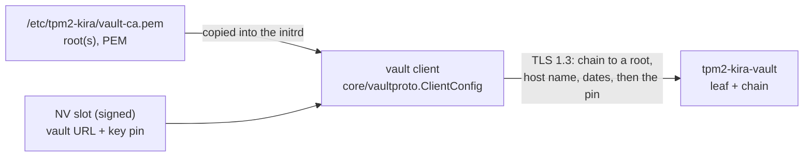

# PLAN: the vault's pepper wrapped for the TPM; its TLS certificate verified against a root certificate

## Goal

CodeQL (code scanning) flags `InsecureSkipVerify: true` in the vault
client (`internal/vaultkey/vault.go`, and the same pattern in the vault's
`internal/tlsutil.PinnedConfig`). Today the only check is the pin of the
vault's key (SHA-256 of its SubjectPublicKeyInfo) in `VerifyConnection`.
The connection shall be verified the standard way: a chain to a root
certificate placed in a defined location, the vault's host name, the
validity dates - and no `InsecureSkipVerify` anywhere.

## Design

- **The location:** `/etc/tpm2-kira/vault-ca.pem`, root-owned, a PEM bundle
  (one or more root certificates; every vault of every slot). Both initrd
  integrations (mkinitcpio install hook, initramfs-tools hook) copy it in
  when a slot uses a vault; `control` counts a changed file as "pending
  rebuild", like the other initrd inputs.
- **The check:** one function in the core, `vaultproto.ClientConfig(roots,
  host, pin)`: TLS 1.3, `RootCAs` from the file, `ServerName` from the URL,
  Go's standard verification - then the pin in `VerifyConnection`, kept:
  the root file lies unsigned in the initrd on /boot, the pin is in the
  signed NV slot, so swapping the file alone does not get a foreign vault
  accepted. tpm2-kira's client and the vault's `PinnedConfig` both use it.
- **Fail closed:** no file, or no root in it that verifies the vault - the
  vault is refused with a message naming the file. `vault enrol` checks
  the same before it enrols; `status`/`control` show a missing root.
- **The vault's certificate:** `tpm2-kira-vault` makes a root CA (20
  years) in its state directory, `/var/lib/tpm2-kira-vault/tls/` (`ca.pem`,
  `ca-key.pem`, next to the existing `key.pem`/`cert.pem`), and a leaf signed
  by it (1 year, SAN: the host), renewed from the root at start when it has
  less than 30 days left. It serves leaf and root and prints the root for
  the machines (`tpm2-kira-vault tls root`).
- **What the pin pins:** a certificate of the verified chain. New
  enrolments pin the root's key, so the leaf can be renewed without
  re-enrolling a machine; a pin of an old leaf still matches.
- **Dates are checked** (decided): the system clock in the initrd, set from
  the RTC. A machine whose clock is outside a certificate's validity
  refuses the vault and says so, with both dates.

## Steps

0. [x] **Pepper wrapped for the TPM.** (Code, unit, vault and swtpm tests done; vmtest pending.) Today the operator's pepper travels
   in the clear inside TLS (`ReleaseResponse.Pepper`). `EnrolRequest`
   carries the release key's Name; the vault draws a fresh 32-byte K, wraps
   it with `MakeCredential` for (EK, RK Name) and encrypts the pepper under
   K with AES-256-GCM; `ReleaseResponse.PepperWrapped` replaces `Pepper`.
   tpm2-kira opens K with a second `ActivateCredential` under the slot's
   policy - the pepper opens only in the approved boot, like R. Tests: the
   core, the vault, swtpm, vmtest with a pepper. Breaks: pepper devices
   enrol again (the vault has no RK Name for them).
1. [ ] core: `vaultproto.ClientConfig`, `LoadRoots(path)`; unit tests:
   good chain, unknown root, wrong host, wrong pin, expired, no file.
2. [ ] tpm2-kira: `vaultkey.NewClient` reads the roots
   (`/etc/tpm2-kira/vault-ca.pem`, a variable for the tests); enrol,
   status and control report a missing or failing root.
3. [ ] initrd: both hooks copy the file; `control`'s rebuild check covers it.
4. [ ] vault: root CA + leaf in `tlsutil`; `tls root` command; an own
   certificate and chain in the state directory; `PinnedConfig` via the
   core's function; its tests.
5. [ ] docs (vault setup, SECURITY-BACKGROUND), HISTORY.md (a security fix).
6. [ ] SHA-1: the legacy and test notes (below).
7. [ ] tests: `make test-all`, the vault's tests, `tools/vmtest.py` (its
   vault steps place the root on the VMs).

**Breaks:** existing vault enrolments refuse the vault until the root file
is placed (and the vault's certificate reissued under its root). The old
self-signed vault certificate works as its own root in the meantime: Go
accepts a self-signed certificate that is itself in `RootCAs`.

## Decided

1. Dates checked against the system clock.
2. The vault generates its root and keeps it in its state directory.
3. One bundle, `/etc/tpm2-kira/vault-ca.pem`.

## Also in this change: SHA-1 notes

- PCR SHA-1 bank (`core/attest/measurepoint.go`, `internal/measure`,
  `core/vaultproto/verify.go`, `admin/vault_enrol.go`): a comment that the
  SHA-1 bank is legacy, used only where the TPM or firmware extends no
  SHA-256 bank; enrolment and status name it "legacy SHA-1 bank".
- `internal/admin/cmd_test.go`: a comment that the SHA-1 there is a test's.
- TOTP's HMAC-SHA1 stays (RFC 6238's default, what authenticator apps use).
