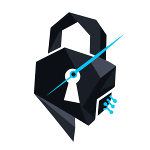
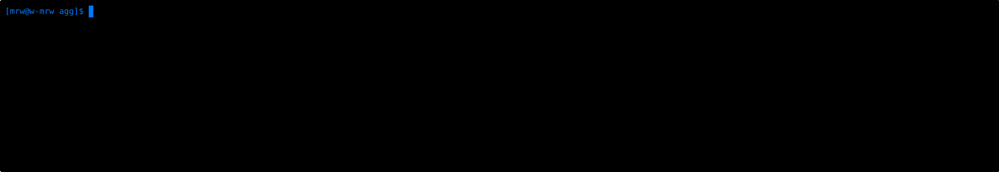
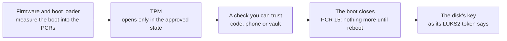

# tpm2-kira (Known Integrity Recognition Agent)

<p align="center">
  
</p>

A TPM2 based tool to recognize modifications on your system !before! entering passphrases to unlock your disk.
Time-Based One-Time-Password Tokens calculated on Secrets, that the TPM2 reveals only when the device is in an unmodified state.

<p align="center">
  
</p>

**Successor/Extension to [tpm2-totp](https://github.com/tpm2-software/tpm2-totp).**

> [!CAUTION]
> tpm2-kira is currently in **alpha**. Expect breaking changes between versions.

## What it does

Before you type a passphrase, tpm2-kira shows whether this machine still boots what you approved.
The TPM only opens what tpm2-kira keeps in it while the boot measurements match the values your
signing key approved; at the end of the code screen the boot closes (PCR 15), so the running
system cannot use any of it until the next boot.



Every part belongs to one of four layers. A machine takes from each only what it uses: the boot
image carries only those parts, and only those run at boot.

| Layer | The choice | In detail |
|---|---|---|
| **The slot** | a boot state your signing key approved: everything else stands on it | [SLOT](docs/SLOT.md) |
| **Who checks the boot** | a TOTP code you compare with your authenticator; a phone that verifies a TPM quote over Bluetooth LE (experimental); the vault, remote attestation over TLS (experimental) | [CODE](docs/CODE.md), [PHONE](docs/PHONE.md), [VAULT](docs/VAULT.md) |
| **Where the code screen is** | the console, always; SSH in the boot image, its host key certified by a CA in the TPM (experimental) | [SSH](docs/SSH.md) |
| **The disk's key** | per LUKS keyslot: cryptsetup's own passphrase, or a recipe combining a password and a salt from this TPM, the phone or the vault. The passphrase can always be typed by hand | [DISK-KEY](docs/DISK-KEY.md) |

How the parts fit together, with [aSSH](assh/README.md), tpm2-kira-vault and the Marify app: [ARCHITECTURE](docs/ARCHITECTURE.md).

## Requirements

- A TPM 2.0 and Linux with its kernel support
- To build: Go 1.26 or later

Details, and what a TPM with only a SHA-1 bank means: [INSTALL](docs/INSTALL.md), [SLOT](docs/SLOT.md).

## Quick start

```bash
git clone --recurse-submodules https://github.com/tpm2-trust/tpm2-kira.git
cd tpm2-kira
make build
sudo make install
sudo make install-mkinitcpio        # Arch; on Debian: install-initramfs-tools

sudo tpm2-kira control              # guided: the boot chain, then what this machine combines
```

Or the code alone, by hand: `sudo tpm2-kira setup`, `sudo tpm2-kira slot add --totp` (scan the QR codes it
prints), rebuild the boot image, reboot, and compare the code on the code screen with your authenticator.

Packages for Arch and Debian, the disk's route and uninstalling: [INSTALL](docs/INSTALL.md), [BOOT-INTEGRATION](docs/BOOT-INTEGRATION.md).

## Commands

Everything but the help needs root. `tpm2-kira help` is one screen, `tpm2-kira help <command>` a command's page.

| | |
|---|---|
| Guided | `control` |
| The slot | `setup` · `slot add\|approve\|info\|list\|status\|delete` · `status` |
| Who checks the boot | the code screen at boot · `phone ...` |
| The disk's key | `luks ...` · `phone salt ...` · `vault ...` |
| The boot image | `initramfs plan`; in the image `tpm2-kira-boot`: `run`, `close`, `machine-id`, `unlock-key`, `ssh-child`, `gate-child` |
| By hand | `yubikey list` · `pcrtips` · `version` |

## Documentation

| | |
|---|---|
| **Using it** | [INSTALL](docs/INSTALL.md) · [CONTROL](docs/CONTROL.md) · [SLOT](docs/SLOT.md) · [CODE](docs/CODE.md) · [PHONE](docs/PHONE.md) · [VAULT](docs/VAULT.md) · [SSH](docs/SSH.md) · [DISK-KEY](docs/DISK-KEY.md) |
| **When something is wrong** | [TROUBLESHOOTING](docs/TROUBLESHOOTING.md) · [DEBUG-BLE](docs/DEBUG-BLE.md) · [PLATFORM-OBSERVATIONS](docs/PLATFORM-OBSERVATIONS.md) |
| **How it works** | [ARCHITECTURE](docs/ARCHITECTURE.md) · [BOOT-INTEGRATION](docs/BOOT-INTEGRATION.md) · [SEALING](docs/SEALING.md) · [PROTOCOL-BLE](docs/PROTOCOL-BLE.md) · [SECURITY-BACKGROUND](docs/SECURITY-BACKGROUND.md) |
| **Working on it** | [PROJECT-STRUCTURE](docs/PROJECT-STRUCTURE.md) · [TESTING](docs/TESTING.md) · [AGENTS](AGENTS.md) |
| **Plans and records** | [HISTORY](HISTORY.md) · the `docs/PLAN-*.md` files · [pentest 1](docs/pentest1/penetration_test_report.md) · [pentest 2](docs/pentest2/) |

## Security

Report a vulnerability as [SECURITY.md](SECURITY.md) says. The cryptographic design, the threat model and the
trust boundaries are in [SECURITY-BACKGROUND](docs/SECURITY-BACKGROUND.md).

## History

This project is in development: **no backwards compatibility is maintained**, and blob formats, on-disk
layouts and CLI flags may change without a migration path. [HISTORY.md](HISTORY.md) records what was superseded and why.

## License

BSD 3-Clause, see [LICENSE](LICENSE).
