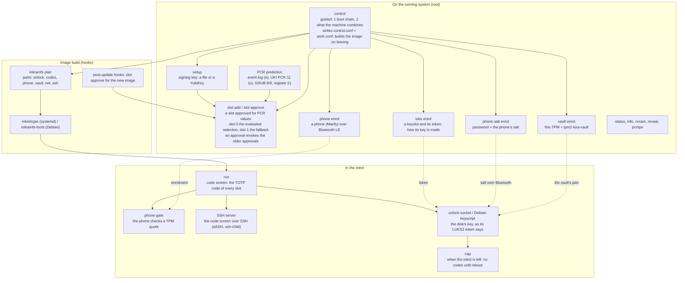
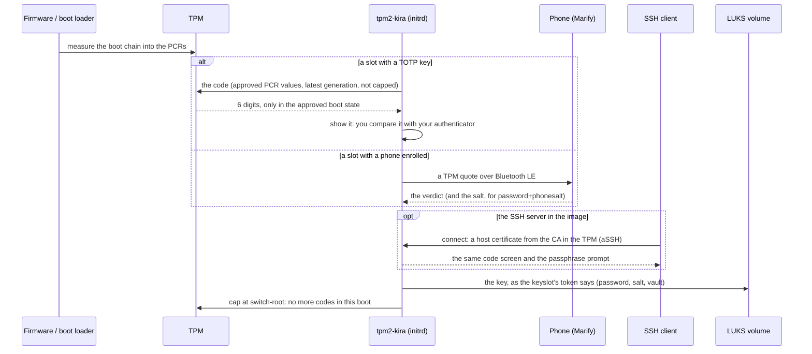

# tpm2-kira (Known Integrity Recognition Agent)

<p align="center">
  
</p>

A TPM2 based tool to recognize modifications on your system !before! entering passphrases to unlock your disk.
Time-Based One-Time-Password Tokens calculated on Secrets, that the TPM2 reveals only when the device is in an unmodified state.

<p align="center">
  
</p>

**Successor/Extension to [tpm2-totp](https://github.com/tpm2-software/tpm2-totp).**

> [!CAUTION]
> tpm2-kira is currently in **alpha**. Expect breaking changes between versions.

## How It Works

tpm2-kira creates the TOTP key **inside the TPM**, as an HMAC key that never
leaves it: the TPM computes every code, and the key is shown exactly once, as
the QR code you enrol in your authenticator app.

The TPM computes a code only under a policy your signing key has approved:

| Condition | What it checks |
|-----------|----------------|
| **PCR values** | Boot measurements match the values approved at slot add or slot approve time |
| **Generation** | The approval is the latest one: every approval revokes the older ones |
| **Not capped** | `tpm2-kira-boot cap` has not run in this boot — it runs when the initrd is left, so the running system cannot compute codes |

On every boot, tpm2-kira asks the TPM for the current code before the
passphrase prompt. Compare it with the code in your authenticator app — if
they match, your boot chain is intact.

When a system update changes PCR values (kernel update, initramfs rebuild,
Secure Boot key rotation, etc.), the TPM refuses until you approve the new
values with `slot approve` and your signing key. The key itself stays the same, so
there is nothing to re-enrol.

The code is one of four layers (below); more in [docs/CODE.md](docs/CODE.md). For more details on the cryptographic design, see [SECURITY-BACKGROUND.md](docs/SECURITY-BACKGROUND.md).

### What it does, and when

On the installed system you set it up (`control` guides through all of it);
the boot image carries only the parts something uses (`initramfs plan`);
in the initrd they run, and `cap` ends them.



## The layers

Every part of tpm2-kira belongs to one of four layers, and a machine takes
from each only what it uses: the boot image carries only those parts
(`tpm2-kira initramfs plan`), and only those run at boot.

| Layer | The choice | Commands | In detail |
|---|---|---|---|
| **The slot** | a boot state your signing key approved; what everything below that needs the TPM stands on | `setup`, `slot add\|approve\|info\|list\|status\|delete\|restore` | [docs/SLOT.md](docs/SLOT.md) |
| **Who checks the boot** | the code (TOTP), compared with your authenticator at the console or over SSH; a phone (Marify) at the machine, over Bluetooth LE, that verifies a TPM quote in the code's place; the vault, remote attestation over TLS, that verifies a TPM quote before it releases its part of the disk's key | `reveal`, `phone …`, `vault …` | [docs/CODE.md](docs/CODE.md), [docs/PHONE.md](docs/PHONE.md), [docs/VAULT.md](docs/VAULT.md) |
| **Where the code screen is** | the console, always; SSH in the boot image, with the host key certified by an SSH CA in the TPM, when you turn it on - over SSH the code is what attests the boot | `control` (step 2) | [docs/SSH.md](docs/SSH.md) |
| **The disk's key** | per LUKS keyslot, named by its token: cryptsetup's own passphrase (no token), `password+salt`, `password+phonesalt` (the phone keeps the salt), `tpm+vault` (nothing typed) | `luks …`, `phone salt …`, `vault …` | [docs/DISK-KEY.md](docs/DISK-KEY.md), [docs/VAULT.md](docs/VAULT.md) |

### The slot

`tpm2-kira slot add` approves what this boot measured - firmware, Secure
Boot state, and the unified kernel image or GRUB's PCRs - in slot 0, and
the firmware and Secure Boot state alone in slot 1, the fallback. After
an update the hooks run `slot approve`: the TPM's key stays, so nothing is
enrolled again. Which PCRs to choose and why, the boot path's hardening,
inspecting and deleting a slot: [docs/SLOT.md](docs/SLOT.md).

### Who checks the boot: the code, the phone, the vault

- **The code** is a TOTP code the TPM computes only in the approved boot
  state, before the cap at switch-root; you compare it with your
  authenticator, at the console or over SSH: [docs/CODE.md](docs/CODE.md).
- **The phone** (experimental) attests at the machine: it verifies a TPM
  quote over Bluetooth LE and shows its verdict; the slot it attests shows
  no code any more, the fallback slot keeps its own:
  [docs/PHONE.md](docs/PHONE.md).
- **The vault** (experimental) is remote attestation over TLS:
  tpm2-kira-vault verifies a TPM quote of the slot's approved boot state
  before it releases its part of the disk's key, so an unattended machine
  unlocks only in that state: [docs/VAULT.md](docs/VAULT.md).

### Where the code screen is: the console, and SSH

The boot image can bring up its own network, and `run` then also serves
the code screen over SSH - the code is what attests the boot there; the
phone attests at the machine only - with the disk's prompt in the session
(experimental, off until set in `control`). The SSH server is
[aSSH](assh/README.md)'s, a library inside `run`: its half that speaks SSH
runs as nobody, without a key; the host key is made in the TPM at every
boot and certified by the SSH CA: [docs/SSH.md](docs/SSH.md).

### The disk's key

How a volume's key is made is read from its own LUKS2 header at boot:
the token of tpm2-kira's keyslot names the recipe, and cryptsetup's own
prompt with the recovery passphrase is always the fallback. The four
cases side by side, the route (`rd.luks.key=` on Arch, the keyscript on
Debian) and how systemd takes the key: [docs/DISK-KEY.md](docs/DISK-KEY.md);
unattended, from this TPM and a vault: [docs/VAULT.md](docs/VAULT.md).


## Requirements

**Hardware:**
- TPM 2.0 (discrete or firmware TPM)

**Software:**
- Linux with TPM 2.0 kernel support (`/dev/tpmrm0`; `/dev/tpm0` is used only when
  the kernel provides no resource manager)
- Go ≥ 1.26.0 (build only; the `go` line of go.mod is the minimum). The
  release builds and the acceptance runs use the Go release go.dev names as
  current, asked at build time, so no release ships a standard library with
  known vulnerabilities. Debian 13 ships 1.24: install the current Go from
  https://go.dev/dl into `/usr/local/go` and put `/usr/local/go/bin` first
  in `PATH`.

**Supported architectures:** x86_64, aarch64 (the Arch package is x86_64 only)

## Quick Start

```bash
# Build
git clone --recurse-submodules https://github.com/mrwiora/tpm2-kira.git
cd tpm2-kira
make build

# Install
sudo make install

# First-time setup: generates the signing keys
sudo tpm2-kira setup

# Seal a TOTP key to what this boot measured: firmware and Secure Boot
# state, plus the unified kernel image or GRUB's PCRs - and a fallback
# slot sealed to firmware and Secure Boot state alone
sudo tpm2-kira slot add

# Show the current TOTP code
tpm2-kira reveal
```

`setup` makes the signing key that approves every PCR policy, and nothing else. It looks for a YubiKey first: with one plugged in it offers to take the key from a PIV slot (`--yubikey`, optionally `=SERIAL`, `--slot`, default 9a) so the private key never exists on the machine; without one, or with `--local`, it creates an ECDSA P-256 key pair at `/etc/tpm2-kira/keys/` (`seal.pub`, `seal.key`, root-only). `tpm2-kira yubikey list` shows the candidates; the trade-offs are in [docs/PLAN-YUBIKEY.md](docs/PLAN-YUBIKEY.md). `slot add` creates a TOTP key inside the TPM, approved for what this boot measured ([docs/SLOT.md](docs/SLOT.md#adding-a-slot-slot-add)); scan the QR codes it prints with your authenticator app, the fallback slot's too. A selection that leaves out the kernel, initrd and command line lets a modified initrd show a valid code, see [Choosing PCRs](docs/SLOT.md#choosing-pcrs). `slot add` refuses to run until `setup` has created the keys (or you pass your own with `--privkey` / `--pubkey`).

## Installation

### Build from Source

```bash
sudo pacman -S base-devel go git    # Arch
# or
sudo apt install build-essential git    # Debian/Ubuntu, with Go from go.dev (see above)

git clone --recurse-submodules https://github.com/mrwiora/tpm2-kira.git
cd tpm2-kira
make build
sudo make install                   # tpm2-kira and tpm2-kira-boot, in /usr/local/bin
sudo make install-mkinitcpio        # Arch: the hooks, in /etc/initcpio
sudo make install-initramfs-tools   # Debian/Ubuntu: the hook and boot scripts, in /etc/initramfs-tools
```

There are two binaries: `tpm2-kira`, everything on the installed system,
and `tpm2-kira-boot`, what the boot image carries (the code screen and the
parts the image's plan names, the cap, the keyscript) and nothing of the
administration. Built from source or from a package, both systems get the
same: the hooks find the binaries in `/usr/bin` or `/usr/local/bin`, the
image has `/usr/bin/tpm2-kira-boot` alone, and `tpm2-kira control` does the
rest the same way on both.

### Arch Linux (AUR)

```bash
paru -S tpm2-kira      # or your preferred AUR helper
```

The PKGBUILD in [packaging/aur/](packaging/aur/) is a template: it builds a
checksummed release tarball, and its `pkgver` is filled in at publish time, so
it cannot be built straight from a clone. See
[packaging/aur/README.md](packaging/aur/README.md) to build one locally.

After installing, run setup and slot add once, then rebuild the initramfs:

```bash
sudo tpm2-kira setup
sudo tpm2-kira slot add --pcrs 0,7,11u    # with a unified kernel image
sudo mkinitcpio -P
```

### Debian / Ubuntu (.deb)

```bash
sudo apt install build-essential debhelper dpkg-dev    # and Go from go.dev (see above)
make deb
sudo apt install ../tpm2-kira_*_amd64.deb
```

`make deb` derives the package version from `git describe`, so an untagged
checkout produces something like `0.2.3+9.g9d32210`.

The package installs the binary, the initramfs-tools hook and boot scripts, and
rebuilds the initramfs. It does **not** run `setup` or `slot add`, because sealing
generates a new TOTP secret and prints a QR code you need to scan:

```bash
sudo tpm2-kira setup
sudo tpm2-kira slot add --pcrs "0e,2e,4e,7e,8e,9e"
sudo update-initramfs -u
```

The binary is built statically (`CGO_ENABLED=0`), so the initramfs needs no
libraries and the package has no shared-library dependencies.

### Verify

```bash
tpm2-kira version
```

## Guided: `tpm2-kira control`

For a person rather than a script, in two steps. It starts by checking
`/etc/tpm2-kira/control.conf`: a file that does not load is not worked on
- control lists every line it refuses, with its number and what to do, and
quits before anything is asked or written. Otherwise control writes the
file itself, every setting it keeps; you do not edit it.

**Step 1, the boot chain**, is the first screen until it is in place. On
top the **prerequisites**, each a line, green when met and red with what
to do when not: a usable TPM, mkinitcpio or initramfs-tools, tpm2-kira's
hook files installed, systemd and sd-encrypt in HOOKS, the LUKS devices,
a recovery passphrase (a keyslot that is not tpm2-kira's) on each, and
no keyslot that opens with an **empty passphrase** - such a disk is
encrypted, yet anybody with it opens it, so it is red; tpm2-kira still
takes the empty passphrase where it asks for the recovery one. Under it
the steps: **mkinitcpio adoption** (sd-tpm2-kira into HOOKS),
**kernel command line adoption** (the key's route: `rd.luks.key=`
naming the socket, crypttab on Debian) - each shows the line as it
should read and writes it only when you say so. **Continue to step 2**
opens once both are in place. The boot image is built when you leave
`control`, once, after you say yes.

**Step 2** is what the machine combines, in submenus; every option is
open, done, or greyed with the reason this machine cannot have it - no
TPM, no Bluetooth adapter, no wired network interface, no recovery
passphrase, an option it builds on still missing:

| Submenu | Options |
|---|---|
| Signing key and TOTP codes | the signing key (and a YubiKey's PIN, stored); the standard sealing - slot 0 to the evaluated PCR selection, acknowledged or custom, and slot 1 the fallback; every slot a line, **picking it deletes the slot whole** |
| Attestation by phone | enrol a phone; Bluetooth in every boot image |
| Disk unlock | password + salt; password + phone salt (the phone); this TPM + a vault - each a keyslot of its own, enrolled it offers the removal |
| Network and SSH at boot | the image's network (DHCP or static, proposed from the running system); the SSH server with the code screen |

An option that needs another one control can set up offers it on the
way: the vault and SSH set up the image's network first. The vault is
asked before the enrolment - does it answer, with the pinned key - and
at every later look at the machine whether it still knows this device;
one that does not is red.

**Why the TOTP code comes first, and the phone only after a reboot.**
Enrolling a phone pins the boot it happens in as the good one: every later
boot is compared with it, and nothing the phone can check itself says that
this first state is clean. So the phone is enrolled only in a boot you
verified: slot 0 is sealed with a TOTP code, the reboot goes through the
code screen, you compare the code with your authenticator, and in that boot
the phone is enrolled, which then retires slot 0's code. `phone enrol`
holds to it whichever way it is started: it refuses a boot that did not
pass the code screen, and one whose PCRs at the code screen were not the
ones slot 0's code is approved for (no code was shown, nothing verified
it); then it asks whether you compared the code. A further phone needs a
boot an enrolled phone attested (SECURITY-BACKGROUND §3.1).

On top of step 2, the machine's status, judged line by line - the TPM and
its banks, the endorsement key's vendor, Secure Boot, how it booted, the
slots, the signing key, the initramfs, a Bluetooth adapter, the LUKS
devices, the boot image's network, the vault -
**green what is good, orange what is open, red what is not good, with
the risk in brackets**: the
SHA-1 bank in use, Secure Boot disabled or in Setup Mode, a slot sealed
without the kernel measured, a TPM whose endorsement key no known vendor
vouches for (a phone then trusts it on first use, as it would a software
TPM), a loose file holding the PIN, an empty passphrase, a vault that
does not answer. The header carries the version. Because the status
already says what is not good, the steps repeat none of the commands'
advisory warnings. A slot whose deletion stopped halfway shows as dirty,
marked `[!]` and recommended first, until a run removes the rest (see
[Deleting a slot](docs/SLOT.md#deleting-a-slot)).

The boot image is built once, **when you quit `control`**, after
everything is set up - a build takes its time. It is out of date when a
file of the boot chain (`mkinitcpio.conf` and its `.d` files,
`/etc/kernel/cmdline`, `crypttab.initramfs`) changed after it, or when
the **boot plan** says so: the image carries the disk unlock always, and
each other part - the TOTP codes, the phone's Bluetooth gate, the vault,
the network, the SSH server - only while something uses it (a sealed
slot, an enrolled phone, the settings in `control.conf`), and names its
parts with the digest of their settings (`tpm2-kira help initramfs`). A
part in use now and not in the image - the first sealed slot, the first
phone, SSH switched on - or in it with other settings - another port,
another login key - makes the image out of date; the status' "Boot
image" line says which. New TOTP codes for a slot that has some, a
approve, a further phone, a LUKS keyslot or the YubiKey's PIN never do.
A part the image carries and nothing uses any more is no reason to
rebuild: the next build leaves it out. Quitting then shows the reasons
and what the build puts in, and runs `mkinitcpio -P` (`update-initramfs
-u`) when you say yes. The image looked at is the first preset's default
(its UKI, else its initramfs) - fallback and further profiles are not
checked yet. **Ready to reboot** leads step 2 when the image is current
but this boot did not go through it, and picking it reboots, after a
confirmation.

Every step runs with the same functions the commands below use; run
`control` again later and it shows the state and what is left. The
commands below are for specific settings, and they touch no configuration
file: `control` alone writes the two configuration files.
`/etc/tpm2-kira/control.conf` is tpm2-kira's - the radio settings and the
image's network and SSH server, what the image is built with and nothing
else (nothing of it goes into the image but the network and SSH settings,
as files of their own). `/etc/tpm2-kira/assh.conf` beside it is
[aSSH](assh/README.md)'s: the SSH CA and its slots, the port, the keys
that may log in ([docs/SSH.md](docs/SSH.md)).
Beside it `control` keeps the YubiKey's PIN, checked on the token, in
`/etc/tpm2-kira/pin` (root's alone, never in the image), and the keys
that may log in at boot in `/etc/tpm2-kira/authorized_keys` (root's
keys copied there when asked; edit it for others). The two wiring steps of step 1
are checks, green and no longer pickable once in place. Every other file
is advised, never edited, with two exceptions, each asked for every
time: the mkinitcpio step writes sd-tpm2-kira into the HOOKS of
`/etc/mkinitcpio.conf` when you say so (editing it yourself works just as
well), and the route step writes the line it shows into
`/etc/kernel/cmdline` (or the cmdline.d file, a boot entry's options
line, a crypttab line) the same way. The disk keys are toggles: enrolled,
picking one offers the keyslot's removal instead of a second enrolment.
Everything but the help needs root; `control` says so on its own screen,
the commands in a line.
Each screen is a page of its own, cleared each time it is shown; what a
step prints stays until "Back to ..." is answered. Sealing both slots,
each QR code gets a cleared screen of its own, held until you confirm it
is in your authenticator. The screens are forms (arrow keys, Enter; Esc
leaves, in a submenu back to step 2; `ACCESSIBLE=1` for plain prompts),
built with [huh v2](https://github.com/charmbracelet/huh) (module
charm.land/huh/v2); without a terminal, `control` prints both steps and
exits.

```
  [ KIRA ] control 0.5.0-rc1 - the protections of this machine, step by step
  Step 1 of 2: the boot chain

  Prerequisites
    ✓ TPM: /dev/tpmrm0, SHA-256 bank
    ✓ Initramfs: mkinitcpio
    ✓ Boot integration: tpm2-kira's hook files are installed
    ✓ systemd in the initrd: systemd and sd-encrypt in HOOKS
    ✓ LUKS: /dev/sda2
    ✓ Recovery passphrase: a keyslot that is not tpm2-kira's on every device
    ✗ Passphrase: keyslot 0 of /dev/sda2 opens with an empty passphrase (risk: ...)
    ✓ Secure Boot: enabled
    1 not met: the steps that need them say so.
  The boot chain
  Recommended next: Kernel command line adoption (the key's route)
  systemd-cryptsetup takes a volume's key from tpm2-kira when its rd.luks.key= names the socket. ...
┃   ✓ mkinitcpio adoption  - sd-tpm2-kira in HOOKS of /etc/mkinitcpio.conf
┃ > • Kernel command line adoption (the key's route)
┃   - Continue to step 2  - first: Kernel command line adoption (the key's route)
┃     Quit
↑ up • ↓ down • enter submit
```

## Commands

`tpm2-kira help` is one screen, the commands grouped by what you are doing;
`tpm2-kira help <command>` (or `<command> --help`) is that command's page
with its subcommands, options and examples. Called without a command,
tpm2-kira runs `reveal`.

| | Commands |
|---|---|
| Guided | `control`: step 1 the boot chain, step 2 what the machine combines |
| The slot | `setup` the signing key · `slot add` a slot and its TOTP key · `slot approve` the current boot state (the hooks run it) · `slot info` a slot's blob · `slot list\|status\|delete\|restore` · `status` the overview |
| Who checks the boot | `reveal` / `reveal-plain` the code · `phone enrol\|unenrol\|status\|gate\|ekcert\|quote\|verify` the phone (Marify, Bluetooth LE) |
| The disk's key | `luks status\|enrol\|remove\|mark\|route\|derive` · `phone salt enrol\|rotate\|status\|unenrol` · `vault enrol\|status\|unenrol` |
| At boot (the units and hooks) | `initramfs plan` what the image carries; in the image, `tpm2-kira-boot`: `run` · `cap` · `unlock-key` (Debian keyscript) · `gate` (the phone's radio worker) · `ssh-child` (the SSH server's unprivileged half, started by `run`) |
| By hand | `yubikey list` · `pcrtips` · `version` |

Global options come before the command, or after it as the command's own
(after it wins): `--tpm PATH` (default `/dev/tpmrm0`), `--nvram INDEX` (a
slot 0-15 or a full index such as `0x01803010`; without it most commands
take every populated slot), `--debug`.

## Early Boot Integration (Arch Linux / mkinitcpio)

tpm2-kira can display TOTP codes during early boot — before you enter your disk encryption passphrase. This way you can verify the system hasn't been tampered with before typing your LUKS password.

### Install the hooks

```bash
sudo make install-mkinitcpio
```

This installs:
- `sd-tpm2-kira` — mkinitcpio install hook (systemd-based initramfs)
- A **post-generation hook** that automatically runs `tpm2-kira slot approve` after every initramfs rebuild

### Configure mkinitcpio

Edit `/etc/mkinitcpio.conf` and add the hook next to `sd-encrypt`:

```bash
# Systemd-based initramfs (recommended):
HOOKS=(base systemd autodetect modconf block keyboard sd-tpm2-kira sd-encrypt filesystems fsck)
```

The order of the two hooks does not matter for the boot: what runs when is
decided by the units (`tpm2-kira.service` before `systemd-pcrosseparator`,
the key socket before `cryptsetup-pre.target`, the disk after both), not
by the position in `HOOKS`, and neither hook reads what the other wrote.
`sd-tpm2-kira sd-encrypt` is the order to use, because it reads like the
boot: the code screen, then the disk.

What the image does at boot depends on two things, both optional:

| In the image / on the command line | At boot |
|---|---|
| nothing but the hook | the code screen, then `sd-encrypt`'s own passphrase prompt (systemd's), as if tpm2-kira were not there once the code is confirmed |
| `rd.luks.key=<UUID>=/run/tpm2-kira/unlock.sock` on the kernel command line | the code screen, then tpm2-kira's passphrase prompt; a typo falls back to systemd's prompt |
| a phone enrolled (`phone enrol`) and the adapter found at build time | the code screen also asks the phone and shows its verdict; the passphrase prompt is never held |


### Configure the disk unlock

The main disk takes its key from tpm2-kira's socket when the kernel
command line names it next to `rd.luks.name=`:

```
rd.luks.name=<UUID>=cryptroot rd.luks.key=<UUID>=/run/tpm2-kira/unlock.sock
```

`tpm2-kira luks route` checks the files the command line comes from and
prints the line as it should read (`control`'s step 1 writes it when you
say so). How the key is then made - asked, derived, or from the vault -
is the keyslot's token: [docs/DISK-KEY.md](docs/DISK-KEY.md). Then
rebuild (`sudo mkinitcpio -P`); the post-generation hook approves the new
boot state, so the next boot matches.

### How it works at boot



`tpm2-kira.service` starts before the disk unlock and runs `tpm2-kira
run`: the code screen ([docs/CODE.md](docs/CODE.md)), the phone's gate
when one is enrolled ([docs/PHONE.md](docs/PHONE.md)), the SSH server when
it is set ([docs/SSH.md](docs/SSH.md)), and the key socket
([docs/DISK-KEY.md](docs/DISK-KEY.md)) - each only when the boot plan put
it in the image. Enter at the code screen, or 90 seconds, ends the hold;
at switch-root `tpm2-kira-cap.service` caps the TPM, and no code can be
computed until the next boot.

See [initramfs/mkinitcpio/mkinitcpio.conf.example](initramfs/mkinitcpio/mkinitcpio.conf.example) for more HOOKS configurations (LVM, multiple encrypted devices, etc.).

### What is installed where

Which unit runs when, and under which conditions the gate is in the image: [docs/BOOT-INTEGRATION.md](docs/BOOT-INTEGRATION.md#what-is-installed-where).

## Early Boot Integration (Debian / initramfs-tools)

Debian's stock initramfs has no systemd in it, so the systemd unit used on Arch
does not apply. The `.deb` installs two scripts instead:

| Path | Role |
|---|---|
| `/usr/share/initramfs-tools/hooks/tpm2-kira` | copies the binary into the image |
| `/usr/share/initramfs-tools/scripts/init-premount/tpm2-kira` | starts the display at boot |
| `/usr/share/initramfs-tools/scripts/init-bottom/tpm2-kira` | stops it and runs `tpm2-kira-boot cap` before the real root takes over |
| `/lib/cryptsetup/scripts/tpm2-kira` | cryptsetup keyscript: the volume's key from tpm2-kira's prompt |
| `/etc/tpm2-kira/initramfs.conf` | display mode |

`/init` runs `init-premount` before `local-top/cryptroot` asks for the
passphrase, which is what puts the code on screen first.

### Configure the disk unlock (Debian)

`cryptroot` takes the key from a keyscript; add tpm2-kira's to the root
volume's line of `/etc/crypttab`, then `sudo update-initramfs -u`:

```
vda3_crypt UUID=… none luks,discard,keyscript=/lib/cryptsetup/scripts/tpm2-kira
```

The keyscript asks the same socket `systemd-cryptsetup` does on Arch, and
cryptsetup's own prompt is its last try: [docs/DISK-KEY.md](docs/DISK-KEY.md#debian-initramfs-tools).

### Display mode

`/etc/tpm2-kira/initramfs.conf`, `run` or `once`: [docs/BOOT-INTEGRATION.md](docs/BOOT-INTEGRATION.md#display-mode).

### Choosing PCRs on Debian

There is no UKI, so PCR 11 is empty and the `11u` and `11e` sources do not
apply. GRUB carries the equivalent measurements instead:

| PCR | Measures | Changes when |
|---|---|---|
| 0, 2 | firmware code and option ROMs | firmware update |
| 4 | the GRUB EFI binary the firmware loaded | `grub-install`, shim/GRUB package update |
| 7 | Secure Boot state and policy | key rotation, enabling/disabling Secure Boot |
| 8 | every command GRUB runs (`grub_cmd: ...`) | `update-grub`, kernel version change |
| 9 | contents of every file GRUB reads (grub.cfg, modules, kernel, initrd) + EFI LoadOptions | **every kernel or initramfs update** |

```bash
# Measures kernel, initrd and command line; predicted across updates (below)
tpm2-kira slot add --pcrs "0e,2e,4e,7e,8e,9e"

# Stable across kernel updates, but a modified initrd or command line
# still shows a valid code (slot add prints a warning)
tpm2-kira slot add --pcrs "0e,2e,4e,7e"
```

### PCR 8 and 9 are predicted for the next boot

`slot approve` predicts PCR 8 and 9 from this boot's event log and the files on disk, so an update needs no boot without a code; the hooks run it. What it cannot foresee, and the state of the art: [docs/BOOT-INTEGRATION.md](docs/BOOT-INTEGRATION.md#pcr-8-and-9-are-predicted-for-the-next-boot).

## Uninstall

```bash
# Remove sealed data first
tpm2-kira slot delete --yes

# Remove binary
sudo make uninstall

# Remove mkinitcpio hooks (if installed)
sudo make uninstall-mkinitcpio
sudo mkinitcpio -P

# Optionally remove signing keys
sudo rm -rf /etc/tpm2-kira/keys
```

On Arch:
```bash
tpm2-kira slot delete --yes
sudo pacman -R tpm2-kira
```

On Debian:
```bash
tpm2-kira slot delete --yes
sudo apt remove tpm2-kira
```

Purging the Debian package deliberately leaves `/etc/tpm2-kira/keys` in place:
the signing key is the only way to approve new PCR values for a key that may
still be sealed in the TPM. Delete the slot first, then the directory.

## Troubleshooting, diagnosis, exit status

The event-log calculator, what to do when a code stops matching, the common errors and the exit status table are in [docs/TROUBLESHOOTING.md](docs/TROUBLESHOOTING.md); how Bluetooth gets into the boot image and why a phone was not asked at boot in [docs/DEBUG-BLE.md](docs/DEBUG-BLE.md); the repository layout and how the tests are run in [docs/PROJECT-STRUCTURE.md](docs/PROJECT-STRUCTURE.md).

## Security

See [SECURITY.md](SECURITY.md) for the vulnerability reporting policy and [SECURITY-BACKGROUND.md](docs/SECURITY-BACKGROUND.md) for an in-depth description of the cryptographic design, threat model, and trust boundaries.

## History

[HISTORY.md](HISTORY.md) records superseded formats, removed features and the
reasoning behind them, so the source can describe what it is rather than what it
used to be. This project is in development: **no backwards compatibility is
maintained**, and blob formats, on-disk layouts and CLI flags may change without
a migration path.

## License

BSD 3-Clause — see [LICENSE](LICENSE).