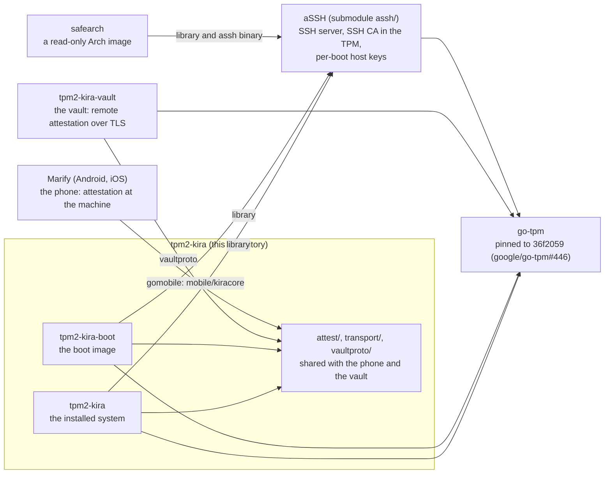
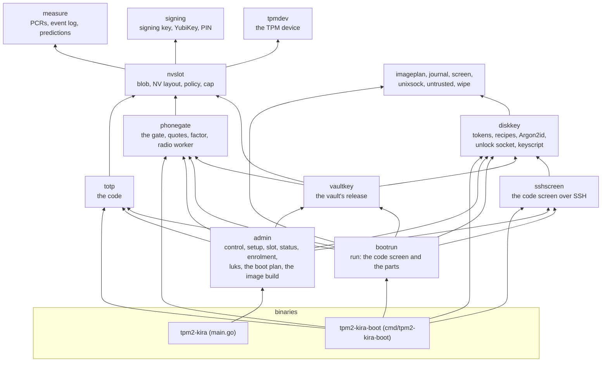
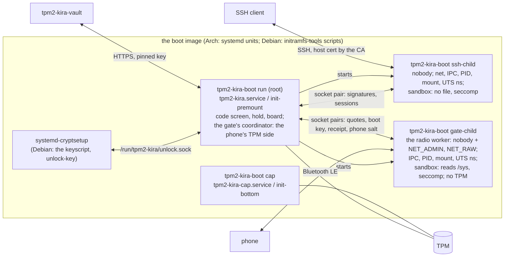

# Architecture

How tpm2-kira is built: the projects it works with, the three ways a boot
is checked, the two binaries and their packages, the processes at boot,
and what is kept where. How to use each part is on the pages this one
links to.

## The projects



| Project | What it is | How to use it |
|---|---|---|
| tpm2-kira | `tpm2-kira` on the installed system, `tpm2-kira-boot` in the boot image | [README.md](../README.md), `tpm2-kira help` |
| aSSH | the SSH server tpm2-kira's code screen runs on, the SSH CA held in the TPM, the per-boot host keys it certifies; a project of its own | [assh/README.md](../assh/README.md), [SSH.md](SSH.md) |
| tpm2-kira-vault | keeps the remote part of a `tpm+vault` keyslot's key and releases it to a fresh TPM quote of an approved boot | [VAULT.md](VAULT.md), `../tpm2-kira-vault/README.md` |
| Marify | the phone app that verifies a boot over Bluetooth LE and can keep the phone salt | [PHONE.md](PHONE.md), [PROTOCOL-BLE.md](PROTOCOL-BLE.md), `../marify` |
| safearch | a read-only Arch image that uses aSSH for its host keys | `../safearch/README.md` |

## Who checks the boot

Every check rests on the slot: a boot state (PCR values and a
generation) the signing key approved. Only in that state does the TPM
compute a code, answer the phone, or open the parts of a key.

```mermaid
flowchart TB
  SLOT["slot: an approved boot state<br/>PolicyAuthorize over PCRs + generation"]
  subgraph CODE["the code (TOTP)"]
    C1["at the console"]
    C2["over SSH (aSSH)"]
  end
  PHONE["the phone at the machine<br/>Bluetooth LE, a TPM quote<br/>(Marify)"]
  VAULTC["the vault, remote attestation over TLS<br/>a TPM quote before it releases its part<br/>(tpm2-kira-vault)"]
  SLOT --> CODE & PHONE & VAULTC
  PERSON(("a person compares<br/>with the authenticator")) --- CODE
  PHONE -->|verdict, and the phone salt| KEY["the disk's key"]
  VAULTC -->|the remote part| KEY
  CODE -->|Enter, then password (+ salt)| KEY
```

| Check | Where it happens | What it unlocks | Page |
|---|---|---|---|
| the code | at the console, or in an SSH session to the boot image | nothing by itself: the person confirms and types | [CODE.md](CODE.md), [SSH.md](SSH.md) |
| the phone | next to the machine, over Bluetooth LE | the boot's release; with `password+phonesalt`, the salt | [PHONE.md](PHONE.md) |
| the vault | over the network, TLS with a pinned key | with `tpm+vault`, the key without anybody typing | [VAULT.md](VAULT.md) |

How a volume's key is made is named by its LUKS2 token; with several of
tpm2-kira's keyslots they are tried in order - the vault, the phone's
salt, the typed salt - and cryptsetup's prompt with the recovery
passphrase is always the last way in ([DISK-KEY.md](DISK-KEY.md)).

## The two binaries

`tpm2-kira` is everything on the installed system; `tpm2-kira-boot` is
what the boot image carries and nothing more. The code is in `internal/`,
one package per layer; a package knows only those below it, and nothing
the boot runs imports the administration (`boot_binary_test.go`).



| Binary | Commands | Pages |
|---|---|---|
| `tpm2-kira` | `control`, `setup`, `slot …`, `status`, `phone …`, `luks …`, `vault …`, `initramfs plan`, `reveal`, `yubikey`, `pcrtips` | [README.md](../README.md) "Commands", `tpm2-kira help <command>` |
| `tpm2-kira-boot` | `run`, `cap`, `machine-id`, `unlock-key`, `ssh-child`, `gate-child`, `reveal` | `tpm2-kira-boot help`; the pages: `tpm2-kira help run`, `cap`, `unlock-key`, `ssh-child`, `gate-child`; [BOOT-INTEGRATION.md](BOOT-INTEGRATION.md) |

## At boot

`run` is a supervisor: it starts the parts the image's plan names
(`/etc/tpm2-kira/plan/<part>`, decided when the image is built) and
nothing else. The parts give each other what they need through a board,
not by calling each other ([PROJECT-STRUCTURE.md](PROJECT-STRUCTURE.md),
`internal/bootrun/parts.go`). The two parts that parse input from outside
are child processes `run` starts itself, as nobody, confined by aSSH's
`sandbox` on every thread - so the process tree is the same on Arch and
Debian; only what starts `run`, hands the disk's key to cryptsetup, brings
up the network and keeps the log differs
([BOOT-INTEGRATION.md](BOOT-INTEGRATION.md#arch-and-debian)).



| Part (plan) | In the image when | Process |
|---|---|---|
| `unlock` | always | `run` answers the key socket (Arch) or the keyscript (Debian) |
| `codes` | a slot is sealed | `run` shows the codes |
| `phone` | a phone is enrolled and the adapter found | `run` starts `gate-child`, the radio worker, which has no TPM; everything the phone check needs from the TPM - the record check, quotes, the boot key (certify, sign, its challenge), the EK, opening the phone salt - `run` does as the gate's coordinator, and it reads the receipt itself ([BOOT-INTEGRATION.md](BOOT-INTEGRATION.md), `internal/phonegate/gate_service.go`) |
| `vault` | a slot is enrolled with a vault | `run` asks the vault while the screen holds |
| `net`, `ssh` | set in `control` | the image's network; `run` starts the SSH server, `ssh-child` speaks SSH |

## What is kept where

| What | Where | Written by |
|---|---|---|
| a slot's blob (TOTP key, phones, the vault's part) | TPM NV `0x01803010` + n | `slot add`, `slot approve`, `phone enrol`, `vault enrol` |
| a slot's generation | TPM NV `0x01803810` + n | `slot add`, `slot approve` |
| the phone record counter | TPM NV `0x01803820` + n | `phone enrol`, `phone unenrol` |
| the boot settings ("Debug at boot") | TPM NV `0x01803000` | `control` |
| the machine-id, sealed under slot 0's policy | EFI variable `KIRAmachineID` (tpm2-kira's GUID) | `slot add` (slot 0), `slot approve`; removed with slot 0 and by `slot delete` |
| the SSH CA | EFI variable `KIRAasshCA` (the key itself in the TPM) | `control`; removed by `control` (when SSH is switched off, if you say so) and `slot delete` |
| the signing key | `/etc/tpm2-kira/keys/` (or a YubiKey) | `setup` |
| tpm2-kira's settings | `/etc/tpm2-kira/control.conf` | `control` |
| aSSH's settings | `/etc/tpm2-kira/assh.conf` | `control` |
| the keys that may log in at boot | `/etc/tpm2-kira/authorized_keys` | the person (`control` says so) |
| a keyslot's recipe | its LUKS2 token (`tpm2-kira-salt`, `-phonesalt`, `-vault`) | `luks enrol`, `luks mark` |
| what the image carries | `/etc/tpm2-kira/plan/` in the image | `tpm2-kira initramfs plan` (the hooks) |

## Testing

Unit and integration tests run here (a software TPM for the
integration suite); the whole life on real, encrypted VMs - packages,
`control`, reboots unlocked over SSH, the vault - is `tools/vmtest.py`:
[TESTING.md](TESTING.md).
