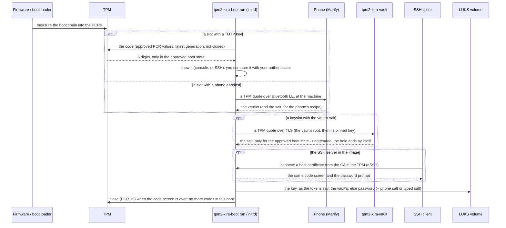

# Boot integration in depth

What the hooks put into the initramfs on Arch and Debian, the units and their conditions, the display mode, and how PCR 8/9 are predicted on a GRUB system. The installation itself: [INSTALL.md](INSTALL.md).

## Setting it up: Arch Linux (mkinitcpio)

tpm2-kira can display TOTP codes during early boot — before you enter your disk encryption passphrase. This way you can verify the system hasn't been tampered with before typing your LUKS password.

### Install the hooks

```bash
sudo make install-mkinitcpio
```

This installs:
- `sd-tpm2-kira` — mkinitcpio install hook (systemd-based initramfs)
- A **post-generation hook** that automatically runs `tpm2-kira slot approve` after every initramfs rebuild

### Configure mkinitcpio

Edit `/etc/mkinitcpio.conf` and add the hook next to `sd-encrypt`:

```bash
# Systemd-based initramfs (recommended):
HOOKS=(base systemd autodetect modconf block keyboard sd-tpm2-kira sd-encrypt filesystems fsck)
```

The order of the two hooks does not matter for the boot: what runs when is
decided by the units (`tpm2-kira.service` before `systemd-pcrosseparator`,
the key socket before `cryptsetup-pre.target`, the disk after both), not
by the position in `HOOKS`, and neither hook reads what the other wrote.
`sd-tpm2-kira sd-encrypt` is the order to use, because it reads like the
boot: the code screen, then the disk.

What the image does at boot depends on two things, both optional:

| In the image / on the command line | At boot |
|---|---|
| nothing but the hook | the code screen, then `sd-encrypt`'s own passphrase prompt (systemd's), as if tpm2-kira were not there once the code is confirmed |
| `rd.luks.key=<UUID>=/run/tpm2-kira/unlock.sock` on the kernel command line | the code screen, then tpm2-kira's passphrase prompt; a typo falls back to systemd's prompt |
| a phone enrolled (`phone enrol`) and the adapter found at build time | the code screen also asks the phone and shows its verdict; the passphrase prompt is never held |


### Configure the disk unlock

The main disk takes its key from tpm2-kira's socket when the kernel
command line names it next to `rd.luks.name=`:

```
rd.luks.name=<UUID>=cryptroot rd.luks.key=<UUID>=/run/tpm2-kira/unlock.sock
```

`tpm2-kira luks route` checks the files the command line comes from and
prints the line as it should read (`control`'s step 1 writes it when you
say so). How the key is then made - asked, derived, or from the vault -
is the keyslot's token: [DISK-KEY.md](DISK-KEY.md). Then
rebuild (`sudo mkinitcpio -P`); the post-generation hook approves the new
boot state, so the next boot matches.

### How it works at boot



`tpm2-kira.service` starts before the disk unlock and runs `tpm2-kira-boot
run`: the code screen ([CODE.md](CODE.md)), the phone's gate
when one is enrolled ([PHONE.md](PHONE.md)), the SSH server when
it is set ([SSH.md](SSH.md)), the vault's release when a slot is
enrolled with one ([VAULT.md](VAULT.md)), and the key socket
([DISK-KEY.md](DISK-KEY.md)) - each only when the boot plan put
it in the image. Enter at the code screen, the phone's verdict, the
vault's key, or 90 seconds ends the hold;
`run` then closes the boot (PCR 15), `tpm2-kira-close.service` (Debian: `local-top`'s
script) closes it again before any volume is opened, whatever `run` did, and no code can be
computed until the next boot.

See [initramfs/mkinitcpio/mkinitcpio.conf.example](../initramfs/mkinitcpio/mkinitcpio.conf.example) for more HOOKS configurations (LVM, multiple encrypted devices, etc.).

## Setting it up: Debian (initramfs-tools)

Debian's stock initramfs has no systemd in it, so the systemd unit used on Arch
does not apply. The `.deb` installs these instead:

| Path | Role |
|---|---|
| `/usr/share/initramfs-tools/hooks/tpm2-kira` | copies the binary into the image |
| `/usr/share/initramfs-tools/scripts/init-premount/tpm2-kira` | starts the display at boot |
| `/usr/share/initramfs-tools/scripts/local-top/tpm2-kira-close` | runs `tpm2-kira-boot close` when the code screen is over, before `cryptroot` opens a volume (a failure reboots) |
| `/usr/share/initramfs-tools/scripts/init-bottom/tpm2-kira` | stops it and runs `tpm2-kira-boot close` once more before the real root takes over (a failure reboots) |
| `/lib/cryptsetup/scripts/tpm2-kira` | cryptsetup keyscript: the volume's key from tpm2-kira's prompt |

`/init` runs `init-premount` before `local-top/cryptroot` asks for the
passphrase, which is what puts the code on screen first. The script starts
the same `run` as Arch's unit, which starts the phone's radio worker and
the SSH server's unprivileged half itself: what differs between the two is
listed in [BOOT-INTEGRATION.md](#arch-and-debian).

### Configure the disk unlock (Debian)

`cryptroot` takes the key from a keyscript; add tpm2-kira's to the root
volume's line of `/etc/crypttab`, then `sudo update-initramfs -u`:

```
vda3_crypt UUID=… none luks,discard,keyscript=/lib/cryptsetup/scripts/tpm2-kira
```

The keyscript asks the same socket `systemd-cryptsetup` does on Arch, and
cryptsetup's own prompt is its last try: [DISK-KEY.md](DISK-KEY.md#debian-initramfs-tools).

### Choosing PCRs on Debian

There is no UKI, so PCR 11 is empty and the `11u` and `11e` sources do not
apply. GRUB carries the equivalent measurements instead:

| PCR | Measures | Changes when |
|---|---|---|
| 0, 2 | firmware code and option ROMs | firmware update |
| 4 | the GRUB EFI binary the firmware loaded | `grub-install`, shim/GRUB package update |
| 7 | Secure Boot state and policy | key rotation, enabling/disabling Secure Boot |
| 8 | every command GRUB runs (`grub_cmd: ...`) | `update-grub`, kernel version change |
| 9 | contents of every file GRUB reads (grub.cfg, modules, kernel, initrd) + EFI LoadOptions | **every kernel or initramfs update** |

```bash
# Measures kernel, initrd and command line; predicted across updates (below)
tpm2-kira slot add --pcrs "0e,2e,4u,7e,8e,9e"
```

Secure Boot checks GRUB and the kernel, not GRUB's command line or the
initrd, so on a GRUB boot every slot includes PCRs 8 and 9: `slot add`
refuses a selection without them; the fallback slot 1 and the SSH CA's
slot 1 are PCRs 7, 8 and 9. An entry edited at the GRUB console
(`break=`, `rdinit=`) is a shell before the close; `control` advises a
GRUB superuser password (`set superusers=` and `password_pbkdf2` in
`/etc/grub.d/40_custom`, the menu entries `--unrestricted`, then
`update-grub`) and judges its absence red.

### Secure Boot on Debian: no hibernation

With Secure Boot on, Debian's kernel locks itself down (`integrity`) and refuses hibernation:
`/sys/power/disk` shows `[disabled]`, and the kernel logs `hibernation is restricted`. Suspend
to RAM stays. A vault releases nothing unless Secure Boot is on, so on Debian a machine has a vault's
keyslot or hibernation, not both.

## What is installed where

The package puts five unit files into `/usr/lib/systemd/system` on the
host, because the mkinitcpio hook takes them from there. None of them is
enabled on the host, and each carries
`ConditionPathExists=/etc/initrd-release`, so enabling one there by mistake
does nothing.

The image carries one binary, `/usr/bin/tpm2-kira-boot`: the code screen
and the parts of the plan, the close, the keyscript, the phone's radio worker
and the SSH server's unprivileged half. `tpm2-kira`, the administration,
stays on the installed system; the hooks run it to decide the plan.

What goes in is the **boot plan**'s (`tpm2-kira initramfs plan`,
`tpm2-kira help initramfs`): the disk unlock always, every other part only
while something uses it, and what needs the TPM only with one. The image
names its parts in `/etc/tpm2-kira/plan/`; `tpm2-kira-boot run --plan` and the
Debian scripts start only those.

| Unit | In the initramfs image | Does something when |
|------|------------------------|---------------------|
| `tpm2-kira.service` (`run`: the code at the prompt, the gate's coordinator, the SSH server, and the key provider for `systemd-cryptsetup`) | always, once `sd-tpm2-kira` is in `HOOKS`. `run` waits for the TPM's device (at most 5 s after the boot's first wait for it, SSH.md, "One wait per boot") only when a part of the plan needs it | a volume asks for its key; with the codes in the plan (a slot with a TOTP key or phones), a code is shown. Without them nothing is shown: the hold lasts while the vault opens its part, else the boot is released at once. The first `slot add` makes the image out of date (`control` rebuilds it when left). The gate ends when the boot is released; the process stays to answer the volumes' key requests and ends at switch-root |
| `tpm2-kira-unlock.socket` (the key socket) | always, with the display | `systemd-cryptsetup` activates a volume whose key file is the socket |
| `tpm2-kira-close.service` (closes the boot: PCR 15 extended, `tpm2-kira-boot close`, which every slot object's policy and the SSH CA's read - no code, no slot's part opens, no key is certified until the next boot; `run` closed it already when the code screen was over, this closes it whatever `run` did; required by `initrd.target`; a failure - every way refused, or a TPM silent for the first time - is a hard reboot, `FailureAction=reboot-force`: no shell with PCR 15 at zero; SSH.md, "The close: what it can come to") | with the TPM in the plan: a slot is sealed, whatever its methods, or an SSH CA exists (also one kept while SSH is off) | the code screen is over (after `tpm2-kira.service`), before `cryptsetup-pre.target` |
| `tpm2-kira-machine-id.service` (releases the sealed machine-id, `tpm2-kira-boot machine-id`) | with the image's network | before systemd-networkd starts and before the close: slot 0's policy holds, `KIRAmachineID` unseals ([SSH.md](SSH.md) §2.1) |

The slots' records are EFI variables (`KIRAslotN`): the image reads them
through efivarfs. systemd mounts it itself on Arch (the hook adds the
module for a kernel that does not have it built in); on Debian the
init-premount script mounts it before `run`, whenever the plan has the
TPM. Without it no slot is read, and the boot goes on to the passphrase
prompt ("efivarfs not mounted?" in the log).

The phone's gate is no unit: with the phone in the plan, `run` starts its
radio worker itself. The phone is in the plan with a TPM, a phone enrolled
(or `TPM2_KIRA_ATTEST_BLUETOOTH=always`), its record signed by this
machine's key and current, **and** the adapter found when the image was
built; the signing public key and the adapter's modules and firmware go
into the image with it. Otherwise no Bluetooth module or firmware is in the
image, and the build says which condition failed. `phone unenrol` without
rebuilding the image leaves the gate in it with nothing to do: it reports
at boot that no phone is enrolled, and the next build leaves it out.

### The child processes of run

Two parts parse what arrives from outside before the disk is unlocked,
and `run` starts each as a process of its own - the same on Arch and
Debian, with nothing of it in a unit or a script:

| | `ssh-child` (the SSH server) | `gate-child` (the phone's radio worker) |
|---|---|---|
| user | a uid no one else has (aSSH's `sandbox.ClaimUID`, `ASSH_CHILD_UIDS`; nobody only when none is free) | nobody, with `CAP_NET_ADMIN` and `CAP_NET_RAW` alone (the HCI user channel) |
| namespaces of its own | network, IPC, PID, mount, UTS | IPC, PID, mount, UTS (Bluetooth sockets exist only in the first network namespace) |
| open files | the listening socket, a socket pair to `run` | two socket pairs to `run`, `/dev/rfkill` |
| files it can reach (Landlock) | none | reads beneath `/sys` (the adapter's and rfkill's state) |
| TPM | none: `run` signs | none: `run` quotes, opens the boot key and the phone salt, reads the receipt |

Each then confines itself with aSSH's `sandbox`, on every thread (Go runs
a program on several threads, and prctl, Landlock and seccomp act on the
thread that asks): no new privileges, no executable memory, Landlock as
above (no TCP bind or connect either), and none of the system calls that
administer the machine - mounts, modules, the clock, other processes'
memory, namespaces, user IDs, keyrings, BPF, running a program (seccomp,
EPERM; another architecture's ABI ends the process). `tpm2-kira help
ssh-child`, `tpm2-kira help gate-child`.

### Arch and Debian

The boot is one process tree on both: `run` and its children, started
with the same arguments. What differs is what the distribution's boot
does around it:

| | Arch (mkinitcpio, systemd) | Debian (initramfs-tools) |
|---|---|---|
| `run` is started by | `tpm2-kira.service` | `scripts/init-premount/tpm2-kira`, in the background |
| the disk's key | `systemd-cryptsetup` reads `tpm2-kira-unlock.socket` (`rd.luks.key=`, crypttab(5) AF_UNIX key files) | cryptroot runs the keyscript `unlock-key`, which asks the socket `run --unlock` made |
| the adapter's modules | loaded by `systemd-modules-load` (`modules-load.d`) | loaded by the image's init (`conf/modules`, the hook's `force_load`) |
| the image's network | `systemd-networkd`, the plan's `.network` file; the sealed machine-id released before it (`tpm2-kira-machine-id.service`), from which networkd derives its default DUID (a copied identity wins) | the script: initramfs-tools' `configure_networking`, or busybox' `udhcpc` / `ip` (`remote.conf`) with the copied identity; the machine-id is released all the same, before it |
| the narrative | the journal: `journalctl -b -u tpm2-kira.service` | `/run/initramfs/tpm2-kira.log` |
| the boot closed (PCR 15: every slot and the SSH CA) | `run` when the code screen is over, before READY; then `tpm2-kira-close.service`; down aSSH's ladder (SSH.md), a failure: `FailureAction=reboot-force` | `run` when the code screen is over, before its READY file (`--ready-file`); then `scripts/local-top/tpm2-kira-close`, which waits for that file or for `run` gone and runs before cryptroot, whose prerequisites name every other script of `local-top`; again `scripts/init-bottom/tpm2-kira`; down aSSH's ladder (SSH.md), a failure: `reboot -f`, then SysRq `b` |
| the close before a resume from hibernation | a drop-in on `systemd-hibernate-resume.service` (`ExecStartPre=tpm2-kira-boot close --resume`, after `tpm2-kira.service`); a failure: no resume | `scripts/local-top/tpm2-kira-close` (`tpm2-kira-boot close --resume`, after that script's own close), before cryptroot; a failure clears `resume=` |
| stopped | at `initrd-switch-root`: the units' stop | `scripts/init-bottom/tpm2-kira`: TERM to `run` (5 s) |
| the measure point | ordered before systemd's PCR separators | before cryptroot (no separator) |

The display refreshes once per 30-second TOTP window, writing to the same
console as the passphrase prompt. The prompt scrolls up as codes arrive;
typing is unaffected, since the passphrase is not echoed anyway.

### Debian with systemd-boot and a UKI: not yet

On Debian the boot is GRUB's, whose command line and initrd Secure Boot
does not check; so every slot there includes PCRs 8 and 9, the fallback
and the SSH CA's slot 1 with them ([SSH.md](SSH.md) §11). A unified kernel image would put
both into the signed image, as on Arch. Debian 13 cannot measure such a
boot yet: its systemd 257 has no `systemd-pcrosseparator`, and its dracut
systemd initrd measures no `enter-initrd` into PCR 11, so slot 0's
prediction of PCR 11 fails. The tried conversion, and what else it met, is
in [HISTORY.md](../HISTORY.md) ("Debian on systemd-boot and a UKI: not
yet"); it is worth doing once Debian ships systemd 258 or later.

## PCR 8 and 9 are predicted for the next boot

GRUB measures every command it runs into PCR 8 and every file it reads
into PCR 9, and the kernel's EFI stub adds its load options and the initrd
to PCR 9. The event log of the running boot is the complete script of
that. After an update only the entries of what changed differ, so
`slot approve` replays this boot's log with those entries replaced by what is
on disk now - the way SUSE's `pcr-oracle` does it; neither Debian nor
`systemd-pcrlock` (which knows no GRUB) offers this:

| changed on disk | what is put into the replay |
|---|---|
| the initrd (`update-initramfs`) | its SHA-256, in GRUB's file event and the stub's `Linux initrd` tag |
| a new kernel | the version string in GRUB's `linux`/`initrd`/`echo` commands, the kernel command line and the stub's load options; the kernel's and initrd's SHA-256 |
| `grub.cfg` (`update-grub`) | its SHA-256, and the `menuentry`/`submenu` commands rebuilt from it - GRUB measures them with their whole body |
| `grubenv`, GRUB modules, `.lst` files | their SHA-256 |

The hooks run it: `/etc/initramfs/post-update.d/tpm2-kira` after every
`update-initramfs`, and `/etc/kernel/postinst.d/zzz-tpm2-kira` (also
`postrm.d`) after `zz-update-grub` has written the final `grub.cfg` of a
kernel install or removal. `slot approve` prints what it substituted, for
example `PCR9 /initrd.img-6.12.111+deb13-amd64: now /boot/initrd.img-…`.
The next boot then shows a code at once; no boot without one, no second
approve.

What the prediction cannot know, and what then happens: a different menu
entry chosen at the GRUB menu, a command line edited there, a `grubenv`
the boot rewrites (`GRUB_SAVEDEFAULT`, `recordfail`), or a GRUB package
update that changes the module set. Such a boot shows no code - expected,
not a compromise - and `sudo tpm2-kira slot approve` after it binds to the
state you booted, as the approval always did. The prediction is checked
against this machine's real log in the test suite
(`internal/measure/grub_predict_test.go`, Debian 13, GRUB 2.12).

Approving is still never automatic at *boot*: a tampered kernel does not
become a trusted baseline by being booted once. The hooks run on the
unlocked system, after a change you made.
