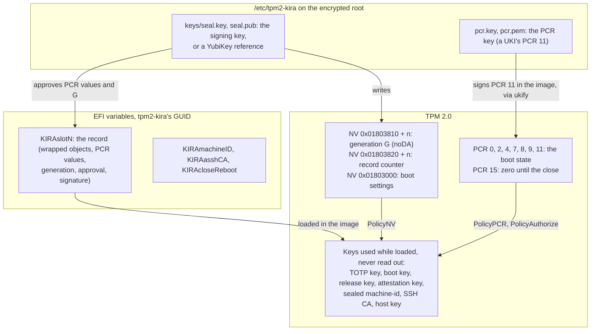
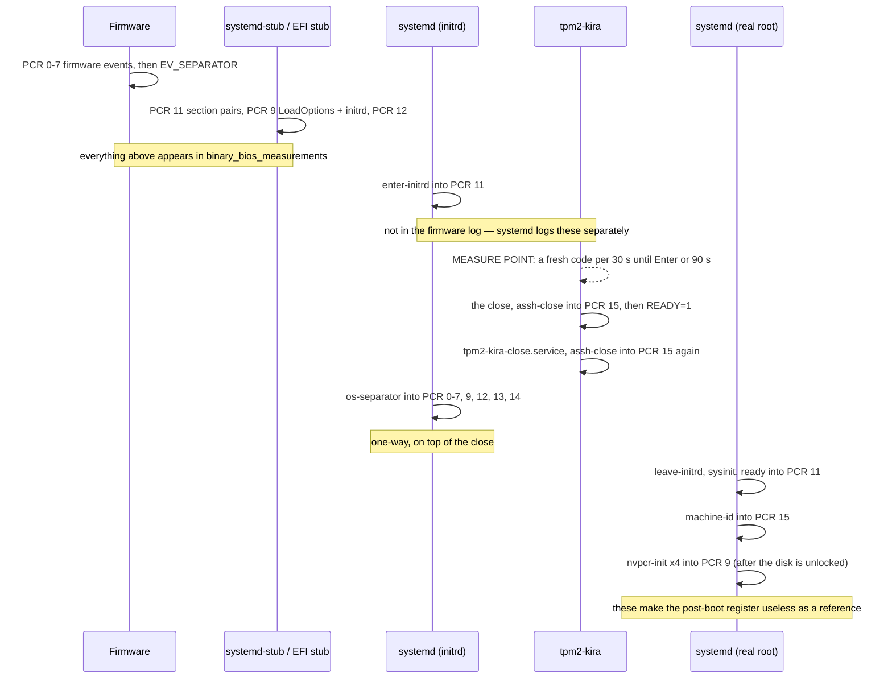
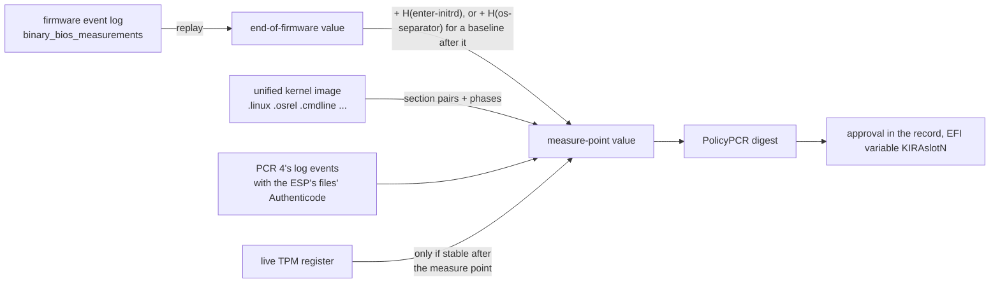
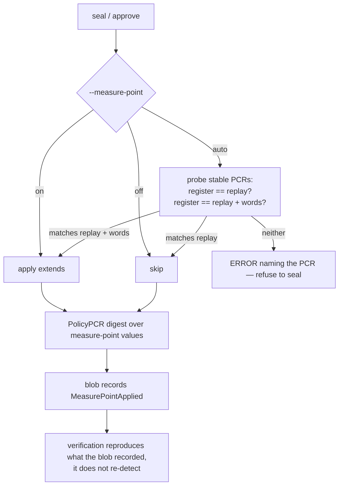
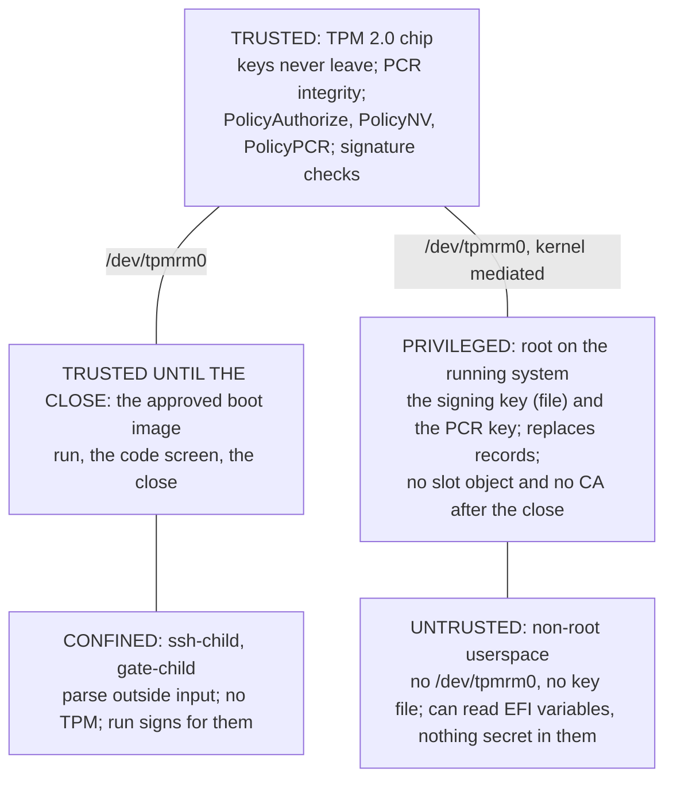
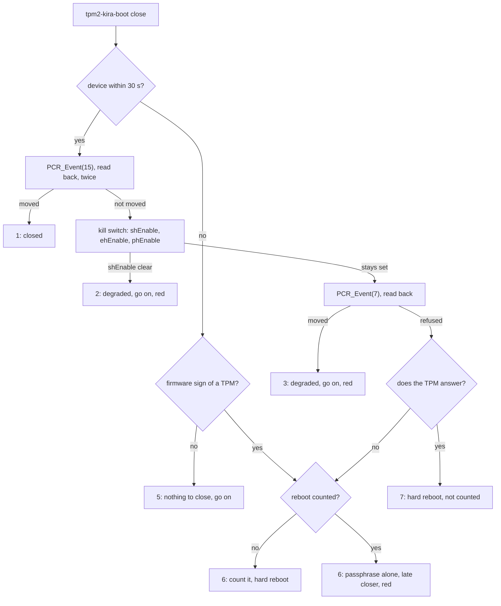

# TPM2-KIRA Security Background

How tpm2-kira protects its secrets, where data is stored, how authentication
works and where the trust boundaries are; then what has been tested on what,
what is not proven, and which risks are accepted and why. It describes the code
of branch `feat/close-pcr15` (tpm2-kira `f0965aa`).

| For | Read |
|---|---|
| What is stored where, the policies, the flows | §3, §4, §5, §6 |
| The threat model, who can change what, the record's format | §8, §9, §10 |
| Trust between the phone and the machine | §13 |
| The close and what it can come to | §14 |
| Which PCRs, and why these | §15 |
| Arch against Debian, which key does what | §16 |
| What was tested, on what, with which result | §17 |
| What failed or is not proven | §18 |
| The accepted risks, each with its limit | §19 |

---

## 1. Purpose

tpm2-kira gives a machine secrets that its TPM uses only in a boot state the
owner approved, and only until the code screen in the boot image is over: the
key behind the TOTP codes, the sealed machine-id, the phone's boot key, the
release key that opens the TPM's and the vault's parts of a disk key. aSSH's SSH
CA in the same TPM follows the same rule.

If the boot chain changes (firmware update, bootloader or kernel change, Secure
Boot policy change), the TPM refuses. The owner, proven by possession of a
signing private key, can approve the new state; nobody, the owner included, can
read a key back out of the TPM after enrolment. When the code screen is over the
boot image extends PCR 15, **the close**: every one of these objects reads PCR 15
in its own policy, so from then on nothing opens until the next boot, root
included, whatever has been approved (§14).

tpm2-kira adds ways to unlock and informs. It does not withhold systemd's own
passphrase prompt; the one exception is a TPM that answers and refuses every
way of closing (§14).

---

## 2. High-Level Architecture



---

## 3. What Is Stored Where

### 3.1 The slot's record (the "blob"), in an EFI variable

Each slot (0-15; its number is also written as `0x01803010` + *n*) keeps
one serialised `SealedBlob` (format version 20, §10), its **record**, in
the EFI variable `KIRAslotN` under tpm2-kira's vendor GUID
(`67f474ef-94a1-4412-88df-d62349d430a9`), at most 8 KiB. In the TPM a
slot keeps only what a TPM policy reads or nobody may turn back: its
generation index (§3.2), which also says that the slot exists, and its
record counter (§3.3). Nothing in the record needs the TPM to keep it
(*Why an EFI variable*, below).

The record's TOTP key is optional: a slot holds a TOTP key when it is
chosen (`slot add --totp`), phones, the vault, the TPM salt - or no
method at all (the boot state sealed, for the machine-id and the boot
key); which recipe needs which method is not the format's to say. Today
phones still retire the TOTP key (*TOTP key or phones*, below).
Phone attestation is an optional part of the same blob,
and within that part the way a verifier reaches the machine is a typed
*method*: phones over Bluetooth LE, and tpm2-kira-vault over HTTPS
(VAULT.md). The blob contains:

| Field               | Content                                                         | Sensitive? |
|---------------------|-----------------------------------------------------------------|------------|
| `Version`           | Blob format version (20)                                        | No         |
| `Public`            | TPMT_PUBLIC of the TOTP key object; empty without TOTP | No     |
| `Private`           | TPM2B_PRIVATE of the TOTP key object (TPM-wrapped); empty without TOTP | **Yes**¹ |
| `PCRDigests`        | Per-PCR index, source (register/eventlog/uki/signed) and digest | No         |
| `TOTPAlgorithm`     | HMAC hash of the key: SHA-1, or SHA-256 on a TPM without SHA-1; 0 without TOTP | No |
| `Generation`        | The generation the approval requires                            | No         |
| `PolicyRef`         | Random per slot; qualifies its approvals for all its keys       | No         |
| `SigningPublic`     | TPMT_PUBLIC of the signing key                                  | No²        |
| `ApprovalSignature` | Signing key's signature over `H(approvedPolicy ‖ PolicyRef)`    | No         |
| `PCRKey`            | Public PCR key (§15) when the slot takes PCR 11 signed; else empty | No      |
| `MeasurePointApplied` | Whether the eventlog PCRs' values include the measure-point extends³ | No |
| `Attestation`       | The optional phone-attestation part (fields below)             | Partly¹    |
| `BlobSignature`     | Signature over everything above                                 | No⁴        |

The attestation part (`Attestation`), created by `phone enrol`. It describes
the machine as an attester, whatever the method:

| Field           | Content                                                              | Sensitive? |
|-----------------|----------------------------------------------------------------------|------------|
| `DeviceID`      | 16 random bytes naming this machine to its verifiers                 | No         |
| `FriendlyName`  | The machine's name as verifiers show it                              | No         |
| `AKPublic`      | TPMT_PUBLIC of the attestation key, which signs the quotes; its Name, which verifiers pin, is computed from it | No |
| `AKPrivate`     | TPM2B_PRIVATE of the attestation key (TPM-wrapped)                   | **Yes**¹   |
| `EKAlg`         | Which endorsement key template enrolment used (ECC or RSA)           | No         |
| `BootKeyPublic` | TPMT_PUBLIC of the boot key (§3.4)                                   | No         |
| `BootKeyPrivate`| TPM2B_PRIVATE of the boot key (TPM-wrapped)                          | **Yes**¹   |
| `ReleaseKeyPublic` | TPMT_PUBLIC of the release key (§3.7)                             | No         |
| `ReleaseKeyPrivate`| TPM2B_PRIVATE of the release key (TPM-wrapped)                    | **Yes**¹   |
| `TPMSalt`       | The salt part of recipe 0x1200, wrapped (TPM2_MakeCredential) for this TPM's EK and the release key: it opens only through the release key's policy; empty without | No⁶ |
| `PCRAlg`, `PCRSelection` | The PCR bank and registers that are quoted                  | No         |
| `Count`         | Value of the slot's record counter when the part last changed (§3.3) | No         |
| methods         | Who may ask for a quote, and over what: typed blocks, below          | Partly¹    |

Method 1, phones over Bluetooth LE (`Phone`):

| Field           | Content                                                              | Sensitive? |
|-----------------|----------------------------------------------------------------------|------------|
| `ChannelPublic` | TPMT_PUBLIC of the sealed object holding the channel's secrets⁵      | No         |
| `ChannelPrivate`| TPM2B_PRIVATE of that object (TPM-wrapped)                           | **Yes**¹   |
| `ChannelPCRs`   | The registers its first branch reads besides PCR 15 (today PCR 7) and their values⁵ | No |
| `Verifiers`     | Up to 8 phones: id, anchor public key (signs the phone's verdicts), channel public key, policy id; no name | No |

Method 2, tpm2-kira-vault (`Vault`, VAULT.md), created by `vault enrol`:

| Field           | Content                                                              | Sensitive? |
|-----------------|----------------------------------------------------------------------|------------|
| `URL`           | The vault, `https://host:port`                                       | No         |
| `Pin`           | SHA-256 of the vault's TLS root's key (SubjectPublicKeyInfo): a key of the vault's verified chain must be it - the chain itself is verified against `/etc/tpm2-kira/vault-ca.pem` | No |
| `Label`         | The vault keyslot's label in the key's derivation                    | No         |
| `Local`         | The local part L, the unattended recipes' password, wrapped (TPM2_MakeCredential) for this TPM's EK and the slot's release key: it opens only through the release key's policy; empty with a typed password | No⁶ |
| `Pepper`        | The salt is made with an operator's pepper                            | No⁶ |
| `PepperCheck`   | An unattended recipe with a pepper: 16 bytes of an HMAC of the key (behind Argon2id), to tell a mistyped pepper from the right one at boot; empty otherwise | No⁶ |

⁶ The wrapped part opens only on this TPM, in a boot state the signing key
approved, before the close (PCR 15); and it is half of the key, the vault keeps the other.

**TOTP key or phones.** TOTP is a method of its own: `slot add --totp`
seals a TOTP key, `slot add` alone none; `control` asks. A slot with one
shows a code at boot, compared with the authenticator; a slot with neither
a code nor phones is not shown, and the hold lasts only while the vault
opens its part. The first phone enrolled for the slot retires the key: the phone's check (the quote,
the boot key's code, the person's confirmation on the phone, §13) covers what
the code proves and more, and a second, weaker path to the same verdict
would only be one more thing to keep, lose or leak. While a phone is enrolled
the boot screen shows the slot as "mobile attestation locked - please
connect" until the phone is in, then the phone's code, then the verdict.
When the last phone leaves, no TOTP key comes back by itself (nor with any
other enrolment): `slot add --totp` seals one. The slot's policy (`SigningPublic` and `PolicyRef`)
stays through all of it: the boot key and the release key are made under
it, not under the TOTP key, and keep working. The fallback, slot 1, keeps
its code: it is the check for a boot without the phone (a flat battery, a
lost phone, no Bluetooth in the initrd).

**Why a phone is enrolled after a TOTP code: the phone is enrolled in a
verified boot.** Enrolment is trust on first use for the phone: it pins the
machine's attestation key and takes the boot state of the enrolling boot
as the baseline every later boot is compared with. Nothing the phone can
check itself says that this first state is clean; a boot chain that was
tampered with before the enrolment would be pinned as good. Only a check
made before the phone existed can say it, so the order is fixed:

1. The slot is sealed with a TOTP key (`control`, "Signing key and TOTP codes", or `slot add`).
2. The machine boots through tpm2-kira's code screen. The code exists only
   while the PCRs are the ones the signing key approved, and the person
   compares it with the authenticator: this boot is verified.
3. In that boot the phone is enrolled (`control`, "Attestation by phone", or `phone enrol`), and with
   that the slot's TOTP key is retired.

`phone enrol` enforces what the machine can know of this (`requireVerifiedBoot`
in `internal/admin/attest.go`): the boot passed the code screen (the close extended
PCR 15, which happens at every boot with a sealed slot), and, for a slot with a
TOTP key, the slot's PCRs at the code screen - recomputed from this boot's
event log, before the OS separator, with `enter-initrd` on PCR 11 - are
the approved ones, so the screen did show the slot's code. A boot that
fails either is refused: it was not verified, whatever happened at its
screen. What the machine cannot know, that someone compared the code, it
asks before the phone is involved. A further phone for a slot that
already has phones needs a boot an enrolled phone attested ("mobile
attestation passed"); the machine keeps no record of that verdict, so it
asks. The rule holds for `control` and for `phone enrol` by hand alike.

**Open, with TOTP optional:** a slot sealed without `--totp` has no code
to verify the enrolling boot with; `phone enrol` then has only the close as its
evidence, and the phone pins whatever state that boot had. Whether a phone
(and a typed password) may be enrolled into a slot without a TOTP code is
part of the decision which recipe needs which method (PLAN.md, part C).

**Why an EFI variable.** A record's integrity is the signing key's
signature, its freshness the record counter in the TPM (§3.3), and
its private parts are wrapped: by this TPM's storage key, the TPM salt and the
vault's part for its EK. So it needs no
protection of the TPM's - only room, which an NV index (2048 bytes on many TPMs,
`TPM2_PT_NV_INDEX_MAX`) has not for an RSA EK with two wrapped factors, an RSA
signing key, or phones beside the rest. The variable against an NV index:

| | an NV index | EFI variable `KIRAslotN` |
|---|---|---|
| Size | `TPM2_PT_NV_INDEX_MAX`, often 2048 | 8 KiB (tpm2-kira's limit; firmware stores are small) |
| Write | the signing key alone (PolicySigned) | root |
| Replaced by an attacker | refused: signature, counter | refused: signature, counter |
| Deleted | the owner's authorisation (empty on most machines) | root; also a firmware reset of its variables |
| A TPM clear | gone with the keys it wraps | left behind, useless: `status` names it |
| Read by | anyone with TPM access | any local user: efivarfs shows variables mode 0644, and nothing sets it tighter; it holds nothing secret in clear |
| Written | at every approval, enrolment | the same; no TPM NV write for it |

A deleted or replaced record is a denial of service: the slot's methods
fail at boot, and the fallbacks unlock (the password and salt typed, then
the operating system's recovery passphrase). `status` and `control` name
a record without its slot and a slot without its record, with the cause,
and remove what is left. A record is written whole or not at all: the
firmware keeps the old variable until the new one is there.

**What the machine keeps of a phone, and why no more.** The record is readable
without a key (§9), so it holds only what the machine needs to find and trust
its phone:

- the phone's channel key, by which the machine recognises it in the
  encrypted handshake, and the id it signs its receipts with;
- the anchor key, which verifies the phone's verdicts;
- nothing that names the phone. The phone sends no name, not even its
  model; the machine numbers its phones ("phone 1", "phone 2") and
  says at boot only that "your phone" attested. The machine finds the phone
  by itself, in the handshake, so nobody needs to be told which phone to
  pick up; the person knows their phone.
- no Bluetooth address: the phone connects to the machine, which
  advertises with a new random address at every boot, and the phone's
  address is never stored.

And none of it links a phone across machines: the phone makes a new
channel key, id and anchor key for every machine it enrols with
(PROTOCOL-BLE.md §11.1, §11.2), so two machines comparing what they keep
find nothing in common. One phone still attests any number of machines,
each through its own record.

¹ The `Private` field is encrypted by the TPM's storage hierarchy. It cannot be
decrypted outside the TPM that created it, and the key in it can only be
*used* by that TPM, under the object's policy. It is never decrypted for
tpm2-kira: there is no `TPM2_Unseal` of a key. The same holds for `AKPrivate`,
`BootKeyPrivate` and `ReleaseKeyPrivate`.

² The key object's policy binds the signing key's **Name**, so a substituted
`SigningPublic` makes `PolicyAuthorize` fail; it is stored because the key
files are not reachable in the initrd.

³ Which extends were applied follows from the eventlog PCRs: the seal folds
the same words into each of them (§5.8), so the blob keeps one flag and `slot info`
spells the extends out from the selection. The blob holds nothing that only
describes how it was made (the tool's version, the event log's path, the time
of the calculation, the key files' paths): what is not needed to compute a
code, to approve or to attest is not stored, since every byte counts against
the record's limit (§10, *Size*). The signing key's files are found at
tpm2-kira's default paths or the ones given on the command line, never from
the blob (§5.5).

⁴ The blob carries a detached signature over `[version ‖ payloadLen ‖ payload]`,
made with the same signing key. Unsigned blobs are rejected outright. It
protects the *metadata* (PCR selection and sources, UKI paths) that `slot approve`
acts on; the TPM enforces the rest by itself. It also covers the attestation
part: which verifiers are enrolled cannot be changed without the signing
key, and the Bluetooth gate verifies the signature in the initrd with a copy
of the signing *public* key that the initramfs hooks put into the image.

⁵ The channel's secrets are the machine's static Noise key and the advertising
key, 64 bytes sealed in one object (`internal/nvslot/channel.go`). Its policy is
not the slot's, and is fixed when it is made:

    PolicyOR( PolicyPCR(7 as sealed, 15 == zero) ; PolicyCommandCode(Unseal),
              PolicySigned(signing key, policyRef) ; PolicyCommandCode(Unseal) )

The first branch is the gate's: before the close, with this machine's Secure Boot
state in PCR 7, whatever image it boots, approved or not, so that the phone can
show a boot nobody approved as changed. The list of registers is one constant
(`channelPCRs`). A Microsoft-signed live USB, Secure Boot switched off, a db or dbx
update: PCR 7 differs, nothing opens them, there is no gate, and the phone finds no
machine (§13.4).

PCR 7's value is the one the gate will see at the next boot: replayed from the event
log, like a slot's (§5.8), because on the running system of an Arch machine
`systemd-pcrosseparator` has moved the register. The record carries it
(`ChannelPCRs`) for PolicyOR's branch digest; a record with another value does not
fit the object's policy. Without a usable log the registers are taken, and enrolment
warns.

The second branch is the running system's, with a signature over the TPM's nonce of
that session: `phone enrol` for a further phone (the phones have pinned these keys),
`phone salt enrol`, `phone gate` after the close or with PCR 7 moved, and `slot
approve`. A moved PCR 7 means sealing them again, and only a person does that: `status`
and `control` are red with the command to run (the next boot's PCR 7, from the log, is
not the sealed one), and `slot approve` at a terminal, `slot approve --seal-channel` or
`control`'s line shows the old and new value and what the event log says PCR 7 is made of
(the old value's events are kept nowhere: no difference, what to compare with what you
changed), then opens them with the signing key and seals the same secrets to the new
value, before it raises the generation. An approval with `--unattended` (every hook),
`--if-moved`, or with no terminal and no flag approves the slot as always and leaves the
channel, and says so (`ChannelApproval`, `internal/admin/channel_approval.go`): the
signing key is at a hook's hand, so a channel that followed by itself would follow
whatever moved PCR 7, with no person ever seeing it. A db or dbx update takes effect at the next boot, so the log shows it only
then: that one boot has no gate, as it has no slot that reads PCR 7. The phones keep
what they pinned.

Whoever opens them can recognise the machine's advertisements and imitate its Bluetooth
endpoint, but cannot produce a quote, which only the TPM's attestation key can sign. Who
still can: §19.

### 3.2 The generation index

Each slot has an NV index at its number's index + `0x800`
(`0x01803810` for slot 0). It holds an 8-byte big-endian generation `G`; a slot exists
while it is defined. Attributes:

- `OwnerRead`, `AuthRead` (empty auth): anyone can read it, as `PolicyNV` must.
- `PolicyWrite` with a PolicySigned policy: only the signing key can write
  it.
- `NoDA`: `PolicyNV` reads it with an empty password, and a dictionary-attack
  lockout must not stop the slots at boot (the storage primary and every slot
  object are noDA too; tpm2-kira holds no PIN in the TPM, so nothing of its own
  loses protection, but anything else sealed under that primary with a password
  would).

It serves revocation alone (`PolicyNV(G == n)`, raised by `slot approve`);
closing the slots for the rest of the boot is PCR 15's (§14).

### 3.3 The record counter

A slot with an attestation part has a third NV index, at `0x01803820` + *n*: an
8-byte **counter** (`TPM_NT_COUNTER`), with `OwnerWrite`, `OwnerRead`,
`AuthRead` (empty auth) and `NoDA`.

It is a revision number for the attestation part, kept by the TPM. It does
**not** count attestations: nothing is written to the TPM's NV storage when
the machine boots or is attested. It moves only when the verifiers of the
slot change (`phone enrol`, `phone unenrol`), typically a handful of times
in a machine's life.

It answers a question a signature cannot: is this blob the *current* one? An
older blob, still naming a phone that was removed since, verifies just as well.
So the attestation part carries a `Count`, and the gate accepts the blob only
while `Count` equals the counter. `phone enrol` and `phone unenrol` write the
blob with the counter's next value and then increment the counter; `slot approve`
and `slot add` carry the part over with its `Count` unchanged.

A TPM counter can only be incremented. Deleting the index does not help
either: the TPM starts a new counter above the highest value any counter in
it ever had. The gate also insists that the index *is* a counter, since an
ordinary index at the same handle could hold any number. Whoever has the owner
hierarchy can raise the counter, which makes the genuine blob stale until the
user enrols again: a denial of the phone check, never an accepted blob.

### 3.3a The boot settings

One NV index per machine, `0x01803000` (the free start of the range, below
the slots), holds the switches the boot reads: today one, debug, which makes
the code screen and the phone check log every step and put the narrative on
the console. Format: `[version:1 = 1][flags:1]`, bit 0 debug; another
version or an unknown flag is refused. It exists only while a switch is on.
`control` writes it with the signing key (PolicySigned, as the generation
indices), so nobody else can turn on verbose output on the console; anyone
with TPM access can read it, and it holds nothing secret. It is not
measured and not signed beyond its write policy: it changes how much is
logged, never what is trusted. Keeping it in the TPM rather than on the
kernel command line or in the image means switching it changes neither the
image nor PCR 11.

### 3.4 The boot key

The attestation part holds a second TPM key, the *boot key*: an ECC P-256 key
for signing and key agreement, created inside the TPM (`sensitiveDataOrigin`,
`fixedTPM`, `fixedParent`), with `userWithAuth` clear and the **same policy as
the slot's TOTP key**: PolicyAuthorize by the signing key with the slot's policy
reference, then PolicyPCR(15 == zero) (§4.1). So it is usable exactly when a TOTP code can be computed - in a
boot state the signing key approved, at the slot's current generation, before
the close - and one approval covers both keys; `slot approve` needs to know nothing
about it. `slot add` on an existing slot keeps the slot's policy reference when it
carries the attestation part over, so that the boot key stays under the new
TOTP key's approvals.

At enrolment the attestation key certifies it (`TPM2_Certify`, bound to the
session), and the phone pins its public point after checking the attributes
above and its policy: the machine sends the signing key's public area and the
slot's policy reference, the phone recomputes the slot's policy digest
(`attest.SlotPolicyDigest`: PolicyAuthorize, then PolicyPCR(15 == zero))
and compares it with the certified key. So the phone knows, not merely assumes,
that the key lives in the TPM it has verified, cannot be used with a
password, and unlocks on nothing but that signing key's approvals. It pins
the signing key's Name with the point.

At every attestation the phone seals a fresh eight-character code to the
boot key (ECDH with a one-time key, HKDF-SHA256, AES-256-GCM, bound to the
session's qualifying data). `TPM2_ECDH_ZGen` under the slot's policy recovers
it. The machine shows the code on its screen, returns a MAC as proof, and
signs the session's qualifying data together with the quote's digest with
the same key (`TPM2_Sign`, under the same policy). The phone verifies the
MAC with its own key and the signature with the pinned point, shows the code
and the result, and signs nothing before the person confirms. The signature
is the transferable half: anyone with the pinned point can verify, now or
later, that this quote describes a state the signing key approved. The code never travels back, and in the initrd the radio worker
never sees it: the coordinator's TPM opens the challenge and hands the worker
the proof only.

What it adds to the quote: the TPM's own statement that this boot state is
an approved one, and a tie between the phone's session and the screen in
front of the person. A look-alike machine that forwards the Bluetooth session
to the real one cannot show the code. What it does not replace: when the TPM
refuses the key, only the quote says which registers differ; and the key
trusts what the signing key approved, where the phone's own profiles do not.

### 3.5 How several keys live in one slot, and what the TPM keeps

A slot is **data**, not a key inside the TPM. The keys in it are stored the way
TPM 2.0 stores every ordinary key - outside the TPM, wrapped so that only this
TPM can use them.

`TPM2_Create` returns two things for a new key: the **public area** (algorithm,
attributes, policy digest, public key) and the **private area**, encrypted and
integrity-protected by the TPM with a key derived from its storage primary seed,
which never leaves the chip. Nobody can read the private key out of those bytes,
and no other TPM can use them (`fixedTPM`, `fixedParent`). To use the key,
software hands both areas back with `TPM2_Load`, uses the temporary handle
(`TPM2_HMAC`, `TPM2_Sign`, `TPM2_ECDH_ZGen`, `TPM2_ActivateCredential`) and
flushes it. tpm2-kira never sees a private key.

```
EFI variable KIRAslotN   (bytes, under one signature by the signing key)
├── slot part
│   ├── TOTP key          public area + wrapped private area   (with --totp)
│   ├── approved PCR values, generation, policy reference
│   └── signing public key, approval signature, PCR key (with a signed PCR)
└── attestation part
    ├── attestation key   public area + wrapped private area
    ├── boot key          public area + wrapped private area
    ├── release key       public area + wrapped private area
    ├── wrapped factors (TPM salt, the vault's local part)
    ├── the channel's secrets, sealed: public area + wrapped private area
    └── phones, the vault, revision
```

The TPM has no notion of "slot"; it is given one key at a time. What ties the
keys together is their **policy**: each public area carries a policy digest,
fixed at creation and part of the key's Name, and all carry the same slot policy
(§4; the release key adds a command code to it, §3.7; the channel's object alone has
another, §3.1 note ⁵). Using one goes the same way:

1. read the record from its EFI variable; re-create the storage primary
   (deterministic from the seed);
2. `TPM2_Load` the key wanted;
3. open a policy session and run §4.3;
4. if the session's digest equals the key's policy digest, the TPM runs the
   command.

The same session satisfies any of them, which is why one approval covers all,
and why a key with a different policy is a different key with a different Name -
the check the phone makes at enrolment (§3.4).

What the TPM itself keeps, and never gives out:

- **Storage Primary Seed**: generates the primary key deterministically.
- **Primary Key** (ECC P-256, restricted decrypt, noDA): re-derived on every use
  with `TPM2_CreatePrimary` from a fixed template; parent of the key objects and
  the salt key for the session that carries the TOTP key in at seal time.
- **The keys while loaded**: the TOTP key, a keyed-hash object with the HMAC
  scheme (the TPM computes `HMAC(key, counter)` in `TPM2_HMAC`; tpm2-kira
  receives only the 20- or 32-byte result and truncates it to six digits,
  RFC 4226); the attestation key; the boot key; the release key.

### 3.6 Filesystem (signing key pair)

`tpm2-kira setup` generates an ECDSA P-256 pair, or records a key in a YubiKey
PIV slot. Any RSA-2048 or ECC P-256/P-384 key works instead, including the
sbctl Secure Boot DB key, via `--pubkey` / `--privkey`.

`setup` writes both key files with mode `0400`. `slot add` and `slot approve` read a
key file only through `ReadSigningKeyFile` (`internal/signing/keyfile.go`), which refuses:

- a symlink (the file is opened with `O_NOFOLLOW`),
- anything but a regular file with exactly mode `0400`,
- a file not owned by root or by the user running tpm2-kira,
- a file in a directory that is group- or world-writable, or owned by
  someone else.

The checks run on the open descriptor and the key is parsed from the content
read through that same descriptor, so the file cannot be swapped between
check and use.

### 3.7 The release key and the sealed machine-id

The **release key** (`core/attest/releasekey.go`) is what a wrapped factor is made
for: a credential from `TPM2_MakeCredential` for (EK, the release key's Name) opens
only on the TPM holding that EK, with the release key loaded and its ADMIN role
authorised. `adminWithPolicy` makes that a policy session ending in
`PolicyCommandCode(ActivateCredential)` after the slot's policy (§4.1). So the TPM
salt and the vault's local part unwrap exactly where the slot's TOTP key computes:
in a boot the signing key approved, before the close. It is ECC P-256, `fixedTPM`,
`fixedParent`, noDA; it never signs or decrypts anything; it exists for its Name.

The **sealed machine-id** (EFI variable `KIRAmachineID`, `internal/machineid`) is
unsealed under slot 0's policy before the image's network comes up, and so before
the close (docs/SSH.md §2.1).

---

## 4. Authentication Model: PolicyAuthorize

### 4.1 The key object's policy

```
authorized = H( H(0…0 ‖ TPM_CC_PolicyAuthorize ‖ signingKeyName) ‖ policyRef )
authPolicy = H( authorized ‖ TPM_CC_PolicyPCR ‖ selection(PCR 15) ‖ H(PCR 15 = 0…0) )
```

It is fixed when the object is created and never changes. It says: *use this
key under whatever policy the signing key has approved for `policyRef`, and
only while PCR 15 is zero* (`attest.SlotPolicyDigest`, `attest.ClosePCR`).
PCR 15 is read in the slot's bank (SHA-256, or SHA-1 for a `--sha1` slot).
The PolicyPCR after PolicyAuthorize is the object's own: no approval can
leave it out. Every slot object is created under it: the TOTP key, the
sealed machine-id, the boot key and the release key (whose policy adds
PolicyCommandCode(ActivateCredential)). `UserWithAuth` is clear, so there
is no password path.

### 4.2 The approved policy

```
pcrPolicy      = H(0…0 ‖ TPM_CC_PolicyPCR ‖ PCR selection ‖ H(PCR values))
approvedPolicy = H(pcrPolicy ‖ TPM_CC_PolicyNV ‖ H(G ‖ offset 0 ‖ EQ) ‖ generationIndexName)
approval       = Sign_signingKey( H(approvedPolicy ‖ policyRef) )
```

With PCR 11 signed by the PCR key (§15), the first part is the PCR key's instead,
and the plain PCRs follow:

```
pcrPolicy = H( H(0…0 ‖ TPM_CC_PolicyAuthorize ‖ pcrKeyName) ‖ empty policyRef )     then PolicyPCR(the others)
pcr11sig  = Sign_pcrKey( H(PolicyPCR(11 == the image's value at enter-initrd)) )    in the image's .pcrsig
```

`PolicyAuthorize` resets the session's digest to a digest of the PCR key's Name, so
the approval names the key, not a value of PCR 11: a new image the PCR key signed
needs no approval of 11, and the plain PCRs and the generation stay the signing
key's. A selection of signed PCRs alone is refused: the approval would cover none.
The vault computes the same (`vaultproto.ApprovedPolicy`, `SignedPCRPolicy`).

The approval is stored in the blob. It is only valid while the PCRs hold the
approved values **and** the generation index holds `G`; the object's own
policy adds that PCR 15 is zero.

### 4.3 Computing a code

```
1. PolicyPCR(11)      with a signed PCR: TPM reads PCR 11
2. PolicyAuthorize    with a signed PCR: the PCR key's signature, as a ticket
                      (nvslot.checkSignedPCRs finds it in systemd-stub's
                      /run/systemd/tpm2-pcr-signature.json; none: ErrNotSigned)
3. PolicyPCR          TPM reads the plain registers
4. PolicyNV           TPM reads the generation index, compares with G
5. VerifySignature    TPM checks the approval against the session digest
                      → ticket (signing key loaded in the owner hierarchy:
                        PolicyAuthorize refuses the NULL ticket a
                        NULL-hierarchy key produces)
6. PolicyAuthorize    session digest := the authorized digest (§4.1)
7. PolicyPCR(15)      TPM reads PCR 15: zero until the close
                      → session digest = the key object's authPolicy
8. HMAC(counter)      TPM computes the code's HMAC
```

Every slot object goes through this one place (`nvslot.ApprovedSessionThen`).

### 4.4 Where the guarantee is enforced

Every decision is made **inside the TPM**. `TPM2_PolicyPCR` derives the PCR
digest from its own registers; `TPM2_PolicyNV` reads the index itself;
`TPM2_VerifySignature` checks the approval; `TPM2_PolicyAuthorize` accepts
only the signing key whose Name is bound in the object. If any of these
differ by one bit, `TPM2_HMAC` is refused. The software comparisons tpm2-kira
makes first (PCR values, generation) only produce readable errors.

### 4.5 What the parts buy

- **The key never leaves the TPM.** No unseal exists. Neither root, nor
  another booted OS, nor a probe on the TPM bus can obtain the key. An attacker
  who satisfies the policy can make the TPM compute codes for chosen times,
  so a matching state still matters — but stolen access yields a list of
  codes for the times it was used, not the key forever.
- **Slot approve does not need the key.** New PCR values are approved by signing;
  the object is unchanged, so no re-enrolment.
- **Revocation.** Each approve raises `G`. Older approvals require an older `G`
  and stop working, so a copy of an old record cannot bring back a state only an
  older approval named. PCR 11 under the PCR key is outside this (§19).
- **The close.** PCR 15 is extended when the code screen is over. Every slot
  object's own PolicyPCR(15) fails until the next boot, so nothing in the running
  OS can compute a code or open a slot's part, root included, whatever the signing
  key approves. PCR 15 cannot be reset; the SSH CA's policy reads it too. §14.
- **noDA everywhere it matters.** The generation index, the storage primary and
  the slot objects are noDA, and `PolicyPCR` has no DA: a lockout never stops the
  slots at boot. Only a PIN counts; tpm2-kira keeps none in the TPM.
- **The generation index's Name.** Deleting and recreating the index does
  not help: the policy binds the index's Name, and a recreated index has a
  different Name until it is written, which needs the signing key.
- **`policyRef` per slot.** Approvals are bound to one slot. Without it, every
  approval ever made with the signing key — for any slot, or for an earlier seal —
  would fit every object.

### 4.6 What this does *not* guarantee

> The TPM computes codes when the PCRs match the approved values, the
> generation matches, and PCR 15 is zero (the close has not run) — or under
> any other state the signing key approves, before the close.

Anyone holding the signing private key can approve any state. The key is as
security-critical as the TPM policy. `/etc/tpm2-kira/keys/seal.key` sits on
the encrypted root filesystem, so it is not reachable in the initrd; with a
YubiKey, it is never on disk. §19 has what follows for root on the running system.

---

## 5. Operation Flows

### 5.1 Seal

```
1.  Load and check the signing key files
2.  Refuse an event in PCR 15 in the firmware's log (§15), and on a GRUB boot
    a selection without PCRs 8 and 9; for a YubiKey, verify the PIN
3.  Keep the attestation part and its policyRef if this signing key wrote them;
    else policyRef := 32 random bytes
4.  With TOTP: pick the HMAC hash (SHA-1, or SHA-256 if the TPM has no SHA-1),
    generate the key (20 or 32 bytes), CreatePrimary, Create the HMAC key object
    with authPolicy = the slot's policy (§4.1). The key is sent in a session
    salted with the primary key, with parameter encryption
5.  Approve and write (§5.3)
6.  Show the key once, as base32 and QR code, for the authenticator
```

### 5.2 Reveal / run (initrd)

```
1.  Read the record from its EFI variable, deserialise (not verified: no key
    in the initrd for the code screen; the phone's gate verifies it)
2.  Read the generation index; compare with the blob's G         (advisory)
3.  Compare the blob's PCR digests with the live registers       (advisory)
4.  CreatePrimary, Load the key object
5.  Policy session as in §4.3, then TPM2_HMAC(time / 30)
6.  Truncate to six digits; a fresh code every 30 s while the hold lasts
7.  The hold ends (Enter, the phone's verdict, the SSH session, the time): the
    parts finish what they opened, run closes the boot (§14), then READY
8.  Answer the key requests on the unlock socket, one volume at a time,
    with what is typed at the prompt
```

A planted record can only carry an object its author created, whose key does
not match the user's authenticator; the substitution shows as a failed
comparison, not a false pass.

Step 8 is where the disk's key enters, and on Arch it is deliberately
systemd-cryptsetup's own mechanism (crypttab(5), AF_UNIX key files, the
socket named as the volume's key file by `rd.luks.key=`) rather than a prompt of
tpm2-kira's that systemd knows nothing about: the volume is activated by
systemd-cryptsetup with its crypttab options, and only the source of the key
moves. On Debian cryptroot's keyscript `unlock-key` asks the same provider. The
request waits for as long as tpm2-kira takes, which is what makes a hold real
without a unit that refuses to start; and a wrong or missing answer sends
systemd-cryptsetup to its own prompt for the remaining tries, so the passphrase
can be entered by hand (DISK-KEY.md, "When the answer is wrong"; the one exception:
§14, step 7). The provider trusts nothing about the requester beyond its uid and
its peer name, and gives nothing to a request for a token's saved key: it holds no
such keys.

#### Disk unlock: who does what

tpm2-kira does not open the disk. It reads the volume's LUKS2 header for its
token, which names the recipe (DISK-KEY.md, "The token"), makes the key (§5.9) and
never speaks to device-mapper; it hands over bytes when asked, in the place a key
file would be. The transfer on Arch, step by step:

```
1.  tpm2-kira-unlock.socket creates /run/tpm2-kira/unlock.sock (root, 0600)
    before cryptsetup-pre.target; tpm2-kira.service adopts it (Sockets=,
    LISTEN_FDS).
2.  The kernel command line names that path as the volume's key file
    (rd.luks.key=<UUID>=/run/tpm2-kira/unlock.sock; or an x-initrd.attach
    line of /etc/crypttab does, in its key field), and the generator made
    systemd-cryptsetup@<volume>.service from it before any unit ran.
3.  systemd-cryptsetup@<volume>.service runs
      systemd-cryptsetup attach <volume> <device> /run/tpm2-kira/unlock.sock
    The key "file" is a socket: it binds an abstract client socket named
    NUL ‖ random ‖ "/cryptsetup/" ‖ <volume> and connects.
4.  tpm2-kira checks the peer's uid (its own: root) and reads the volume
    out of the peer name. Any other peer, and the token kinds
    (/cryptsetup-tpm2/, -fido2-salt/, -pkcs11/, which want a saved token
    key), are closed without data.
5.  The request waits until the hold has ended (READY), then, one at a
    time, the volume's recipe runs: what it needs is asked at the prompt
    on /dev/console or in the SSH session.
6.  tpm2-kira writes the raw bytes - no newline, no length, no framing;
    EOF ends the key - wipes its copy and closes.
7.  systemd-cryptsetup unlocks the keyslot with those bytes and maps the
    volume. A wrong passphrase is a wrong key file: systemd-cryptsetup
    drops the key file and asks for a passphrase itself, through its
    password agent on the console, for the remaining tries (3 in all);
    tpm2-kira is not told. Only then the unit fails. No answer at all
    (the connection closed without data) is treated the same.
```

What is systemd's, used as installed by sd-encrypt: `systemd-cryptsetup`,
its generator, `cryptsetup.target` and `cryptsetup-pre.target`, the
generated `systemd-cryptsetup@*.service` units, the dm-crypt modules and
udev rules, the crypttab in the image. What is tpm2-kira's: the socket
unit and the provider (`internal/diskkey/unlock.go`), whose key source is one function
of the volume name. The configuration is the administrator's `rd.luks.key=`
on the kernel command line. Both channels - the password agent's on
`/run/systemd/ask-password`, and this one - are root-only `/run` sockets that never
touch a file or the kernel keyring.

Memory. Both sides lock what holds the key and erase it: `systemd-cryptsetup` by
`mlockall` and guarded buffers, tpm2-kira by `mlockall` too (at boot best effort, on the
installed system a stop if it is refused) and one fixed buffer of cryptsetup's limit,
overwritten after the answer, in a process that is not dumpable. What neither can do: the kernel's socket buffer holds the bytes between write and read, and a hibernation
image would hold all of RAM; neither exists in the initrd, which has no swap. The whole of
it: DISK-KEY.md, "The secure way to plug in".

### 5.3 Approve and write (slot add and slot approve)

```
1.  Refuse an event in PCR 15 in the firmware's log (§15)
2.  Compute the PCR values for the next boot (§5.6–5.8, §15)
3.  pcrPolicy := PolicyPCR digest of those values, or with a signed PCR §4.2's
4.  Check the record will fit, with the largest signatures the key can make
5.  Write G' = G + 1 to the generation index (PolicySigned)
    → from here every older approval is revoked
6.  approvedPolicy := PolicyNV(pcrPolicy, generation index == G')
7.  Sign the approval; update the blob; sign the blob; write its EFI variable
```

If step 7 fails after step 5, the error says the generation was raised and the slot
shows no code until an approval succeeds. A signing key that is not at hand (a
YubiKey not plugged in) fails before step 5: nothing is written, the slot keeps its
approval, and the hook says what is due.

### 5.4 Approve

```
1.  Read the blob; load the signing key (--privkey or the default key, never
    a path from the blob) and verify the blob's signature with it
2.  Check the key is the one the key object trusts (SigningPublic)
3.  For a YubiKey: find it and verify the PIN, before anything is written
4.  Approve and write (§5.3) with the preserved or given PCR selection
```

Approve never unseals, never uses the key object, and does not need the PCRs
to match. It works in the running OS after the close: the approval is a
signature over a digest computed in software, with the generation index's
Name as it is.

### 5.5 Key resolution in slot approve

```
Private key = --privkey flag  →  /etc/tpm2-kira/keys/seal.key
Public key  = --pubkey flag (must match)  →  derived from the private key
```

The blob names no key file. The blob is what the key is about to verify, and
anyone with TPM access can replace it (§9): a planted blob signed by its
author's key and naming that key would otherwise verify against itself, and
approve would report success instead of tampering. So the key comes from the
command line or tpm2-kira's default location, and a slot sealed with a
non-default key always needs `--privkey` on approve.

`resolveResealKeys` in `internal/admin/reseal.go` implements this.

### 5.6 The measure point

A PCR policy is checked against **live registers at the instant a code is computed**.
For tpm2-kira that instant is one specific point in the boot: the moment
`tpm2-kira-boot run` reads the TPM in the initrd, before the LUKS passphrase prompt.
Everything sealing does must answer one question:

> What will PCR *i* be at the measure point of the *next* boot?

That is neither "what the firmware log says" nor "what the running system
shows". Both differ, in different directions:



Two consequences follow, and both caused real breakage:

1. **The firmware event log stops short of the measure point.** It describes
   the end of firmware. The systemd extends that follow are recorded in
   `/run/log/systemd/tpm2-measure.log`, a different file written by a
   different producer. Replaying only the firmware log under-counts.
2. **The live register at seal time is past the measure point** for any PCR
   that keeps being extended afterwards. PCRs 9, 11 and 15 do; PCRs 0–7, 12,
   13 and 14 stop, which is what makes them usable as a reference.

### 5.7 Reconstructing each PCR



Per source:

| Source | Reconstruction | Valid for |
|--------|----------------|-----------|
| `r` register | read the register as-is | PCRs that stop changing at the measure point |
| `e` eventlog | replay the firmware log, then apply the measure-point extends; GRUB's 8 and 9 predicted (below) | PCRs 0–12, not 4 |
| `u` uki | 11: replay systemd-stub's section measurements from the image, then the phases. 4: this boot's log with each loaded image's digest replaced by the Authenticode hash of the file on the ESP (`pcr4predict.go`) | PCRs 4 and 11 |
| `s` signed | 11's value from the image, and the slot takes it signed by the PCR key (§4.2, §15) | PCR 11 |

> **The event log and the TPM banks are independent.** A machine can have a
> SHA-256 PCR bank but a firmware event log that only carries SHA-1 digests.
> The `e` source then has nothing to replay in the selected bank, and a naive
> replay returns the PCR's all-zero reset value — a plausible-looking digest
> that the machine will never produce. tpm2-kira counts the extends applied per
> PCR and refuses in that case rather than sealing it.
>
> The SHA-256 value cannot be derived from a SHA-1 log: PCR values in different
> banks are different values, and several event types (`EV_EFI_VARIABLE_*`,
> `EV_SEPARATOR`) have digests that are not simply a hash of the logged payload,
> so re-hashing the payloads would be wrong. On such a machine either use
> `--sha1` (needs a SHA-1 PCR bank on the TPM) or the register source. For
> PCRs 0–7 the register source is equivalent — they do not change between the
> measure point and seal time — so nothing is lost by using it there.

**Measure-point extends** (systemd hashes the literal word: no NUL terminator,
no machine-id, no salt, so these are universal constants, not per-host values):

| Word | Extended into | Unit | `sha256` |
|------|---------------|------|----------|
| `os-separator` | PCR 0–7, 9, 12, 13, 14 | `systemd-pcrosseparator.service` | `ff5b9d73dad709633ae76adf444012b57e913a12ed7403c3931145862f35f841` |
| `enter-initrd` | PCR 11 | `systemd-pcrphase-initrd.service` | `51e6b92f405d1f98d96e3de343d61d420ad6923b25de21d766f9298192f14fed` |

Extended *after* the measure point, and therefore never part of an approved
policy: `leave-initrd`, `sysinit`, `ready` (PCR 11), `machine-id:<id>` (PCR 15),
`nvpcr-init:<name>:...` (PCR 9).

> **An initramfs without systemd has no measure-point extends.** On Debian's
> initramfs-tools the code is shown from an `init-premount` script, and none of
> the units above exist, so the measure point *is* end-of-firmware and
> `--measure-point=auto` resolves to `off`. There is also no UKI, so PCR 11 is
> empty and `u` applies to PCR 4 alone; GRUB's measurements land in PCR 8
> (every command it runs, logged as `grub_cmd: ...`) and PCR 9 (the *contents*
> of every file it reads — grub.cfg, modules, kernel, initrd — plus
> `LOADED_IMAGE::LoadOptions`) instead.
>
> PCR 8 and 9 therefore change on **every** kernel or initramfs update. The
> `e` source predicts their next value from this boot's log: GRUB's and the
> stub's digest conventions are known, so the entries of what changed on disk
> are replaced and the log replayed (`internal/measure/grub_predict.go`;
> docs/BOOT-INTEGRATION.md, "PCR 8 and 9 are predicted for the next boot"). What it
> cannot foresee - a menu choice, an edited command line, a grubenv the boot
> rewrites - leaves a boot without a code and an approval after it.

**UKI section measurement.** systemd-stub measures each present section twice,
in its own fixed order (`.linux`, `.osrel`, `.cmdline`, `.initrd`, `.ucode`,
`.splash`, `.dtb`, `.uname`, `.sbat`, `.pcrpkey`; `.pcrsig` is never measured
because it carries the signature over these measurements):

```
PCR11 = Extend(PCR11, H(section_name + "\0"))    # NUL-terminated ASCII
PCR11 = Extend(PCR11, H(section_bytes))
```

The firmware event log *renders* the name as UTF-16 (`".\0l\0i\0n\0u\0x\0\0\0"`),
which is the event payload — but the measured digest is over the ASCII form.
`H(".linux\0")` = `0da293e37ad5511c59be47993769aacb91b243f7d010288e118dc90e95aaef5a`.

> **Trap:** `section_bytes` is the **unpadded** content. PE sections are padded
> up to the file alignment, and Go's `debug/pe` exposes that padded length as
> `Section.Size` (it is `SizeOfRawData`); the content length is
> `Section.VirtualSize`. Measuring the padded length yields a PCR 11 value the
> machine will never present. See `docs/UKI-PCR11-PADDING.issue`.

`tpm2-kira slot add` guards this by recomputing PCR 11 from the image and comparing
it against the current boot's event log, refusing to seal on mismatch
(`--verify-uki=false` overrides). `slot approve` skips the check because it runs
when the image on disk is legitimately not the one that booted.

**Useful constants for diagnosis.** PCRs 2, 3 and 6 normally contain only the
firmware `EV_SEPARATOR`, so their value is machine-independent:

| State | sha256 |
|-------|--------|
| `EV_SEPARATOR` event digest | `df3f619804a92fdb4057192dc43dd748ea778adc52bc498ce80524c014b81119` |
| zero PCR + separator (end of firmware) | `3d458cfe55cc03ea1f443f1562beec8df51c75e14a9fcf9a7234a13f198e7969` |
| the same + `os-separator` (measure point) | `8d22c738fcd1730fb0789cb09c0f72a0012baa3ea867723b26772c9ca0ae6571` |

If PCR 2/3/6 hold neither of the last two, something is performing extra
extends — it is never a changed measurement.

### 5.8 Making the seal match the measure point



Three properties make this safe:

- **Refusal beats guessing.** A PCR whose register matches neither branch is
  not reconstructible on that host, and sealing would bind the policy to a
  value the machine will never produce. That is a silent failure at the next
  boot, so `auto` errors out instead.
- **Build-time beats run-time for the transition.** The mkinitcpio install
  hook inspects the image being built and records the verdict
  (`/run/tpm2-kira/measure-point.state`, read by its post hook for `slot approve
  --measure-point`), because probing the *current* boot cannot know what the
  *next* one will do — exactly the case where these units first appear in the
  initramfs.
- **The blob is self-describing.** What was applied is stored, so verification
  recomputes the sealed values rather than re-deriving them from a system that
  may have changed. `tpm2-kira slot info` shows it.

Ordering is enforced so the measure point is deterministic:
`tpm2-kira.service` declares `After=systemd-pcrphase-initrd.service` and
`Before=systemd-pcrosseparator.service systemd-pcrnvdone.service`, and is
`Type=notify`. Without those edges the measure point could land on either side of
the extends, which would make an identical machine pass or fail across identical
boots.

Running *before* the separator is what makes the codes boot-time codes.
`tpm2-kira-boot run` shows a fresh code every 30 seconds and asks whether it
matches the authenticator; Enter, or the end of the 90-second hold, ends the code
screen: `run` closes the boot (§14), sends `READY=1`, and the display exits; the
separator runs after READY. The key never left the TPM, the display only ever held
the code it was showing, and a runtime compromise cannot turn into a forged code
at the next boot. Holding the boot costs nothing in security: during the hold only
the measured initramfs runs, and the codes on the screen are the design. A blob
sealed from the registers (post-separator values, the event log not usable) shows
no code at boot: the close comes first.

The phone's gate asks for a quote during the hold, before the separator and
before the close, while its boot key still opens. The baseline the phone pins is
predicted for the state after the separator, the one the running system's registers
can vouch for at enrolment (`CheckMeasurePointValues`); the phone takes both as one
boot (`attest.SameBootState`).

What the separator and the close do not cover is the signing key: whoever can use
it can approve any state; after the close that opens nothing in this boot, but
the next boot of that state shows codes. Keep it on a YubiKey (the intended setup),
or at least off the machine; §19 says what a key file on it means.

### 5.9 The combiner

Every recipe's keyslot holds the key `Combine(password, salt)` (`internal/diskkey/combine.go`): Argon2id with 1 GiB of
memory, 16 passes, 4 lanes and a 64-byte output, encoded as base64
without padding and followed by a newline, which is part of the key. A
device-held salt is not the device's part itself but an HKDF of it - the
phone's factor and the TPM's part (`internal/phonegate/factor.go`), the
vault's part with the pepper as HKDF's salt (`internal/vaultkey/vault.go`)
- so the part never meets the password; the unattended recipes' password
is an HKDF of the TPM's part L. The TPM does not check the typed
password: after a stolen machine boots normally, it can be guessed
offline at Argon2id's cost, and its strength is the limit. The
parameters are a contract with every enrolled keyslot and do not change.
The bytes are fixed by a known answer in a test (taken from the earlier
separate combiner, hashpwd2): a keyslot enrolled with it opens with
tpm2-kira's recovery recipe, and the other way round.

---

## 6. Policy Digests: Software vs TPM Computation

The PolicyPCR digest of plain PCRs is computed by the TPM in a trial session
(`measure.ComputePolicyDigestFromPCRValues`); the rest in software
(`core/vaultproto`, `core/attest`):

```
PolicyNV:        H(prev ‖ 0x00000149 ‖ H(operandB ‖ offset:2 ‖ operation:2) ‖ indexName)
PolicyAuthorize: H( H(prev ‖ 0x0000016A ‖ keySignName) ‖ policyRef )
```

Software computation lets an approval be made in the running OS after the
close, where no policy session of the slot succeeds: it binds the
generation index's Name as `TPM2_NV_ReadPublic` returns it, and the vault
recomputes the same digest (`vaultproto.ApprovedPolicy`). The object's own
part, PolicyAuthorize then PolicyPCR(15 == zero), is computed in software
too (`attest.SlotPolicyDigest`, §4.1), and with a signed PCR the PCR key's part
(`vaultproto.SignedPCRPolicy`, `measure.SignedPolicy`).

A wrong digest cannot weaken anything — the TPM would simply refuse to
compute codes — but it would lock the user out. The integration tests check
every digest against real policy sessions on swtpm, the slot's policy
against a trial session in either bank (`TestSlotPolicyDigestIsTheTPMs`).

The PolicySigned digest that guards NV writes is computed by the TPM in a
trial session, with the signing key loaded via `TPM2_LoadExternal`.

---

## 7. Key Requirements and TPM Compatibility

### Supported key types

| Key Type   | LoadExternal  | Notes                              |
|------------|---------------|------------------------------------|
| RSA-2048   | ✓             | Universally supported              |
| RSA-4096   | TPM-dependent | Many consumer TPMs reject this     |
| ECC P-256  | ✓             | Recommended; compact and fast      |
| ECC P-384  | ✓             | Supported but less common          |

The TPM must load the signing public key to verify approvals
(`TPM2_VerifySignature`) and NV write authorisations (`TPM2_PolicySigned`).
`slot add` loads it before creating anything, so a key the TPM cannot load is
refused up front.

### Key scheme

Keys are loaded into the TPM with an explicit signing scheme:

- RSA: `TPM_ALG_RSASSA` with `TPM_ALG_SHA256`
- ECC: `TPM_ALG_ECDSA` with `TPM_ALG_SHA256`

The scheme is part of the `TPMT_PUBLIC` structure and therefore part of the
key's **Name**. Changing the scheme changes the Name, which changes the key
object's `authPolicy` and the NV write policy, so it must be the same at seal,
approve and boot.

---

## 8. Threat Model

### What the TPM protects against

| Threat                                      | Mitigation                                |
|---------------------------------------------|-------------------------------------------|
| Offline disk theft                          | The key objects are TPM-wrapped; useless without the specific TPM chip |
| Boot chain tampering (evil maid)            | PCR values change → PolicyPCR fails → no code → user detects compromise |
| Copying the TOTP key                        | No unseal exists; the TPM computes codes and the key never leaves it after enrolment (§4.5) |
| Reading the phone channel's secrets on the running OS, or from another boot chain | Sealed to PCR 7 and PCR 15; after the close, or under another Secure Boot state, only the signing key opens them (§3.1, note ⁵) |
| Using the TPM from the running OS (root, `tss`) | The close extends PCR 15 at the end of the code screen; every slot object's own PolicyPCR(15 == zero) fails until reboot, whatever the signing key approves (§4.5, §14) |
| Rollback to an older approved state         | Every approval raises the generation; older approvals of a slot stop working. Limit: signed PCR 11 and the CA's approvals (§19) |
| A dictionary-attack lockout stopping the boot | The generation index, the storage primary and every slot object are noDA (§4.5) |
| TPM bus sniffing at seal time               | The key goes into the TPM over a salted, parameter-encrypted session |
| Record tampering in its EFI variable        | `Private` area is integrity-protected by TPM; tampering causes `TPM2_Load` to fail; a substituted signing key fails PolicyAuthorize |
| Planted record steering `slot approve`      | `slot approve` verifies the record with a key it takes from `--privkey` or the default location, never from the record (§5.5) |
| Approving a new state without the owner     | Requires the signing private key (or the YubiKey and its PIN) |

### What the TPM does NOT protect against

| Threat                                       | Why                                        |
|----------------------------------------------|--------------------------------------------|
| A shell with the approved PCRs intact, before the close | Another OS, or a shell in the genuine initrd, while the PCRs still match: the TPM computes codes on request, including for future times. §15 is what keeps such a shell out of an approved state; docs/SLOT.md, "Hardening the boot path" |
| Physical attacker on the TPM bus             | An active interposer can fake replies, the close's read-back included, and substitute the salt key's public area at seal time, which is not authenticated. Out of scope (§19). Passive sniffing sees only HMAC results |
| Compromise of the signing private key         | Its holder can approve any state |
| TPM reset attacks (if PCRs can be replayed)   | Platform-specific; DRTM/measured launch can mitigate |
| Pre-recorded codes (clock set forward)        | The code is `HOTP(secret, time/30)` and the time comes from the RTC, which is neither measured nor protected. An attacker boots the untouched machine with the clock set to when the owner will next boot, notes the codes shown, then tampers with the boot chain and shows the recorded codes at that time; they match the authenticator. Inherent to time-based codes: only a counter- or challenge-based scheme removes it. A firmware setup password, a locked boot order and Secure Boot (so no other OS can be booted to set the clock) raise the cost; unexpected RTC drift is a sign |
| The authenticator app                         | It holds a copy of the key |

The risks that are taken knowingly, each with why the design still holds and how
far, are §19.

### PCR selections that attest less than they appear to

A policy is only as meaningful as the registers it binds. These selections look
protective but are not, and `slot add`/`slot approve` warn about each:

| Selection | Why it is weak |
|-----------|----------------|
| PCR 0 alone | PCR 0 measures firmware **code**, not this machine. Every device running the same firmware build holds the same value, so an attacker can reproduce it on their own hardware. Firmware *configuration* lives in PCR 1, which is not covered. |
| No PCR for kernel, initrd or command line (e.g. `0,7`, `0e,2e,7e`) | Nothing before the passphrase prompt is attested after the bootloader. A replaced initrd, or a shell from an edited command line (`rd.break`, `break=`), runs with these PCRs intact: it can log the passphrase while the genuine code is shown, or have the TPM compute codes for future times. PCR 11 (UKI), PCRs 8+9 (GRUB) or 9+12 (systemd-boot) close this. On a GRUB boot `slot add` refuses a selection without 8 and 9 (§15). |
| PCR 7 with Secure Boot disabled, or the platform in Setup Mode | PCR 7 records the Secure Boot state and policy. With Secure Boot off it faithfully records "disabled", and nothing verifies which bootloader or kernel runs — a matching PCR 7 does not mean the boot chain was checked. In Setup Mode the keys can be replaced without physical presence, so the attested policy is one any root user can rewrite. `control` judges both red. |

On the machine, the Secure Boot state is read from `/sys/firmware/efi/efivars`. When it
cannot be read at all, tpm2-kira says so rather than staying silent. A phone and the vault
do not take that word: they establish it from the quote (§13.5).

### Trust boundaries



---

## 9. The Slot's Record and Indices: Who Can Change What

A slot's record is the EFI variable `KIRAslotN` (§3.1): non-volatile, boot
service and runtime access, no authenticated write. In the TPM a slot keeps its
generation index (§3.2) and its record counter (§3.3); the boot settings (§3.3a)
are the one other NV index. `WriteGeneration` (`internal/nvslot/policy.go`) writes
the generation index and `WriteToNVRAM` (`nvram.go`) the boot settings, both
defined as follows:

| Attribute | Set | Effect |
|---|---|---|
| `OwnerRead`, `AuthRead` | yes | any process that can talk to the TPM can read it (`PolicyNV` must) |
| `OwnerWrite` | no | the owner hierarchy cannot write, even with owner auth |
| `AuthWrite` | no | the index's own (empty) auth value cannot write |
| `PolicyWrite` | yes | a write needs a policy session that satisfies `AuthPolicy` |
| `AuthPolicy` | PolicySigned digest of the signing key | only the signing key can authorise a write |
| `NoDA` | the generation index | a lockout does not stop `PolicyNV` at boot |

Each write to them is authorised by a signature from the signing private
key, verified by the TPM, each chunk under a fresh PolicySigned session.

What this means in practice:

1. **Reading a record yields no key of the TPM.** Its private parts are wrapped by
   this TPM and reveal nothing without a valid policy session; PCR digests, public
   keys, the vault's URL and pin, the phones' keys are not secret. efivarfs shows
   the variable to any local user.
2. **Replacing a record needs no key, and gains nothing.** Root writes the
   variable; the record's signature (§3.1, note ⁴) is what authenticates
   its content, and the counter (§3.3) its freshness. `slot approve`
   verifies the signature before acting on any field, with a key it does
   not take from the record (§5.5); `slot info` verifies it too, and shows
   an unverified record as untrusted without opening the paths it names;
   the phone's gate verifies it with the key the image carries. `reveal`
   does not verify it, since the signing key is not available in the
   initrd. A planted record can carry the user's key objects only with an
   approval signed by the user's key for the current generation; otherwise
   it can only carry objects the attacker created, whose codes do not match
   the user's authenticator: a failed comparison, not a false pass. An
   older genuine record put back is refused by the generation (an approval
   since) and by the counter (an enrolment since).
3. **Deleting a record, or a slot's indices, is a denial of service.** Root
   removes the variable; a firmware reset of its variables may too;
   `TPM2_NV_UndefineSpace` takes an index with the owner hierarchy, whose
   auth value tpm2-kira presents empty throughout (`TPM2_CreatePrimary`,
   defining the indices, `slot delete`). The slot's methods then fail at
   boot and the fallbacks unlock: the password and salt typed (recipe
   0x1100), then the operating system's recovery passphrase. `status` and
   `control` name what is left of the slot, and why, and remove it.
   tpm2-kira itself removes an index only when it has the public area
   tpm2-kira defines at that place (aSSH's `persist`, `nvslot.RemoveIndex`).
4. **The real access control is on the key objects**, not on where the
   record is stored: their `authPolicy` (PolicyAuthorize, §4) is what
   prevents unauthorised use, and its PolicyPCR(15 == zero) fails after the
   close at the end of the code screen, so the running system cannot
   satisfy it.
5. **A record is replaced whole or not at all.** The firmware takes the
   whole variable or none of it and keeps the old one until the new one is
   there, so a failed write leaves the record as it was.

An owner-hierarchy password would close the delete path for the indices, but
tpm2-kira always presents an empty owner auth value, so it would stop working on
such a system, and it takes the close's step 2 away (§14). Supporting owner auth is
outside the current design.

---

## 10. Blob Format (Version 20)

The blob is a binary-serialised structure with explicit length prefixes and
maximum size limits to prevent memory exhaustion during deserialisation.

One blob per slot, in three levels:

```
blob
├── slot part                  always: the sealed boot state, its approval;
│                              the TOTP key object when TOTP is selected
└── attestation part           optional: the machine as an attester
    ├── identity, attestation key, quoted PCRs, count
    └── methods                typed blocks; who may ask for a quote, and how
        ├── 1  phones over Bluetooth LE
        └── 2  tpm2-kira-vault over HTTPS
```

The attestation part is the same for every method: one attestation key, one
PCR selection and one count per slot. A method holds only what is particular
to its verifiers and their transport; the vault is the second method type,
next to the phone, and nothing else in the blob changed for it. A blob with a method type this build does
not know is refused, since carrying it over would mean signing it again
unseen on the next `slot approve`.

**Only this version is read.** There is no migration and no compatibility
with earlier formats: a record of another version is an error that says to seal
again, which means a new TOTP secret and enrolling the authenticator, the
phones and the disk's keyslots again.

The TOTP key is an HMAC key used inside the TPM, usable under a policy the
signing key approves (PolicyAuthorize, §4). No command is ever executed from
a blob, and the enrolment QR code is rendered in-process, since an external
`qrencode` would receive the TOTP secret on its command line, readable by
every local user in `/proc/<pid>/cmdline`.

```
Offset  Field                   Type        Notes
─────────────────────────────────────────────────────────────
0       Version                 uint32      Must be 20
4       Payload length          uint32      Signed region length
8       Public length           uint32      ≤ 2MB; 0 with phones (§3.1)
?       Public                  []byte      TPMT_PUBLIC of the TOTP key object
?       Private length          uint32      ≤ 2MB; 0 with phones
?       Private                 []byte      TPM2B_PRIVATE
?       PCR digest count        uint32      ≤ 100
        For each PCR digest:
          PCR index             uint32
          PCR source            uint8       0=register, 1=eventlog, 3=uki, 4=signed
          Path length           uint16      Only if source=uki or signed
          Path                  string      Only if source=uki or signed (UKI location)
          Digest length         uint16      ≤ 1024
          Digest                []byte      Value at the MEASURE POINT
?       TOTPAlgorithm           uint16      TPM_ALG_SHA1 or TPM_ALG_SHA256; 0 with phones
?       Generation              uint64      Generation the approval requires
?       PolicyRef length        uint16      ≤ 64
?       PolicyRef               []byte
?       SigningPublic length    uint16      ≤ 2048
?       SigningPublic           []byte      TPMT_PUBLIC of the signing key
?       ApprovalSignature len   uint16      ≤ 1024
?       ApprovalSignature       []byte      TPMT_SIGNATURE over H(approvedPolicy ‖ PolicyRef)
?       PCRKey len              uint16      ≤ 512, 0 without a signed PCR
?       PCRKey                  bytes       PKIX DER, RSA-2048: signs PCRs of source 4 (signed)
?       MeasurePointApplied     uint8       0 or 1: the measure-point extends are in
                                            the eventlog PCRs' values; 1 only
                                            with eventlog PCRs
?       HasAttestation          uint8       0 or 1; 0 ends the payload
        If HasAttestation=1 (the attestation part, up to the end of the payload):
?         Attestation length    uint32      ≤ 16384; must end the payload exactly
?         DeviceID              [16]byte    Random, assigned at first enrolment
?         FriendlyName length   uint16      ≤ 64
?         FriendlyName          string      The machine's name for verifiers
?         AKPublic length       uint32      ≤ 4096
?         AKPublic              []byte      TPMT_PUBLIC of the attestation key
?         AKPrivate length      uint32      ≤ 4096
?         AKPrivate             []byte      TPM2B_PRIVATE (TPM-wrapped)
?         EKAlg                 uint16      TPM_ALG_ECC or TPM_ALG_RSA
?         BootKeyPublic length  uint32      ≤ 4096
?         BootKeyPublic         []byte      TPMT_PUBLIC of the boot key (§3.4)
?         BootKeyPrivate length uint32      ≤ 4096
?         BootKeyPrivate        []byte      TPM2B_PRIVATE (TPM-wrapped)
?         ReleaseKeyPublic length  uint32   ≤ 4096
?         ReleaseKeyPublic      []byte      TPMT_PUBLIC of the release key (§3.7); empty until a factor is enrolled
?         ReleaseKeyPrivate length uint32   ≤ 4096
?         ReleaseKeyPrivate     []byte      TPM2B_PRIVATE (TPM-wrapped)
?         TPMSalt credential    uint32 + []byte   ≤ 1024: TPM2B_ID_OBJECT, the salt part of recipe 0x1200; empty without
?         TPMSalt secret        uint32 + []byte   ≤ 1024: TPM2B_ENCRYPTED_SECRET
?         PCRAlg                uint16      TPM_ALG_SHA256 or TPM_ALG_SHA1
?         PCRSelection length   uint16      ≤ 24
?         PCRSelection          []uint8     PCR indices that are quoted
?         Count                 uint64      Must equal the slot's record counter
?         Method count          uint8       Each type at most once
          For each method:
            Method type         uint8       1 = phones over Bluetooth LE
                                            2 = tpm2-kira-vault over HTTPS
            Method length       uint32
            Method data         []byte      By type, below; must fill the length
          Method type 1, phones over Bluetooth LE:
            ChannelPublic       uint16 + []byte   ≤ 1024: TPMT_PUBLIC of the sealed channel secrets
            ChannelPrivate      uint16 + []byte   ≤ 1024: TPM2B_PRIVATE of it, wrapped (§3.1, note ⁵)
            ChannelPCR count    uint8       1 to 24
            For each register:
              Index             uint8       < 24
              Digest            uint16 + []byte   ≤ 32: its value in the slot's bank
            Phone count         uint8       ≤ 8
            For each phone:
              ID length         uint16      ≤ 64
              ID                string
              AnchorPub length  uint16      ≤ 256
              AnchorPub         []byte      PKIX DER, ECDSA P-256: signs verdicts
              NoisePub          [32]byte    X25519 static key of the phone
              PolicyID length   uint16      ≤ 64
              PolicyID          string
          Method type 2, tpm2-kira-vault over HTTPS:
            URL length          uint16      ≤ 512
            URL                 string      https://host:port
            Pin                 [32]byte    SHA-256 of the vault's TLS root's SPKI (tokens and the
                                            command line write it as sha256: and its hex)
            Label length        uint16      ≤ 64
            Label               string      The key's label
            Local credential    uint32 + []byte   ≤ 1024: TPM2B_ID_OBJECT, the local part L (the
                                                  unattended recipes' password); empty with a typed password
            Local secret        uint32 + []byte   ≤ 1024: TPM2B_ENCRYPTED_SECRET
            Pepper              uint8       1: the salt is made with an operator's pepper
            PepperCheck         uint16 + []byte   0 or 16: HMAC-SHA256(key, "tpm2-kira/vault/pepper-check/v1"),
                                            its first 16 bytes
                                            for an unattended recipe with a pepper
─────────────────────── end of signed region ───────────────────────
?       Signature length        uint16      ≤ 1024, must be non-zero
?       Signature               []byte      Over [version ‖ payloadLen ‖ payload]
```

Everything except the trailing signature is covered by `SealedBlobPayload`, so
any field added there is automatically inside the signed region. A blob whose
signature is absent is rejected.

The attestation part is the last thing in the payload, and its length must end
the payload exactly, as each method's length must be filled exactly by its
data: nothing can follow unsigned, and a truncated or padded part does not
parse.

**Who writes what.** `slot add` creates the record. `slot approve` reads it,
verifies it with the signing key, changes the PCR digests, generation and
approval, and writes it back, attestation part included and unchanged.
`slot add` on an existing slot keeps the attestation part if the same
signing key wrote the old record, and drops it otherwise: it does not sign
verifiers it cannot vouch for. `phone enrol` and `phone unenrol`, the
vault's and the TPM salt's enrolments read the record, verify it, change
the attestation part and write it back, the slot part unchanged. Every
write replaces the EFI variable whole (§9).

**Size.** A record is at most 8 KiB (`nvslot.MaxRecordSize`): firmware
variable stores are small, and some fail when nearly full. What a record
holds depends on the combination; the signing key matters most: it is in
the record once as `SigningPublic` and signs twice (the approval and the
record). Measured on swtpm, unless it says otherwise:

| Record | Bytes |
|---|---|
| ECC P-256 signing key, four PCRs, a TOTP key | ~690 |
| ... five PCRs on a UKI, PCR 11 signed (the PCR key and the image's path in the record) | 1084 on the Arch VM |
| ... with an RSA-2048 or RSA-4096 signing key | ~1250 or ~2020 |
| P-256, a TPM salt and the vault (unattended, a pepper), ECC EK | ~1660 |
| ... with an RSA-2048 EK (188 bytes more per factor wrapped for it) | ~2040 |
| one phone; each further phone | ~930; ~170 |

`slot add` and `slot approve` check the record against the limit before
they raise the generation, with the largest signatures the key can make,
so a record that would not fit never costs the slot its approval. An
enrolment checks before anything is sent or made; `phone enrol` before the
phone is involved only what is certain (a slot without phones gains at
least one), and the write decides for the phone that actually enrolled.

The stored PCR digests are **measure-point values**, not end-of-firmware values
and not the values a running system would report. `MeasurePointApplied` says
whether userspace extends were folded in, so verification reproduces exactly
what was sealed instead of re-deriving it — see §5.6–5.8.

All multi-byte integers are little-endian. Strings are UTF-8 without null
terminators.

---

## 11. Why No Password Fallback

tpm2-kira has no password-based recovery for a slot; the signing key is the
only way back in, because:

1. **Passwords are weak.** A password stored alongside the blob (or memorised
   by the user) has far less entropy than an asymmetric key pair.
2. **Passwords enable brute-force.** The TPM's dictionary attack lockout helps
   but does not eliminate the risk, especially for weak passwords.
3. **Key-based recovery composes with Secure Boot key management.** The default
   is a dedicated ECDSA P-256 pair created by `setup`, or a key on a YubiKey;
   `--privkey` can name sbctl's db key, so that the key that signs boot
   components also approves slots, at the cost of one key doing both (§16).
4. **`UserWithAuth = false`** on the key object means the TPM physically
   cannot accept password auth. The enforcement is in hardware, not software.

---

## 12. Operational Security Recommendations

1. **Protect the signing private key.** It is the recovery master key. Keep it on a
   YubiKey with no stored PIN, or at least restrict it (`chmod 400`, owned by root,
   in a directory only root can write to; `slot add` and `slot approve` refuse
   anything else, §3.6). Consider keeping a backup in a secure offline location.
2. **Keep `pcr.key` root's alone, and images with a shell before the close unsigned**
   by it and by the db key: any image it ever signed keeps PCR 11 valid (§19).
3. **Secure Boot on, out of Setup Mode, your keys in it.** PCR 7 means little
   otherwise. On GRUB, a superuser password (`control` advises it and judges its
   absence red; it never writes grub.cfg).
4. **Use RSA-2048 or ECC P-256.** These are universally supported by TPM 2.0
   hardware. RSA-4096 may not work on all TPMs.
5. **Monitor TOTP codes.** If the TOTP code is absent or wrong at boot, the
   boot chain may have been tampered with. Do not enter disk decryption
   passwords until the TOTP code is verified.
6. **Approve after planned changes.** The hooks approve after an image rebuild and,
   on Arch, after `bootctl update`. After firmware updates, Secure Boot key rotations,
   and on Debian a shim or GRUB package, run `tpm2-kira slot approve`; `status` says
   when PCR 4 is due.
7. **Read `control`'s status when something looks wrong.** Whatever the close came to
   other than PCR 15 is red there until the next boot, and `tpm2-kira slot info`
   reports a slot as closed until the next boot (PCR 15) in the running system.
8. **NV index range.** tpm2-kira uses `0x01803000` (the boot settings),
   the generation indices `0x01803810–0x0180381F` and the record counters
   `0x01803820–0x0180382F` (TPM2 owner-defined NV range); the slots' records
   are EFI variables. Avoid conflicts with other applications using the
   same range.

---

## 13. Trust between the phone and the machine: who signs what, and why the phone believes it

Phone attestation rests on a handful of signatures and one key agreement.
This section lists them in the order they are given, what each one proves,
and on what the phone's trust in it rests. The phone verifies everything
itself, in the Go core it shares with the machine (`core/attest/`); the app only
moves bytes and shows results.

### 13.1 Roots

There are exactly three roots of trust. Everything below is derived from
them.

| Root | Held by | Established how |
|---|---|---|
| The TPM's **endorsement key** (EK) and its vendor certificate | the TPM | Burnt in by the TPM vendor. The phone checks the certificate chain against the EK root store embedded in the core (tpm2-verifier's `ekroots`). A chain to a vendor not in the store is "vendor not known": a risk to weigh, not untrusted. Where a TPM has no certificate (Intel PTT on old machines) it is "not verified". The result informs and never blocks: the person decides whether to enrol. |
| The **pairing**: the person at both screens at enrolment | the person | A six-digit short authentication string (SAS) computed from the encrypted channel's binding and both sides' nonces, shown by the machine and the phone, confirmed on both. It defeats a man in the middle at enrolment; it is not a TOTP code. |
| The machine's **signing key** (`setup`; ideally on a YubiKey) | the machine's owner | Not known to the phone. The phone meets it only indirectly, through the boot key (§13.4): a boot state it has approved lets the TPM use that key. |

Everything the phone later trusts about a machine is *trust on first use*:
whatever it pins at enrolment, it holds the machine to afterwards. So enrol
only a machine whose current state you trust (`phone enrol` says so).

### 13.2 At enrolment

In order. "cb" is the channel binding of the Noise session, a value both
sides derive and nobody outside the session knows.

| # | Who | What is signed or proven | With which key | What it proves | Why the phone believes it |
|---|---|---|---|---|---|
| 1 | both | Encrypted channel (Noise IK) | fresh static keys, exchanged in the session | nobody reads or alters the messages | **Not yet trusted**: a man in the middle could sit here. Step 2 closes that. |
| 2 | both | SAS over (cb, nonce_phone, nonce_machine), with a commitment so neither side can pick its nonce after seeing the other's | nothing: compared by the person | both screens are ends of the *same* channel | the person saw the same six digits on both screens (root 2) |
| 3 | machine | EK public area and EK certificate | — | this is a real TPM from a known vendor | the certificate chain verifies to a root in the EK root store (root 1), or the person accepted "vendor not known" or "not verified" |
| 4 | phone → TPM | **Credential activation**: the phone encrypts a secret to the EK such that only a TPM holding that EK *and* an object with the AK's Name can recover it (`TPM2_MakeCredential` in software, `TPM2_ActivateCredential` in the TPM) | the EK | the attestation key (AK) lives in the TPM of step 3 | only that TPM can decrypt; the phone received its own secret back |
| 5 | machine | Baseline **quote** over the selected PCRs, qualifying data = H(enrol label ‖ cb) | the AK (restricted signing key) | these are the register values of the running system, in this session | the AK was tied to the TPM in step 4; the qualifying data ties the quote to this session |
| 6 | machine | **Boot-check prediction** (`measure_point_values`): the values the gate will see in the initrd | not signed | what to pin as the baseline | not signed, so the phone *checks* it against the quote of step 5: equal everywhere, and on PCR 11 the quote must be reachable from the prediction by systemd's phase words only (§5.6-5.8). A prediction that fails is not used |
| 7 | machine | **Certification of the boot key** (`TPM2_Certify`), qualifying data as in step 5, with the signing key's public area and the slot's policy reference | the AK | the boot key is an object of this TPM with exactly this public area: made inside the TPM, not duplicable, for signing and key agreement, usable only under the policy "approved by this signing key for this slot", never by a password (§3.4) | signed by the AK of step 4; the phone also checks every attribute of the public area, recomputes the policy digest from the signing key's Name and the policy reference, and checks that the certified Name is the Name of the public area it was sent. It pins the signing key's Name |
| 8 | phone | **EnrolAccept** over (device id, cb, AK Name, anchor public key, verifier id, policy id) | the phone's **anchor key**, generated in the phone's hardware keystore for this machine | this phone holds the anchor key, and binds it to this machine and this session | *this one is for the machine*: the machine pins the anchor public key and later accepts receipts signed by it only. Optionally the phone adds Android Key Attestation for the anchor, so the machine can see the key is in genuine secure hardware |
| 9 | machine | The slot's **blob**, with the phone enrolled (`BlobSignature`, §3.1 note 4), and the record counter raised (§3.3) | the signing key | the stored enrolment was written by this machine's owner and is the current one | checked by the machine itself at every boot, against a copy of the signing public key in the initramfs; not by the phone |

What the phone pins after step 8: the device id, the EK, the AK (public area
and Name), the baseline PCR values, the boot key's public point, the
machine's channel key and advertising key. What the machine pins: the
phone's anchor public key and channel key.

### 13.3 At every boot

| # | Who | What is signed or proven | With which key | What it proves | Why the phone believes it |
|---|---|---|---|---|---|
| 1 | both | Encrypted channel (Noise IK) with the *pinned* static keys | the keys of 13.2 step 1 | the peer is the enrolled machine / the enrolled phone, and nobody is in between | both sides refuse any other static key; nothing to compare any more |
| 2 | machine | **Hello** with a fresh nonce; phone answers a **Request** with its own nonce, the PCR selection, and the **boot challenge** (§3.4): a one-time key and the code sealed to the boot key | — | freshness and binding: `qd = H(label ‖ nonce_a ‖ nonce_v ‖ cb ‖ selection)` is new for every session and known only to its two ends | its own nonce is in it |
| 3 | machine | **Quote** over the selected PCRs with qualifying data `qd` | the AK | these are the registers *now*, in this session, as signed by the TPM pinned at enrolment; the quote also carries the TPM's reset counter and firmware version | the AK is pinned (13.2 step 4); `qd` makes a replay impossible; a reset counter that went backwards is a hard failure |
| 4 | machine | **Boot key proof**: the TPM recovers the code with `TPM2_ECDH_ZGen` under the slot's policy; the machine shows the code, returns `HMAC(k_mac, label ‖ qd)`, and **signs** `label ‖ qd ‖ SHA-256(quote)` with the same key (`TPM2_Sign`) | the boot key, usable only if the slot's policy holds: PCRs as approved by the signing key, current generation, before the close (PCR 15) | *the machine's signing key has approved this boot state - the one in the quote of step 3*, and the screen in front of the person belongs to the machine whose TPM answered | the boot key was certified at enrolment (13.2 step 7), and its policy was checked to be that signing key's approvals; the signature verifies with the pinned point; the code and the MAC key derive from a shared secret only that key can compute; the code is compared by the person with the machine's screen. A proof or signature that does not verify is a hard failure; a refusal is reported as such and is not, by itself, a failure |
| 5 | phone | Comparison of the quoted values with its **profiles** (the baseline and whatever the person approved and remembered later) | — | match, or which registers changed and what that means | its own stored values; this is the one judgement no key on the machine can make for it |
| 6 | person | The decision: continue (match), approve once, approve and remember, or reject | — | a human looked at the result and the code | — |
| 7 | phone | **Receipt** over (verdict, device id, AK Name, `qd`, SHA-256 of the quote, policy id, issue and expiry time, verifier id) | the anchor key, unlocked by the phone's PIN or biometrics | *this phone* gave *this verdict* about *this quote* in *this session* | *for the machine*: the coordinator (§3.4, the process that holds the TPM) checks the signature against the pinned anchor and the binding against the quote it issued itself. A reject needs no signature: believing a false "no" costs a check, never trust |

### 13.4 Why the boot key does not replace the quote, and the quote does not replace the boot key

The quote (step 3) proves **what the registers are**; the phone judges them
against values *it* holds. Nothing on the machine, not even the signing key,
can make the phone call a changed boot "unchanged".

The boot key proof (step 4) proves **that the machine's signing key approved
this state**, and ties the session to the screen. It knows nothing about
which registers moved. A machine that cannot produce it is not necessarily
compromised: an update that was not approved, or a check run after the close,
looks the same.

So the phone shows both, and decides from both: green when the signature of
the boot state is valid, red when it is not; match or changed from its own
comparison. A changed boot with a valid boot-key proof is a state the
machine's owner approved (an approved update); a changed boot without one is
a state nobody approved yet; a matching boot without one means the machine
could not vouch for itself this time.

All of this needs a gate, and a gate needs the channel's secrets, which open
only with PCR 7 as sealed (§3.1, note ⁵). So "changed" covers what moved under
the same Secure Boot state: the image, PCR 11, the loader. A changed PCR 7 - a db
or dbx update, Secure Boot off, a system signed by another key - shows no
"changed": there is no gate, and the phone finds no machine. The passphrase by
hand stays, and after such an update `slot approve` brings the gate back.

### 13.5 Secure Boot's state

**Established from what the TPM vouches for, never from what the machine says.** At
enrolment and at every boot, on the phone (`Verify`) and at the vault
(`VerifyRelease`), `attest.EstablishSecureBoot` takes the PCR 7 of a verified quote and
the digests of PCR 7's events the machine sends (the event log's, `pcr7_chain`), and:

1. replays the digests: they must make the quoted PCR 7, or it is not established;
2. makes `UEFI_VARIABLE_DATA` itself for `SecureBoot` = 1, `SecureBoot` = 0 or absent,
   and an empty `PK` (the firmware's measurement of these, the hash of that structure),
   and looks for their hashes among the digests before PCR 7's separator;
3. says: an empty PK is `setup_mode` (the `SetupMode` variable is not measured; an empty
   PK is what that state is); `SecureBoot` = 1 is `on`; 0 or absent is `off`.
   Anything else - no log, PCR 7 not in the selection, a chain that does not replay, no
   separator, no such event or two, firmware that hashes the variable otherwise - is
   `not_established`.

Event types are in no signature and are not read. Whatever the machine does after the
firmware's separator it cannot place an event before it. A machine that shows another
boot's events does not replay; one that shows no events is not established. **What
this rests on is the firmware that measured it**: firmware that lies measures what it
likes, and shows in PCR 0, not here. Real logs behind the digests: `TestPCR7ChainOfRealLogs`
(on, Setup Mode), the VM test (Setup Mode).

**On the phone:** a red card in every state but `on`, at a match too, at the bind screen
too; it decides nothing, and a match can be continued. **At the vault:** red in the
device's view, on the request, in the audit and in the CLI, with the word WARNING where
there is no colour, for a request refused too; before a device's first quote not
established. It releases as before.

**Where the phone sees it, and where it finds no machine.** The channel's secrets open
only with PCR 7 as sealed (§13.4, §3.1 note ⁵). So a machine that goes from on to off
has no gate: the phone says not reachable, it never gets a quote to read. The red card
is for a boot under the state the channel was sealed under: a machine enrolled off or in
Setup Mode, or one a person sealed the channel for afterwards.

**What the vault's approvals do of a changed PCR 7.** A release needs the signing key's
signature over a policy of the quoted values, so a PCR 7 no approval covers is refused,
and the machine's TPM refuses too (`TestChangedPCR7IsRefusedAndShown`, for the vault's
side; `TestSlotWithSignedPCR11` and the slot policy for the TPM's). Two limits, neither
changed here (the owner's decision): this is "as approved", not "on": a state the signing
key approved with Secure Boot off releases, red; and a slot chosen by hand without PCR 7
is not held to it at all, and is shown not established.

### 13.6 What is *not* trusted

- **The machine's console.** Everything it prints, including "ATTESTED", is
  advisory. The verdict is on the phone's screen.
- **The enrolment record on the machine** (the slot's blob): the phone never
  reads it. The machine checks it itself (§3.3, §9) so that a replaced
  record cannot make the gate serve a stranger's phone.
- **The boot-check prediction** (13.2 step 6): used only after the quote of
  the running system vouched for it.
- **The app.** It shows what the core tells it and passes the person's
  answer back. A bug in the app can mislead the person; it cannot make the
  core sign a receipt it would not sign.

---

## 14. The Close

The close is one operation at fixed points, the same on Arch and Debian. aSSH's
`hostkey.Close` goes down the ladder; `internal/bootclose` is what a boot does with
the outcome. Every slot object carries `PolicyPCR(15 == zero)` after
`PolicyAuthorize` (§4.1), the SSH CA `PolicyAuthorize ; PolicyCommandCode(Sign) ;
PolicyPCR(15 == its open value)`, in the object itself: no approval can leave it out,
no NV index holds it, nothing can reopen it but `TPM2_Startup(CLEAR)`, the next boot.
A once-approved CA made with `--open-events` (safearch) has a non-zero open value;
tpm2-kira's are open at zero and closed in the boot that makes them.

### 14.1 When it runs

1. `run`, when the code screen is over: after the parts have opened what they hold
   (the vault's part, the phone's salt, the TPM salt, the machine-id before them),
   before READY. Its failure is said; the next point decides.
2. The image, whatever `run` did, with the TPM in the plan (a sealed slot, or an SSH
   CA, also one kept while SSH is off): Arch `tpm2-kira-close.service` (after
   `tpm2-kira.service`, before `cryptsetup-pre.target`, required by `initrd.target`),
   Debian `scripts/init-bottom/tpm2-kira`.
3. Right before a resume from hibernation, which starts the TPM afresh (PCR 15 back
   to zero) and runs no code screen: Arch a drop-in on
   `systemd-hibernate-resume.service`, Debian `scripts/local-top/tpm2-kira-close`, both
   `tpm2-kira-boot close --resume`.

An extend more changes nothing: PCR 15 never goes back. Its value says how many closes
ran (§17.2). `TPM2_PCR_Event(15, "assh-close")` gives the same digest in every bank as
systemd-pcrextend's measurement of that word, and where
`/run/log/systemd/tpm2-measure.log` exists it gets a record; trouble with that log
is said and is never the close's.

PCR 15 must be zero at the code screen. `slot add`, `slot approve`, the CA's approvals
refuse an event in PCR 15 in the firmware's log, and `status` and `control` say so in
red: nothing of tpm2-kira's would open on such a machine. On Arch nothing in the initrd
measures into it before the close (systemd-pcrmachine and -pcrfs run in the root alone;
systemd-cryptsetup's `tpm2-measure-pcr=` is off unless crypttab says so, and runs after
the close); on Debian nothing measures into it at all.

### 14.2 What it can come to

Numbered as in docs/SSH.md, which has the operator's view.

| | what is met | what happens | the boot |
|---|---|---|---|
| 1 | PCR 15 moved in every bank, read back (tried twice) | closed | goes on |
| 2 | it did not move, the TPM answers: the kill switch. `TPM2_HierarchyControl` clears `shEnable` with the owner's empty authorization (the platform's where that is refused), then `ehEnable` and `phEnable` with the platform's; the platform's authorization goes random before `phEnable` | closed, degraded: nothing under the owner answers, however the PCRs stand: no slot object, no SSH CA, no owner NV index. NULL-hierarchy keys and extends work. A firmware that locked the platform refuses `ehEnable` and `phEnable`: said, no failure | goes on: the passphrase and a temporary host key; console, `status`, `control` red |
| 3 | `shEnable` stayed set (an owner password, the platform locked or set): PCR 7 extended, read back | closed, degraded: every slot of the rule (§15) reads PCR 7, so every approval is out. A slot chosen by hand without 7, and an aSSH CA without it, stay open | as 2 |
| 5 | no device after the wait (30 s), and no firmware sign of a TPM: no TPM2 or TCPA ACPI table, no event log, nothing the stub measured | nothing to close | goes on, no error |
| 6 | a firmware sign and no answer | one hard reboot, counted in the EFI variable `KIRAcloseReboot`. The next time in a row, or where the count cannot be written: no reboot, `/run/tpm2-kira/close-pending`, and `tpm2-kira-late-close.service` asks every 2 s and closes the moment the TPM answers. A close that holds, some way, removes the count | goes on: the passphrase alone; console, `status`, `control` red |
| 7 | the TPM answers and refuses all of 1-3 | hard reboot, not counted: Arch `FailureAction=reboot-force`; Debian `reboot -f`, then SysRq `b`, then an endless loop | stops as long as that lasts: the one exception to "the passphrase can always be entered by hand" |



`TPM2_Startup(CLEAR)` restores the hierarchies and the PCRs at the next boot. A
resume from S3 (`TPM2_Startup(STATE)`) keeps `shEnable` and `ehEnable` clear and PCR 15
as it was, and sets `phEnable` again; the random platform authorization is what keeps
root from then setting `shEnable` back with an empty one.

**Before a resume from hibernation only 1 or 5 lets the resume go on**: a resumed
system expects its own state, also after a degraded close. Anything else is no resume
(Arch: the drop-in's `ExecStartPre` fails; Debian: an empty `resume=` in
`/conf/param.conf`), so the hibernated session is lost, never the close. The boot's own
close then decides what follows; the resume's close leaves the count alone.
Hibernation to unencrypted swap is not covered, since the kernel may resume it before
the image runs: `control` shows it red.

### 14.3 The way out of step 7

A TPM in that state keeps the machine rebooting until the person takes one of these:

- **Arch (UKI):** Secure Boot off in the firmware, which moves PCR 7, then at
  systemd-boot's menu `e` and the word `tpm2-kira.noclose`. The stub ignores a passed
  command line while Secure Boot is on (systemd-stub(7)). The word is
  `ConditionKernelCommandLine` on `tpm2-kira-close.service` alone; masking the unit does
  not do, because `initrd.target` requires it and systemd freezes. Secure Boot on again
  afterwards.
- **Debian (GRUB):** at GRUB's menu `e` (the superuser password `control` advises),
  `break=bottom` on the `linux` line, which moves PCR 8. The disk's prompts come, then a
  shell before init-bottom; there `rm -r /etc/tpm2-kira/plan/tpm` and `exit`.
- **Either:** rescue media with the LUKS passphrase.

In both boots no slot answers, the command line being outside every approval. Should
the TPM mend in that boot: `tpm2-kira-boot close` by hand, and reboot.

---

## 15. One PCR Rule

**Every slot reads PCR 7 and the image; slot 0 adds the platform (0, 2, 4).**

| | the image | slot 0 (exact) | slot 1 (after a firmware or option-ROM change) |
|---|---|---|---|
| UKI (Arch) | PCR 11, signed by the PCR key for `enter-initrd` | `0e,2e,4u,7e,11s` | `7e,11s` |
| GRUB (Debian) | PCR 8 and 9, approved after every rebuild (GRUB signs nothing) | `0e,2e,4u,7e,8e,9e` | `7e,8e,9e` |
| neither | none tells the image | `0e,2e,7e` | `0e,7e` |
| no event log to read | | `0,2,7` | `0,7` |
| PCR 15 | never in a slot: the close | | |

Slot 1, the fallback, is made with a TOTP key (`slot add --totp`, `control`). The SSH CA's
slots take the same PCRs: `0,2,4,7` and `7`, each with 11 signed
(`ASSH_CA_SLOT_N_SIGNED=11`), on a UKI; `0,2,4,7,8,9` and `7,8,9` on GRUB.
safearch's identity reads `0,2,4,7+11` and `7+11`.

**A UKI's 11 is `11u` until the machine signs.** `setup` makes the PCR key (not on a
GRUB boot); `control` asks before it writes the key's lines into
`/etc/kernel/uki.conf`, every time. `slot add` seals `11u` as long as `uki.conf` does not
sign or the image carries no good signature; a slot's next approval takes it as `11s`
once both hold (`signedSelection`). Without them slot 1 survives a firmware change,
not a kernel not approved, and `control` says so.

`measure.CheckUKIPCRSig` holds the image to what the slots need: exactly one signature
per bank, by that key, of PCR 11 at `enter-initrd`. A signature of a later phase too
would let the running system meet the policy.

Why these and not others:

- **7:** Secure Boot on, with exactly these keys, and the certificate that verified each
  binary. A different signer, Setup Mode, or Secure Boot off changes it.
- **The image:** a UKI in 11 (its sections and the phase), which Secure Boot already
  verified; on GRUB 8 (every command, the kernel command line) and 9 (the files loaded),
  which Secure Boot does **not** verify. An entry edited at the console (`break=`,
  `rdinit=/bin/sh`) gives a shell before the close with PCR 0 and 7 as approved, which
  is why `slot add` refuses a slot without 8 and 9 on a GRUB boot, and `status` names one.
- **0 and 2:** the firmware's code and the option ROMs: the platform. A firmware or NIC
  change moves them, and slot 1 is for that.
- **4:** what the firmware loaded (`EV_EFI_BOOT_SERVICES_APPLICATION`: systemd-boot and
  the UKI; shim and GRUB), a rollback to an older loader. It moves at every loader and
  kernel update, so it is **predicted for the next boot** (`4u`, §5.7); `4e` is refused,
  since this boot's log would not hold at the next. In by decision, and it goes again if
  it makes trouble in the real world (a firmware that measures more into it, an
  unpredictable value): then the table, `pcrtips`, the defaults and the docs lose it in
  one change. No real firmware has been asked yet (§18).
- **Signed 11 for `enter-initrd` alone:** the slots are used in the initrd and closed
  before `leave-initrd`; a root cannot replay a phase that was never signed. A kernel
  update then needs no approval of 11, and slot 1 outlasts a kernel not approved.
- **Left out:** 1 (firmware settings and boot order: changes with a setting, says
  little); 3, 5, 6 (option-ROM settings, the partition table, resume events: noise);
  12, 13 (the stub's command line, credentials, extensions: inside a UKI they are in 11;
  with addons an owner adds 12 by hand); 14 (shim's MOK list: a MOK that verifies a kernel
  is recorded in 7 as well).

**The PCR key is a file**, `/etc/tpm2-kira/pcr.key`, root's alone. Holding it in the TPM
instead would keep a stolen disk or backup from carrying it away, not root on this machine
from using it: a non-exportable key with no PCR 15 in its policy, as the UKI is built after
the close (ukify's `--signing-provider=tpm2`, a new dependency `tpm2-openssl` on Arch). An
option, not scheduled.

---

## 16. Arch and Debian; Which Key Does What

The boot is one process tree on both: `run` and its children, started with the same
arguments (docs/BOOT-INTEGRATION.md, "Arch and Debian"). What differs:

| | Arch | Debian |
|---|---|---|
| Boot chain | systemd-boot, a UKI, mkinitcpio's systemd initrd | shim, GRUB, a separate initrd of initramfs-tools; a UKI waits for systemd 258 (HISTORY.md) |
| Secure Boot checks | loader and the UKI: kernel, initrd, command line. The UKI's db signature comes from outside tpm2-kira (§18). systemd-boot refuses its editor and the stub a passed command line with Secure Boot on | GRUB and the kernel; not GRUB's command line, not the initrd |
| The image in a slot | PCR 11, signed (`11s`) | PCR 8, 9, approved (`8e,9e`), and no slot without them |
| A kernel update | the hook approves PCR 4 and the plain PCRs; 11 needs no approval; skipped, slot 1 still holds | the hook approves 8 and 9 in both slots, 4 in slot 0; skipped, the next boot has no slot and a temporary host key |
| A loader update | a drop-in on `systemd-boot-update.service`: `slot approve --if-moved` | no hook for a shim or GRUB package (§19) |
| The PCR key | `/etc/tpm2-kira/pcr.key`, `uki.conf` | none: GRUB signs nothing |
| Measure point | after `enter-initrd`, before `systemd-pcrosseparator` | before cryptroot; no systemd in the image, so no separator and no phase word |
| Who starts `run` | `tpm2-kira.service` | `scripts/init-premount/tpm2-kira` |
| The disk's key | `systemd-cryptsetup` reads the socket (`rd.luks.key=`) | cryptroot's keyscript `unlock-key` asks the socket |
| The image's close | `tpm2-kira-close.service`, a failure `FailureAction=reboot-force` | `scripts/init-bottom/tpm2-kira`, a failure `reboot -f`, SysRq `b`, a loop |
| The late closer | in the image and the root | in the root; the image has no systemd to start it |
| Before a resume | drop-in on `systemd-hibernate-resume.service` | `scripts/local-top/tpm2-kira-close` |
| The way out of step 7 | `tpm2-kira.noclose`, Secure Boot off | `break=bottom`, the plan's TPM part removed |
| A console edit | refused with Secure Boot on | possible without a GRUB password, red in `control`; moves PCR 8 |
| The log | `journalctl -b -u tpm2-kira.service` | `/run/initramfs/tpm2-kira.log` |

Which key does what:

| Key | Type, where it lives | Made by | What it does | Taken or lost |
|---|---|---|---|---|
| Secure Boot db key | the owner's (sbctl's layout, e.g.), outside tpm2-kira on this branch (§18); on Debian the distribution's chain of shim, GRUB and the kernel | the owner | has the firmware start the loader and the UKI; PCR 7 records it | any image it signs starts; a slot still needs PCR 11 signed by the PCR key |
| PCR key | RSA-2048, `/etc/tpm2-kira/pcr.key` (0400), `pcr.pem`; a copy of the public part in the record | `setup`, not on GRUB | signs PCR 11 at `enter-initrd` through ukify | with the db key: an image slot 1 trusts (§19). Revocation: a new key and the slots approved again |
| Signing key | ECDSA P-256 by default, `/etc/tpm2-kira/keys/seal.key` (0400), or a YubiKey PIV key; or any RSA-2048, P-256, P-384 | `setup` | approves PCR states for the slots and the CA, writes the generation and boot settings indices, signs the record | its holder approves any state, for the next boot on (§19). Lost: no approvals; slots go when the boot state moves, set up again |
| SSH CA | ECDSA P-256 or RSA-2048, in the TPM, wrapped in the EFI variable `KIRAasshCA`, noDA | `control` | certifies this boot's host key, while PCR 15 is zero and a slot's PCRs are approved | never leaves. A TPM clear or variable wipe loses it: a new CA, the clients' line again |
| Host key | the CA's type, in the TPM under the NULL hierarchy; its authorization value only in `run`'s memory | `run`, at every boot | signs every key exchange of this boot, after the close too | gone at the next reboot; stored nowhere |
| Temporary host key | as the host key, not certified | `run`, when no slot certifies or the CA is closed | lets the server serve; fingerprint on the console | as the host key; not checkable from afar (§19) |
| TOTP key | HMAC, wrapped in the record, slot policy, noDA | `slot add --totp` | computes the code in the TPM; the one copy outside is the authenticator's | the authenticator holds a copy; the object is useless without this TPM |
| Attestation key | restricted signing, wrapped in the record | `phone enrol`, a vault enrolment | signs quotes; certifies the boot key | a quote says what the registers are, no more |
| Boot key | ECC P-256, wrapped in the record, slot policy, noDA | enrolment | sign and ECDH for the phone (§3.4) | useless outside the slot's policy |
| Release key | ECC P-256, wrapped in the record, slot policy + `PolicyCommandCode(ActivateCredential)`, noDA | enrolment | is what the wrapped TPM salt and vault part open for (§3.7) | as the boot key |
| LUKS volume key and keyslots | in the LUKS2 header; the key tried is `Combine(password, salt)` (§5.9) | `luks enrol`, the OS's own passphrase keyslot | the disk. At boot tpm2-kira reads the header's tpm2-kira token, answers with the key, and never speaks to device-mapper | the recovery passphrase is always there; a typed password's strength is the limit offline |

---

## 17. What Has Been Tested

**The code:** tpm2-kira `f0965aa` (blob 20, schema 3; what came after it: test tools and documentation), vault `dcf9bda`, Marify `f8d4e61`, aSSH `8c18175`, safearch `f9c8745`, go-uefi-slim `8f7d9c7`. Rows at another commit say so: aSSH did not change after them.
**Date:** 2026-11-02.

**The machines:** the VMs are QEMU with OVMF and swtpm as their TPM, in Secure Boot
**Setup Mode** (`control` says so in red there). So no check below ran on a real TPM or
real firmware, and on a VM's PCR 7 no Secure Boot signature was verified. "swtpm" means
a test against a software TPM on the build machine, "unit" a test with no TPM.
Logs: `.local/runs/` of the workspace.

### 17.1 Results

| Run | Code | On | Result |
|---|---|---|---|
| `tools/vmtest.py --target both`, from `fresh`, the machines in parallel, no `--fast-kdf` | f0965aa | VM | Arch 211, Debian 206, 0 failed (`l/final/vmtest`) |
| The same at a guest of 1792 MiB, the memory floor (MemTotal 1620-1635 MiB), the memory lock on | ad20b07, the same code | VM | Arch 211, Debian 206, 0 failed (`l/mem/vm-1792`). Other sizes, before the lock: tools/LOCALVM.md |
| The memory lock under a memory hog, the real `luks derive` at the real cost, at the floor | ad20b07 | Debian VM, 1 GiB of swap | `VmLck` 1242 at the prompt, 2267 MiB during Argon2id, resident 1038 MiB; `VmSwap` 0 at every sample, 126555 other pages to swap (`l/mem/vm-1792.out`). The same calls without the lock, a probe at 4096 MiB: 35712 kB of the process in swap (`l/probe/debian-pressure.log`) |
| The boot's lock | f0965aa | VM | every boot of the VM test: "memory locked, not dumpable", resident 14-20 MiB after a derivation, peak 1042-1048 MiB, locked 2264-2329 MiB |
| `sandbox`'s lock tests as root | aSSH 8c18175 | Arch VM (kernel 7.2.9), Debian VM (6.12) | pass, the refusal and the whole process, also under a low limit with the capability; a user's `go test` skips the second (`l/final/sandbox-root-*.log`) |
| A refused lock: `luks derive`, `run` | 082f908 | a VM (`luks derive` as root without `CAP_IPC_LOCK`: each VM test); a container (both) | `luks derive` stops before it asks; `run` goes on, one line (`l/docker/nocap.log`) |
| `tools/hibernatetest.py --target both --no-build`, in parallel | f0965aa | VM | Arch 163, Debian 152, 0 failed, with the "not tested" items in §18 (`l/final/hib`) |
| A resumed guest, `--only V2` with a wait added | 75121e2 | VM | Arch: slot 0's TOTP key refuses after the resume, same boot_id 75 s after the first login, with `ICH9-LPC.noreboot` (`g5/resume-uptime.out`) |
| `make test-all` | f0965aa | unit, swtpm | 1061 passed, 8 skipped, 0 failed, no `(cached)` (`l/final/test-all.log`) |
| A failing `tpm2.Policy` callback at go-tpm `c395998`, repeated on one open file (the probe `h2/leakprobe`) | - | Arch VM, kernel 7.2.9, swtpm behind it | `/dev/tpmrm0` and `/dev/tpm0`: the 4th is `TPM_RC_SESSION_MEMORY`. Closing the file clears `tpmrm0`; on `tpm0` the three sessions stay (`h2/probe.log`). tpm2-kira's sessions are explicit now (`TestFailuresLeaveNoSession`) |
| aSSH `go test ./...` | 8c18175 | unit, swtpm | 89 passed, 1 skipped (the lock as root: on the VMs, above), 0 failed (`l/final/assh.log`) |
| go-uefi-slim `go test ./...` | 8f7d9c7 | unit | 46 passed, 1 skipped, 0 failed (`g5/go-uefi-slim.log`); `uki`'s three fuzz targets 40 s each (`g3/fuzz.log`) |
| tpm2-kira-vault's tests | dcf9bda, at the pin c81ea61 | its suite, with and without go.work | all pass |
| safearch `tests/run.sh` | f9c8745 | stubs | 335 passed, 0 failed, 1 skipped (`l/final/safearch-run.log`) |
| Marify `android/scripts/test-emulator.sh` | f8d4e61, core c81ea61 | JVM, emulator, swtpm | 59, 46, 8 passed, 0 failed, ALL PASS (`k/marify-emulator.out`; an 8 GiB data partition, `/` had 11 GB free) |
| safearch `tests/vm.sh` | f9c8745, aSSH 8c18175 | VM (a fresh build, swtpm) | 48 checks passed, 0 failed (96 PASS lines in the log, each written twice; `l/final/safearch-vm.log`, `mkosi.test/vm/run-20261102-171448`) |

### 17.2 On the VMs

Both machines unless it says otherwise; step names (V2, V4, ...) are hibernatetest's.

| Scenario | What the checks saw | Ran on |
|---|---|---|
| A normal boot | code screen over SSH with slot 0's and slot 1's codes equal to the authenticator's; host key certified by the CA (strict `known_hosts`); password and salt asked in the session; the key answered; the system up. Twice, and again after the hibernation steps | Arch, Debian |
| After the code screen | every slot reports closed, slot 0's TOTP key refuses, PCR 15 extended in the running system; `run` logged its close; no late closer, no reboot counted. The image's `tpm2-kira-close.service` ran (Arch) | Arch, Debian |
| PCR 4 | the value predicted before each boot is the register in that boot | Arch, Debian |
| `ssh-child` confined | each boot's log: uid 2147352576 of aSSH's range, namespaces of its own, no new privileges, not dumpable, no executable memory, Landlock (ABI 10 on Arch, ABI 6 on Debian), 70 system calls refused | Arch, Debian |
| The image's contents | `tpm2-kira-boot`, not `tpm2-kira`; no control.conf; the plan names `unlock`, `codes`, `net`, `ssh`, `tpm`; no unit or script starts a gate | Arch, Debian |
| Signed PCR 11 | ukify signs through `uki.conf` (`enter-initrd`), the PCR key mode 0400, slot 0's PCR 11 is signed; the CA's slots 0,2,4,7 and 7, each with 11 signed | Arch |
| A kernel not approved | image built without the hook: slot 0 no code (PCR 4 moved), slot 1's code right, host key certified through slot 1, system up; `slot approve` brings slot 0 back | Arch |
| GRUB selection | `slot add` refuses a slot without 8 and 9; fallback `7e,8e,9e`, slot 0 `0e,2e,4u,7e,8e,9e`; every slot and the CA's slots (`0,2,4,7,8,9`, `7,8,9`) include them | Debian |
| TPM salt | recipe 0x1200 enrolled; opened while the code screen held; unlock with the password alone; removed with its last keyslot | Arch, Debian |
| Vault, unattended | recipe 0x2400 enrolled (refused without a root of the vault); the system up with nobody at console or SSH; on Arch by a slot whose PCR 11 is signed, its selection taken from the slot | Arch, Debian |
| Vault, revoked | the vault refuses, tpm2-kira says so and asks the typed keyslot; unlock with password and salt | Arch, Debian |
| Vault, pepper | a wrong pepper refused by the pepper check, a new approval asked; the right one over the operator interface makes the key; the audit log holds no pepper | Arch, Debian |
| Vault, typed recipe with pepper | recipe 0x1401, salt released during the hold, the password asked with it | Arch, Debian |
| Removal | `slot delete` names the CA and takes every index, the CA's variable, the machine-id's, `ssh_ca.pub`. `control` asks before removing the CA with SSH off; No keeps it | Arch, Debian |
| Argon2id's memory | each boot's log at the key's answer: heap at most 2 MiB, resident at most 22 MiB, peak at most 1047 MiB; after a wrong pepper and the right one too (before: 2052, 2071, 2071 MiB, `k/k1-before`) | Arch, Debian |
| Secure Boot at the vault | the machine's real PCR 7 quoted, the real event log's digests: `SETUP MODE` in the devices table, the device's view and the audit, as the machine's variables say; established in Debian's initrd once it mounts securityfs | Arch, Debian |
| Hibernation risk (V6) | no risk with encrypted swap; red with a swap file on Debian's unencrypted /boot | both; the swap file Debian |
| Suspend (V5) | after S3 the CA is still closed (restartCount 0 → 1) | Arch, Debian |
| The close before a resume | in the image (`image-close.log`). After the boot PCR 15 holds exactly three `assh-close` extends (`312573a5…`, by hash chain): `run`, the unit, the drop-in on Arch's resume; `run`, local-top, init-bottom on Debian's boot | Arch, Debian |
| A resume (V2, V4-reverted) | hibernated, resumed through the code screen over SSH with the certified host key: boot_id kept, CA closed, aSSH says it signs nothing, a certificate asked of it refused, slot 0's TOTP key refuses (restartCount 0 → 1, 1 → 2, resetCount kept) | Arch |
| Step 5 (V4) | no device, no TPM2 table, nothing measured: no reboot, no failed close, the machine up from the passphrase's recipe | Arch, Debian |
| Step 6 (V4 on Arch, from the hibernated state; V9 on Debian, a boot of its own) | `initcall_blacklist=crb_acpi_driver_init`: one hard reboot, no shell on the way, the passphrase, a fresh boot with no resume, no TPM device, state `pending`, the late closer active, the reboot counted, `status` red | Arch, Debian |
| A holding close clears the count (V9) | the count gone, state `closed`, nothing pending | Debian; Arch on swtpm only |
| The way out's mechanics (V8) | no TPM in the boot. Arch: Secure Boot off (the VM's Setup Mode), `tpm2-kira.noclose` at systemd-boot's editor, the close unit left out by its condition. Debian: `break=bottom` written into grub.cfg, the `(initramfs)` shell, the plan's TPM part removed. Up from the passphrase's recipe | Arch, Debian |

### 17.3 On swtpm only

A VM's TPM does not refuse, so the refusing TPM here is a real swtpm behind a test
transport that refuses named commands.

| Scenario | Test |
|---|---|
| Step 2: the hierarchies go, the CA and what else is under the owner stop, the NULL hierarchy and extends work, the next boot has them back | aSSH `TestCloseKillSwitch`; `TestDegraded` |
| A locked platform; an owner password takes step 2 away | aSSH `TestCloseKillSwitchPlatformLocked`, `TestCloseKillSwitchOwnerPassword` |
| Step 3: PCR 7 | aSSH `TestCloseFallsBackToPCR7`; `TestDegraded` |
| Step 7: every way refused is the reboot's error, not counted (the reboot itself is the unit's text: `TestCloseUnitFailsTheBoot`, unit) | aSSH `TestCloseFailsEveryWay`; `TestRefusedReboots` |
| The late closer closes the moment the TPM answers, and leaves no count | `TestLate` |
| A close that holds clears the count | `TestClosedClearsTheCount` |
| S3 keeps `shEnable` and `ehEnable` clear, sets `phEnable` again; the empty platform authorization cannot set `shEnable` back; PCR 15 kept | aSSH `TestCloseAcrossSuspend` |
| The close ends every slot object in both banks; the TPM refuses past tpm2-kira's own check (`TPM_RC_POLICY_FAIL`); the next boot works | `TestTheCloseEndsEverySlotObject` |
| A lockout does not stop the slots | `TestSlotsWorkInLockout` |
| The SSH CA after the close: past the software's check, the TPM refuses | aSSH `TestClose`; `TestHostKeyClose` |
| Signed PCR 11: the image approved with works, another signed image needs no approval, past `enter-initrd` and an unsigned image are refused, the close ends it | `TestSlotWithSignedPCR11` |
| The slot's policy digest equals the TPM's trial session in either bank; every hand-written digest's value from before `PolicyCalculator` still holds | `TestSlotPolicyDigestIsTheTPMs`; `TestPolicyDigestsFixed`, `TestSignedPolicyFixed` (unit) |
| The channel's secrets: not in the record's bytes; open before the close with PCR 7 as sealed, in a boot not approved too; after it refused (`ErrClosed`), by another key too; the signing key opens them, for a further phone and a whole gate | `TestChannelSecretsSealed` |
| PCR 7 in the channel's policy: PCR 7 moved refuses (`ErrChannelMoved`), the gate does not start, the signing key still opens, the status note, a person's `slot approve` seals the same secrets again and only when moved, the close refuses with 7 as sealed and moved; sealed from the log on a system past the separator, open at the next boot | `TestChannelFollowsPCR7`, `TestChannelSealedForTheNextBoot` |
| The channel follows a moved PCR 7 on a person's word alone: the real hooks (mkinitcpio's, initramfs-tools') and no terminal leave it, approve the slot, pass the warning on, with old, new and what moved it; no at the terminal leaves it; yes and `--seal-channel` seal it; `--unattended --seal-channel` refused; PCR 7 extended by hand on swtpm; on the VMs a channel sealed to another value, the real hook scripts and the real event log | `TestApprovalLeavesAMovedChannel`, `TestHooksLeaveAMovedChannel`, `TestChannelApprovalFor`, `TestStatusSaysTheChannel`, `TestControlShowsTheMovedChannel`, `FuzzDescribeEvent`; VM test, "a slot's life" |
| Secure Boot off, in Setup Mode or unreadable is said: `status`, `control` (red, on both steps), `slot add`, `slot approve` (once, whatever the selection, however many slots), the image's hooks, the code screen and every SSH session at boot, the boot's log; no TPM needed, nothing stops | `TestStates`, `TestWarnSecureBootOnce`, `TestSecureBootWarningPlaces`, `TestStatusSaysSecureBoot`, `TestPrereqsShowSecureBootRed`, `TestSayFirmwareState`, `TestSessionGetsTheNoticeFirst`, `TestRemoteSSHConfirmsAndUnlocks`, `TestHookAddsThePlan`; VM test (the VMs are in Setup Mode) |
| Sessions: eight failures of each kind on one connection (a policy refused, a signer that fails, an EK policy refused) leave no session and no object | `TestFailuresLeaveNoSession` |

Secure Boot's state on a real TPM's quote, swtpm's PCR 7 extended as firmware does: on, off, Setup Mode, no log, another boot's events; at enrolment and the next boot, the real core on an emulated phone: Marify `secureBootStatesFromTheQuote`.

Unit, with no TPM: `TestEstablishSecureBootStates`, `TestEstablishSecureBootTakesNoClaim`, `TestEstablishSecureBootNotEstablished`, `FuzzEstablishSecureBoot`, `TestVerdictEstablishesSecureBoot`, the vault's `TestSecureBootStates`, `TestChangedPCR7IsRefusedAndShown`, `TestRequestShowsSecureBoot`, `TestPCR7ChainOfRealLogs` (two real OVMF logs: on, Setup Mode), `TestCombineGivesItsMemoryBack`, `TestSealRefusesASlotWithout8And9OnGRUB`, `TestClosePCRChecked` (a log
with an event in PCR 15), `TestNoTPMAtAll` and `TestSilentTPM` (steps 5 and 6's decisions),
`grub_predict_test.go` (against a Debian 13 log), `pcr4predict_test.go`,
`TestVerifyReleaseSignedPCR` (the vault's computation).

---

## 18. What Failed or Is Not Proven

**WARNING, a gap between this code and tpm2-kira/AGENTS.md.** AGENTS.md says tpm2-kira
manages Secure Boot itself: its keys, the enrolment, the image signed with the db key
before `slot approve`, `control` naming foreign certificates. On this branch none of that
exists: `internal/secureboot` is on `exp/debian-uki` alone. The code here only reads the
Secure Boot state (`sbstate.Read`), judges it in `control` and `status`, says it at boot,
and uses go-uefi-slim for EFI variables and PCR 4's Authenticode hashes. On Arch the UKI's
db signature comes from outside, from sbctl or whatever the owner runs; tpm2-kira neither
makes nor checks it.

**WARNING, what still can reach swap.** `sandbox.LockMemory` covers what holds a
passphrase, a salt or a derived key (DISK-KEY.md, "Memory"), and aSSH's PIN and lockout
authorization. Not covered, open for the owner: `assh agent` and `serve` hold host keys'
authorization values, not dumpable but not locked, on an installed system with swap, against
"no secret of a host key is stored"; `slot add`, `slot approve` and `setup` handle a TOTP
key, a signing key file or a YubiKey's PIN unlocked.

**What the memory lock does not show.** A boot with its lock refused: only `run` in a
container, not a real boot. `MCL_ONFAULT` is what lets Go give locked memory back, through a
fallback of the runtime's (mapping over what `MADV_DONTNEED` refuses), which a Go release
could change: `sandbox`'s test as root and the VM test's resident check would show it, a
user's `go test` does not. A hibernation image holds locked memory too. `ssh-child` has a
prompt's answer in its buffers in passing, unlocked; it runs only in an initrd, without swap.
A machine too small for the 1 GiB has the derivation killed, after the password was typed:
the floor is measured, no early check says so. A 1 GiB keyslot at the floor stays unmeasured (K1).

**What stays of the channel's secrets.** A record stays readable without root
(`go-uefi-slim/efivar` creates variables mode 0644, seen on the development host's
efivarfs), and holds nothing secret in clear: `TestChannelSecretsSealed` looks for them
in the bytes. Before the close they still open by design, for anything booted on the
machine under the same PCR 7 (§19). No phone or radio on a VM has exercised the sealed
channel: that is swtpm and Marify's emulator test. That the event log's PCR 7 is the one
in the initrd is shown on swtpm with a log (`TestChannelSealedForTheNextBoot`), and on
the VMs by the slots, which read PCR 7 the same way; no gate has opened the object in a
VM's initrd.

| Not proven | What exists instead |
|---|---|
| safearch's failed `sealed` extend | `tests/vm.sh` passes but forces no failed extend, so safearch's ladder and reboot are `tests/run.sh` stubs only |
| Debian's resume itself | "Hibernate inconsistent memory map detected": the firmware's e820 differs between boots (OVMF, an ACPI data region moving; `*-memmap.diff`), so the kernel refuses the image. Reported as the test machine's defect. The close before it ran (§17.2); a resume after it has not been seen |
| Arch V3, a resume with tpm2-kira masked, the close alone | the same refusal, in the five Arch runs of 2026-11-01 that got that far. V2 and V4-reverted resumed |
| The firmware refusing a changed or unsigned UKI on Arch | not tested on this branch, the machines being in Setup Mode. Shown only on `exp/debian-uki` ("Access denied" for a UKI changed by one byte) |
| GRUB `break=` gives a shell in which no slot opens | not shown end to end. There is the reasoning (PCR 8), `slot add`'s refusal (VM, unit) and PolicyPCR's refusal of moved PCRs in general (swtpm). V8's `break=bottom` shell ran with no TPM at all |
| The kill switch on a booting system | steps 2 and 3 run on swtpm only; a full system on a VM has not gone through it. systemd's own TPM units may fail then |
| Real firmware (platform authorization locked or empty) | none; `TestCloseKillSwitchPlatformLocked` is what stands in |
| A real TPM | none, in any of these runs. Banks, `TPM2_TestParms`, timings, PCR 4's contents: swtpm and OVMF's |
| Step 7's way out as a rescue | only the mechanics (V8), with no TPM and no broken TPM before it |
| `gate-child`, the radio; the sealed channel on a machine | no phone or Bluetooth in the VM runs; the protocol is Marify's emulator and swtpm tests (the wire did not change), the sealed channel `TestChannelSecretsSealed`, `TestChannelFollowsPCR7` and `TestChannelSealedForTheNextBoot` on swtpm. A boot that unseals it with a real gate has not run on a VM |
| A db or dbx update changing PCR 7 on real firmware, and `slot approve` afterwards | the mechanics on swtpm (`TestChannelFollowsPCR7`, PCR 7 extended by hand). The VMs' firmware has not been updated in a run |
| Debian's init-bottom ending `run` at SIGTERM with a prompt open | not forced. What was measured is the restart with the prompt open: Arch's V4 step 6 at 50.7 s of the kernel's clock (140.9 s before `03510b3`), no "Waiting for process"; Debian's V9 at 97.2 s, its own path with no systemd-shutdown in it, as before |
| sshd's `PerSourcePenalties` as the cause of earlier Arch hibernate stops | switched off in the test, never measured |
| Secure Boot's state on real firmware | OVMF's logs alone: on from a stored log, Setup Mode live; off only by the test's digests. A firmware that hashes the variables otherwise than TCG's profile is not established, red: which real ones do has not been looked at |
| The phone's red card on a real phone, and on iOS | Android's on an emulator; iOS is written, and neither compiled nor run: no Mac on this host |
| The memory floor on other machines, or with a 1 GiB keyslot | two VMs at 2 vCPUs; `cryptsetup` scaled the keyslots to 340-585 MiB. Two volumes at once: not measured |
| A resume on real hardware, in time | On these VMs a resume's wait is the guest's `kvm-clock` (tools/LOCALVM.md), which real hardware does not have |
| The watchdog after a resume, on real hardware | On the VM a resumed system did not keep an armed watchdog alive: q35's iTCO reset it about 30 s after its first login. The test machine now switches that reset off (`ICH9-LPC.noreboot`, tools/LOCALVM.md; `fresh`'s PCRs 0-9, 11, 14, 15 unchanged), so a real machine's behaviour here is not shown |

---

## 19. Accepted Risks

Each is taken knowingly: why the design still works, and how far.

| Risk | Why it still works | Its limit |
|---|---|---|
| Root with the stored PIN or a key file approves any state | Unattended updates need a usable key. In the running boot the close stands: it opens nothing until a reboot | The next boot of that state opens. A YubiKey with no stored PIN removes it, at the cost of a person at every update |
| Root with the db key and `pcr.key` builds an image slot 1 trusts | Both are root's only, and PCR 7 and the signature hold for the rest | From the next boot, slot 1 only: slot 0 reads PCR 4, whose approval names the loader and image |
| A downgrade to an older signed UKI | Any image ever signed keeps PCR 11 valid: what lets kernel updates pass without an approval | Slot 1 opens in it, and whatever that image's close does. Revocation is a new PCR key and new approvals, or dbx |
| Root writes back an older CA approval | The generation revokes a slot's approvals; the CA's approvals by the signing key are never revoked, and approve keeps only the next boot's in the variable | The CA signs in that old state, should the machine boot it. aSSH's own authority has a counter; the signing key has none |
| An approved image with a root shell before the close | PCR 15 is zero there, and every other PCR as approved. Keep such images unapproved and unsigned | Codes and a certificate in that boot, not the keys. On a UKI with Secure Boot on the shell cannot come from an edited command line; a signed addon could add to it, so keep those unsigned |
| An image without tpm2-kira under the same keys | The close is software in the approved image; the TPM cannot tell. It needs the PCR key's signature (or an approval) too | That one boot, with PCR 15 at zero |
| An early extend of PCR 15 (`tpm2-measure-pcr=` before the code screen) | It closes early | A denial of service only: a temporary key and no codes, never an open CA |
| A TPM silent in the initrd, answering later in the same boot (step 6) | The late closer closes the moment it answers; `control` is red meanwhile | Root can kill the closer. Whoever can silence the TPM for the initrd alone and has root afterwards gets that one boot, if the PCRs hold an approved state. `KIRAcloseReboot` is plain: writing it spares a boot the reboot, not a close |
| What boots under the same Secure Boot state reads the channel's secrets before the close | The gate must start in a boot nobody approved, or the phone could not show it as changed. So the object's first branch reads PCR 7 and PCR 15, no approval. A Microsoft-signed live USB and Secure Boot off are out (PCR 7). What stays: an image signed by the owner's db key, and on Debian an edited GRUB entry (`break=`, `rdinit=`): GRUB's command line is PCR 8, PCR 7 does not move | That machine can recognise the advertisements and imitate the Bluetooth endpoint, and keeps that ability once it has read them: an enrolment again makes new ones. It cannot produce a quote of a good state: quotes come from the TPM's registers as they are, the phone says changed. On Debian a GRUB superuser password closes the edited entry (`control` judges its absence red) |
| A moved PCR 7 is no gate | A db or dbx update, or switching Secure Boot, moves it. The phone finds no machine for that boot rather than showing "changed" | The passphrase by hand stays; `status` and `control` are red, and a person's `slot approve` (shown old, new and what moved it) or `control` seals the same secrets again with the signing key; an approval of a hook never does, and says it left it, so an update that moves PCR 7 leaves the phones without a machine until someone comes. A phone that is told "no machine" learns less than one told "changed" |
| Root with the signing key opens the channel's secrets on the running system | Enrolling a further phone, the phone salt's hand-over and sealing them again at `slot approve` need them; each opening signs the TPM's nonce, so a YubiKey asks each time | As the row above; with a key file root can do it unseen (the first row: such root approves anything) |
| A physical attacker on the TPM bus | Out of this design's scope; a firmware TPM has no such bus | Can fake replies, the close's read-back included |
| A temporary host key cannot be checked from afar | Its fingerprint is on the console; it lets the server run when no slot certifies | Whoever logs in remotely after a firmware update accepts an unknown key for that boot; never with `StrictHostKeyChecking=accept-new` |
| A reboot loop with a broken TPM (step 7) | Booting on with an open CA is worse, and the way out exists (§14.3) | The one exception to the passphrase by hand; a person at the console needed |
| A shim or GRUB package on Debian moves PCR 4 with no hook | `status` and `control` say it is due; slot 1 does not read 4 | Slot 0 is down until approved. A dpkg trigger would approve it |
| Step 3 closes only what reads PCR 7 | Every slot of the rule, tpm2-kira's and safearch's, reads it | A slot chosen by hand without 7 and an aSSH CA of another selection stay open; `control` says so |
| An owner password removes step 2 unless the platform's authorization is empty | Step 3 is left | PCR 7 alone closes then; tpm2-kira itself does not work with an owner password (§9) |
| `tpm2-kira.noclose` | Honoured on a UKI only with Secure Boot off, which moves PCR 7, so nothing approved with Secure Boot on opens. `run` still closes | On a machine that runs with Secure Boot off, a console user can use it and the rest of the command line, `rd.systemd.mask=` too, which keeps `run` from closing (reasoned, not tested). Such a machine is red in `control` already (§8) |
| A degraded close turns the owner hierarchy off until the next boot | It is what closes when PCR 15 will not, and the passphrase needs nothing of it | Anything else kept under the owner hierarchy stops as well in that boot. PCR 7's way does not turn it off |
