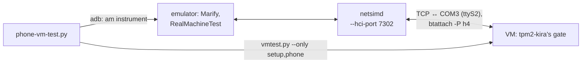

# Testing

## Test depths

Four depths. Each says what it can show; only the third and the fourth end a batch.

| Depth | Command | What runs | Takes (measured) | Is it a proof? |
|---|---|---|---|---|
| **Fast** | `make test-all`, a project's `go test ./...` | unit and integration tests against swtpm, no VM | `make test-all` 190 s, beside the VMs | no |
| **A single scenario** | `tools/vmtest.py --only SCENARIO`, from the snapshot `setup` | that scenario and what it needs, on real VMs | 1-5 min: the table below, plus the typed boot it starts from | never; its report says so |
| **The proof** | `tools/proof.py` | from `fresh`, both machines in parallel: `setup`, `typed-boot`, `hibernate`, `unapproved` (Arch), `silent-tpm`, and then, back at `fresh` with Secure Boot really on, `secure-boot`, `tpm-salt`, `vault-pepper`, `revoked`, `firmware-refuses`; beside them `make test-all`, aSSH's tests, the vault's, safearch's `tests/run.sh` | 15-20 min, an orientation; see below | yes, once per batch |
| **`--all`** | `tools/proof.py --all`, before a release, the owner's call | the proof's scenarios and `second-typed-boot`, `debian-resume`, `V6`, `V3`, `vault-alone`, `typed-vault`, `slot-life`, `removal`, `no-tpm`, `V4-reverted`, `V9-long`, `V8`; safearch's `tests/vm.sh`, Marify's emulator test, the phone against a VM (`tools/phone-vm-test.py`), go-uefi-slim's and tpm2-verifier's tests | about 26 min for the machines, summed from single runs: never run as one | yes, and more |

Measured seconds, in the full run (`.local/runs/t/proof`, 935 s; `make test-all` 166 s and
safearch's `tests/run.sh` 132 s started at 192 s, when the setups were done) and each scenario alone from
a saved setup (`.local/runs/m/`), Arch / Debian. The second setup, with Secure Boot on, adds about 4 minutes:

| Scenario | In the full run | Alone | Budget, for information |
|---|---|---|---|
| `setup` | 169 / 192 | 132 / 144 (`--fast-kdf`) | 175 / 202 |
| `typed-boot` | 50 / 56 | 35 / 41 (`--fast-kdf`) | 49 / 67 |
| `hibernate` | 68 / 7 | 53 / - (`--fast-kdf`) | 68 / 7 |
| `unapproved` | 73 / - | 71 / - | 75 / - |
| `silent-tpm` | 121 / 121 | 111 / - (`--fast-kdf`) | 124 / 124 |
| `secure-boot` | 220 / 256 | 236 / 264 (`--fast-kdf`, a package build in it); from its saved setup 52 / 60 | 218 / 258 |
| `tpm-salt` | 25 / 28 | 16 / 15 (`--fast-kdf`) | 32 / 30 |
| `vault-pepper` | 137 / 156 | 102 / 108 (`--fast-kdf`) | 133 / 158 |
| `revoked` | 60 / 64 | 51 / 54 (`--fast-kdf`) | 60 / 66 |
| `firmware-refuses` | 12 / 9 | 12 / 9 (`--fast-kdf`) | 12 / 10 |
| the machine | 935 / 889 | | 946 / 922 |

After which change: `tools/test-affected.py` prints it, from the table in the workspace's AGENTS.md,
"What to test after a change". In short: installed-system code, the fast depth; the boot, the close or
the unlock, the fast depth and the affected scenarios; a batch ends with the proof; a release with `--all`.

**What no depth covers:**

- A real TPM, real firmware, a real phone or a real radio: the machines are qemu, OVMF and swtpm; the
  phone is the emulator's and its radio netsim's, under `--all` (`tools/phone-vm-test.py`).
- A real update of `db` or `dbx`.
- Debian's normal resume (`debian-resume`, under `--all`) and Arch's V3, as things to rely on: the kernel
  refuses the hibernated image for its memory map, and that is "not tested", no failure. Debian's resume
  was refused in every run here, its `V4-reverted` took it once; Arch's `V3` refused it each time, its
  `hibernate` took it.
- A late TPM's device that comes after the counted boot's close: `TestLate` (swtpm); no VM brings the device
  back within a boot.
- Hibernation with Secure Boot on on Debian: its kernel locks itself down and refuses it. All of
  hibernation and the silent TPM's edited command line run in Setup Mode.
- The vault refusing a real machine not `on`, end to end: the states are its tests' and the swtpm's;
  on the VMs the vault's scenarios run `on` alone.

## What the tools are

Four levels, from seconds to a whole boot:

| Level | What it needs | What it shows |
|---|---|---|
| unit | Go | the logic: blobs, policies, recipes, the board, the parsers |
| integration | Go, swtpm, socat | the binaries against a software TPM: sealing, codes, run, the unlock socket, SSH |
| the VM test (`tools/vmtest.py`, its helpers in `tools/vmtestlib.py`) | fresh, encrypted VMs; docker; the built packages | tpm2-kira's whole life on a real machine: install, `control`, reboots unlocked over SSH, the vault, hibernation |
| the phone against a VM (`tools/phone-vm-test.py`) | the VMs, the Android SDK's emulator, KVM | Marify's real BLE code and session against the real gate: enrolment, a phone salt's hand-over, boots attested in the initrd, the pepper typed through the phone's layout |
| the acceptance run (`tools/acceptance.py`) | a machine you watch | the same install checks, with you at the console for the reboot |

## Unit and integration tests

```bash
make test-unit              # no TPM; tpm2-kira's packages, then the core's (core/, a module of its own)
make test-integration       # swtpm and socat: sudo pacman -S swtpm socat (apt install swtpm swtpm-tools socat)
make test-all
make fuzz                   # the parsers of untrusted input, FUZZTIME per target (30s)
tools/vulncheck.py ./...    # known vulnerabilities the code calls into
```

Tests run with `-count=1` and wait for a state, never for a time
(AGENTS.md). The integration suite builds both binaries, `tpm2-kira` and
`tpm2-kira-boot`, as they ship (static, no cgo) and runs them as a user
against swtpm (`TPM2_KIRA_UNPRIVILEGED=1`).

## The proof: 15-20 minutes

```bash
tools/proof.py                                      # the proof: from fresh, two machines, 15-20 minutes
tools/proof.py --since '2026-11-03 09:00'           # and, after it, what the batch touched
tools/proof.py --all                                # before a release, the owner's call: everything
tools/test-affected.py --since '2026-11-03 09:00'   # what AGENTS.md's table asks for: prints, starts nothing
```

`tools/proof.py` runs both machines in parallel through the scenarios below and, once their setups
are done, beside them what needs no VM: `make test-all`, aSSH's tests, the vault's, safearch's
`tests/run.sh`. **15-20 minutes wall clock are an orientation, not a limit:** time fails nothing. A
scenario over its budget is printed, and a run over 20 minutes says so in its report, with what went
over. Only a run that hangs is stopped: after an hour, reported as stuck, naming what it was in.
It reports in `report.txt` and `report.json` of its run's directory (`.local/runs/proof-<time>/`, or
`--run-dir`), every scenario against its budget, and leaves the machines at `fresh`, stopped (the snapshot
`secureboot` stays). A part
that fails does not stop the others. `--only` is no final proof, and its report says so. A final proof
is this, from `fresh`, without `--fast-kdf`: there is no flag for that.

| Scenario (`vmtest.py --only NAME`) | What it shows | Budget Arch / Debian, s, for information |
|---|---|---|
| `setup` | install, setup, enrolment, `control` (answered by number, and once by the arrow keys on a terminal with a size), the memory lock of a command, a hook under a refused lock, the note on a vault's keyslot | 175 / 202 |
| `typed-boot` | the typed boot over SSH, every running-system check in one go: certified key, TOTP, PCR 15 closed, slots refuse, PCR 4, Secure Boot's warning, memory locked, signed slots on Arch, 8 and 9 on Debian, the close before a volume (Arch a volume's unit in the journal, Debian the first key request in the boot's log) | 49 / 67 |
| `hibernate` | Arch: hibernate and resume; both: the image's close before a resume, suspend; a kernel that refuses the image is "not tested", at once | 68 / 7 |
| `unapproved` | an image not approved, signed by the PCR key (Arch) | 75 / - |
| `silent-tpm` | the failure path: a silent TPM, one hard reboot with no prompt before it, then the passphrase; one wait per boot (Arch reads the console's stamps); the close before a volume | 124 / 124 |
| `secure-boot` | back to `fresh`, real keys in the firmware (`tools/secureboot-vm.py`'s steps, its snapshot `secureboot`), a setup of its own and its typed boot with Secure Boot really on: nothing said of it anywhere, the slots' PCR 7 as approved | 218 / 258 |
| `tpm-salt` | the salt in this TPM: its enrolment; its image is `vault-pepper`'s, its boot `revoked`'s | 32 / 30 |
| `vault-pepper` | the vault, `on`: a wrong, then the right pepper; one image with the salt in this TPM; what the vault shows of a real `on` | 133 / 158 |
| `revoked` | one boot, boot 2's checks: a device revoked on the vault, falling back to the password with the salt this TPM opened; the salt's keyslot removed | 60 / 66 |
| `firmware-refuses` | one byte changed in what the firmware verifies (Arch the UKI, Debian shim): `Access Denied`, nothing of it runs | 12 / 10 |

**Before a release, `--all`:** the proof's scenarios and the rest, named, which also
runs when named in `--only`:

| Scenario | What it shows |
|---|---|
| `second-typed-boot` | a second typed boot of one image |
| `debian-resume` | Debian: the hibernation and the resume; its kernel refuses the image in most runs |
| `vault-alone` | the unattended recipe, Secure Boot on: a boot nobody touches, the vault alone |
| `typed-vault` | the operator-approved typed vault (0x1401), Secure Boot on |
| `keyboard-vault` | a pepper typed through the vault's one-time keyboard (0x1402): two boots with other layouts, a pepper not of the layout's form asked again, a wrong pepper opening nothing, the right one the disk, Secure Boot on |
| `V3` | Arch: the resume with tpm2-kira masked, the close alone |
| `V6` | `control` on unencrypted swap |
| `no-tpm` | V4 step 5: a boot with no TPM at all |
| `V4-reverted` | Debian: the resume with the TPM back |
| `V9-long` | Debian: the close that holds clears the count |
| `V8` | the way out of a close that keeps rebooting |
| `slot-life` | a slot's life, a moved PCR 7 |
| `removal` | what `slot delete` takes; `control` asks before the SSH CA |

`tests/vm.sh` (safearch) and Marify's emulator test run under `--all`, and when AGENTS.md's table
asks (`--with`, `--since`): after the proof.

**The rule:** no full run while a scenario fails; each is proven alone from a saved setup first,
then one full proof. A run expected over 10 minutes is announced first.

## The VM test

`tools/vmtest.py` takes fresh, encrypted test VMs through everything a
person does with tpm2-kira, answers every prompt as a person would, and
writes a report per machine with every session's transcript.

### What it needs

- **The VMs.** Each with its root on LUKS (the passphrase known), a TPM
  2.0 (swtpm is fine), sshd, and a user with sudo; tpm2-kira not
  installed, kept as a snapshot the run goes back to (`reset` below): the
  run installs packages, writes the TPM's NV, an SSH CA into an EFI
  variable, keyslots and a new boot image. (The EFI variable survives
  most snapshots; the run then makes the SSH CA again, and says so.)
- **What the packages are built with**: makepkg here, docker for the
  Debian package (`packaging/build-packages.sh`, which the run calls) -
  nothing is built on a VM.

- **docker**, and the tpm2-kira-vault source beside this repository
  (`../tpm2-kira-vault`): the run starts the vault itself (below).
- **The machines on this host instead:** `tools/localvm.py` runs both with
  qemu, swtpm and OVMF, with no hypervisor and no root, and resets them to
  their snapshot. See `tools/LOCALVM.md` for setting them up from an
  export, the serial console, and the pitfalls. `tools/serialtest.py`
  tests the recipes at their console.
- **`tools/vmtest.conf`** - copy `tools/vmtest.conf.example` (it is not in
  git):

  ```ini
  [defaults]
  password_file = ~/.vm-pw       # the VMs' user password; or $VMTEST_PASSWORD

  [arch]
  host = 172.17.2.198
  user = pix
  # back to the snapshot, on the hypervisor; VMTEST_NAME, VMTEST_HOST are set
  reset = virsh -c qemu+ssh://root@hv/system snapshot-revert vmtest-arch fresh --running

  [debian]
  host = 172.17.2.196
  user = pix
  reset = ssh root@pve 'qm rollback 196 fresh && qm start 196'

  [vault]
  src = ../tpm2-kira-vault
  url = https://172.17.2.174      # where the VMs reach this machine
  port = 443
  ```

  The LUKS passphrase is `luks_passphrase` of a machine's section,
  `$VMTEST_LUKS_PASSPHRASE`, or else the user's password.

### Running it

```bash
tools/vmtest.py --target both               # the proof's scenarios; or arch, or debian
tools/vmtest.py --target both --all         # every scenario
```

A run needs nobody at the keyboard, and starts from a defined state:

1. **The packages of HEAD**: beside the reset, it builds them (`packaging/build-packages.sh`:
   the committed state, aSSH as pinned) and installs exactly those - by
   the commit in their names, never a package of another commit.
   Uncommitted changes are not tested; it says so. `--no-build` takes
   HEAD's packages already in `build/packages`.
2. **Each machine reset**: the `reset` command of its section in
   `vmtest.conf` - going back to its snapshot on the hypervisor - and
   then its ssh is waited for. Without one (or with `--no-reset`) the
   machine must be fresh already; one that is not is refused before
   anything is changed.
3. The scenarios, both machines at once, and the vault in its container.

It ends with `ALL PASS` (exit 0) or `FAILED` and the run's directory
(`./vmtest-<time>`, or `--run-dir`): per machine `report.txt`, the
transcript, a log per command and session (`session-*-control.log`,
`boot-1.log`, ...), and the boot logs; the vault's log and audit in
`vault/`.

Every step is timed: its seconds in the output as it ends, a table with
the laps inside the boots and the slowest steps in each `report.txt`, the
same as `times.json`, and the slowest steps over both machines before the
result.

A scenario that fails does not end the others: the machine goes back to the setup, booted, and the
next goes on from there; one that needs it is not run. Only a machine that does not come back ends
the run.

### Iterating from a saved setup

A final proof starts from the snapshot `fresh`. To work on a scenario, on the machines of
`tools/localvm.py`, the setup can be kept.

```bash
tools/vmtest.py --config ../.local/vms/vmtest-local.conf --target both --save-setup   # the snapshot "setup"; ends
tools/vmtest.py --config ../.local/vms/vmtest-local.conf --target both --from-setup   # the proof's scenarios, from it, without building
tools/vmtest.py --config ../.local/vms/vmtest-local.conf --target debian --only revoked   # a scenario and what it needs
tools/vmtest.py --config ../.local/vms/vmtest-local.conf --target both --drop-setup   # removes the snapshot
```

Each scenario starts with the typed boot, from the setup. `--only setup` runs the setup from `fresh`.
None of these is a final proof, and their reports' first lines say so.

**With Secure Boot on** there is a setup of its own: the scenarios `tpm-salt`, `vault-pepper`, `revoked`,
`vault-alone`, `typed-vault`, `keyboard-vault` and `firmware-refuses` start from the snapshot `setup-secure`.

```bash
tools/secureboot-vm.py both       # only the snapshot secureboot: real keys in the firmware, no tpm2-kira
tools/vmtest.py --config ../.local/vms/vmtest-local.conf --target both --only secure-boot --keep-setup   # from fresh: secureboot, setup-secure
tools/vmtest.py --config ../.local/vms/vmtest-local.conf --target both --only revoked,firmware-refuses   # from setup-secure
```

How keys get in (a test machine only: enrolling PK ends Setup Mode for good): Arch by `sbctl` in the
guest, `create-keys`, `enroll-keys --microsoft`, the loader and the UKI signed, its post hook signing each
rebuild; Debian by `go-uefi-slim/internal/vmcheck`, built from the workspace's checkout, PK, KEK and db with
Microsoft's, nothing signed: shim is Microsoft's, GRUB and the kernel Debian's. `--drop-setup` takes
`setup` and `setup-secure`; `secureboot` stays, and the next run makes it again. Each proof makes both from
`fresh`, in the scenario's time.

A run from a saved setup says on its report's first line that it is no final
proof. A snapshot holds the commit that made it and is refused once anything
but `tools/` and documentation has changed since. `fresh` and `export` are
never written: `tools/localvm.py` refuses to replace or remove them without
`--overwrite`, by hand.

### A test build: `--fast-kdf`

```bash
tools/vmtest.py --config ../.local/vms/vmtest-local.conf --target both --fast-kdf
```

**Such a run is no final proof.** It says so in the output and on the first line
of every report. Argon2id's production cost (1 GiB, 16 passes, 4 lanes) is a
constant in `internal/diskkey/combine.go`; a Go build tag alone,
`kira_test_fast_kdf`, selects a test's (`combine_cost_fast.go`: 16 MiB, 1 pass) -
not a flag, an environment variable, a config or a LUKS token: anything at run time
would be a downgrade an attacker could reach. `packaging/build-packages.sh
--fast-kdf` edits its copies of the recipes to pass the tag, marks the version
`.fastkdf` and writes to `build/packages-fastkdf/`. Every step, the typed recipes'
prompts, keyslots and boots included, runs as always; what is not shown is the
real cost, its memory and its time. Keyslots enrolled with one cost do not open with
the other, and a saved setup is refused by a run of the other kind.

What keeps the tag out of a release: `packaging/aur/PKGBUILD`, `debian/rules` and
`release.yml` never name it and run `packaging/release-binary-check.sh` on what they
built, which refuses a binary Go recorded a build tag for or that holds the test
build's mark; `internal/diskkey/release_test.go` holds the recipes to that, and shows
it on real builds of both kinds; every VM test checks its package the same way before
it touches a machine, and that `tpm2-kira version` says nothing of a test build. A
test build says what it is in `version` and in `tpm2-kira status`. The vault, the
phone, aSSH and safearch derive nothing with this cost: they hand over salts,
parts and peppers; only `diskkey.Combine` runs it, in the two binaries of one package.

### What it checks

The setup:

1. **Preflight:** the machine answers, runs the distribution, is fresh,
   has a TPM and a LUKS device that the passphrase opens.
2. **Install** the package with `dpkg -i` or `pacman -U`; both binaries
   of one version; the root gates.
3. **`setup --local`, `slot add`;** the TPM's code against the one
   computed from the secret `slot add` shows - what your authenticator
   does (on a systemd initrd the running system is past the separator:
   locked until the next boot, by design).
4. The commands that read what only a machine has: `status`'s Secure Boot, `slot status`, `phone
   ekcert`, `luks status`. The rest is the integration suite's: `TestRootIsRequired` (the root
   gate, help pages), `TestSealDefaultsAndStatus`, `TestInfo`, `TestNVRAMList`, `TestDecidePlan`.
5. **`luks enrol --salt typed`** (the recovery recipe) with a test password and salt, and the memory
   of a command that holds it: a refused lock stops it before it asks, `VmLck`, `VmSwap` under
   a hog.
6. **`control`, answered line by line** (its menus, a pty; the session answers its
   "[Enter: ...]" holds): step 1's
   adoptions (the mkinitcpio hook, the key's route), the image's network
   (DHCP, as proposed), the SSH server at boot (port 2222, a 600 s hold)
   with its SSH CA, debug at boot, the image rebuilt when control is left.
   The key that may log in at boot is a test key the run makes; the CA's
   `@cert-authority` line goes into the run's own known_hosts.
7. **The image:** `tpm2-kira-boot` and no `tpm2-kira`, no control.conf,
   the plan's parts, no unit or script that starts a gate (`run` starts
   its children itself).

The boots. **A typed boot** (`typed-boot`, and boot 2, the revoked device's): the boot SSH server
answers; its host key is checked against the CA (`StrictHostKeyChecking=yes`); both slots' codes
against the computed ones; Enter, the password and the salt in the session; the session ends with
the server's last line; after the boot the close ran (every slot closed: PCR 15 extended, slot 0's
TOTP key refuses), the key was answered, memory locked and given back, `ssh-child` ran confined
(nobody, no new privileges, no executable memory, Landlock, seccomp), PCR 4 as predicted, the SSH
CA's slots (signed on Arch, 8 and 9 on Debian), and the boot's log has no error.

**Remote attestation over TLS, the vault,** with Secure Boot on: `vault-pepper` refuses an enrolment without a root, makes
a token, enrols with a pepper, rebuilds the image; a boot nobody touches waits for an operator, is
approved first with a wrong pepper, then with the right one; what the vault shows of Secure Boot, from
the quote. `revoked`: the screen and the prompt say the vault gave no key and the recovery recipe's
keyslot is the fallback, typed over SSH; then unrevoked. Under `--all`, `vault-alone`, `typed-vault` and `keyboard-vault`.

**Hibernation** (`tools/hibernatetest.py`'s docstring has the steps): one hibernation of the typed boot,
kept as a snapshot; the resume over SSH; suspend to RAM; the failure path from it.

**Under `--all`, a slot's life:** `slot approve`, `slot add --nvram 2`, `slot delete` (blob and
generation index gone). Between them slot 2 gets a phone channel sealed to a PCR 7 of another day
(`channel-fixture`: `go test -c -tags kira_vm_fixture ./internal/admin`, on the machine for the run,
never in a package; no VM has a phone, and a register extended by hand moves nothing here, since the
next boot's value comes from the event log). The real hook scripts, `--if-moved` and a run with no
terminal leave it and say so with old, new and the event log's names; no at a terminal leaves it;
`control`'s line seals it, a person's yes is `TestApprovalLeavesAMovedChannel`'s. A gate refusing it
is `TestChannelFollowsPCR7`'s, with PCR 7 extended by hand on swtpm.

Throughout the first part, Secure Boot's warning, from the machine's own variables (in Setup Mode; with
Secure Boot on the same places must say nothing, and the vault's keyslot no recovery note, which `inspect`
shows said in Setup Mode):
once in `slot add`, `status`, per image in the hook's output, red in `control`'s step, and at each
boot on the console (the serial log), in the SSH session and in the boot's log; `slot approve` and
`control`'s step 2 under `--all`.

**Under `--all`, removal:** `control` switches the SSH server off and asks before it removes the SSH
CA - No keeps the EFI variable and `ssh_ca.pub`; `slot delete --yes` then takes everything of tpm2-kira:
no index of its range is left in the TPM, the `KIRAasshCA` variable and `ssh_ca.pub` are gone, and a
second run finds nothing.

### The vault of the run

The run builds tpm2-kira-vault from `[vault] src` and starts it in a
container (`tools/vmtest-vault/`: Arch with swtpm as the vault's TPM),
listening on `[vault] port` of this machine, created for the run and
removed after it - the VMs reach it at `[vault] url`. By hand:

```bash
docker logs tpm2-kira-vmtest-vault                       # the pin and the recovery key of init
docker exec tpm2-kira-vmtest-vault tpm2-kira-vault devices
docker exec tpm2-kira-vmtest-vault tpm2-kira-vault audit
```

The image is built with the host's network (`docker build --network
host`): name resolution inside a build container depends on docker's
firewall rules, which another program reloading the firewall (libvirt's,
when its VMs restart) can take away.

## The phone against a VM

`tools/phone-vm-test.py --target arch|debian|both [--fast-kdf]` puts Marify on the Android emulator
and a test VM on one simulated Bluetooth LE, with nobody at the keyboard:



- **The radio:** the emulator's netsimd opens a raw HCI socket (`-netsim-args --hci-port`). qemu
  connects the guest's COM3 to it (`tools/localvm.py --bt PORT`, or `LOCALVM_BT` for every start of
  a run), and `btattach` makes it an adapter. Not COM2: the firmware prints its console to COM1 and
  COM2, which netsimd would take for HCI packets.
- **The machine's side** is `vmtest.py`'s scenario `phone`, after the setup and the typed boot. Its
  test-only pieces, installed by the scenario alone and in no package: `bluez` (for `btattach`),
  the unit `kira-test-btattach.service`, and the boot image's hook (mkinitcpio's
  `kira-test-btattach`, or initramfs-tools' hook and scripts); `bluetooth.service` masked, as the gate
  takes the adapter whole.
- **The phone's side** is Marify's `app.marify.vm.RealMachineTest` (androidTest, outside the regular
  suite), one `am instrument` per stage (`reset`, `scan`, `enrol`, `attest`), its record and software
  anchor key kept in the app's files between stages. It plays the person: confirms the bind and the
  SAS, continues a matching boot, approves a changed one when told. It logs `sas=`, `state=`,
  `code=`, `layout=` under the logcat tag `KiraVm`, which the scenario reads.
- **What it checks:** the SAS the same on both sides; the hand-over of a phone salt with a keyboard
  (`luks enrol --salt phone --keyboard-pepper`, 0x1302), no layout there; two boots the phone attests
  in the initrd (the first `changed` by the image's rebuild, approved and remembered; the second
  `match`), the boot key proved, the code screen ended by the phone's verdict with no key pressed;
  the pepper typed at the boot SSH server through the layout the phone shows, the disk open; another
  layout at the second boot.
- **What it needs:** the machines of `tools/localvm.py` with `.local/vms/vmtest-local.conf`, the
  Android SDK (emulator, the system image of Marify's `scripts/test-emulator.sh`), KVM, and no other
  netsimd running: one netsimd serves every emulator of a user, so it never runs beside Marify's
  emulator test. Its own AVD `marify-vmtest` boots from wiped data. Logs: `.local/runs/phone-vm-<time>/`.
- **Under `tools/proof.py --all`** as the part `phone-vm`, both machines one after the other: about
  25 minutes each.

## The acceptance run

`tools/acceptance.py` is the run for a person at the machine: it builds
the package of a commit on the target, installs it, checks what can be
checked over ssh, reboots when you say so, asks what the console showed,
and checks the booted system and its journal.

```bash
tools/acceptance.py --distro arch   --host 172.17.2.198 --user pix --ask-password
tools/acceptance.py --distro debian --host 172.17.2.196 --user pix --password-file ~/.vm-pw --luks /dev/vda3
tools/acceptance.py --distro debian --host 172.17.2.196 --no-build --no-reboot   # what is installed
```

The machines a fully unattended run would want - installed by a script,
frozen, with a serial console the harness reads and the phone in the
Android emulator - are the plan in [PLAN-BLE-TESTING.md](PLAN-BLE-TESTING.md).
